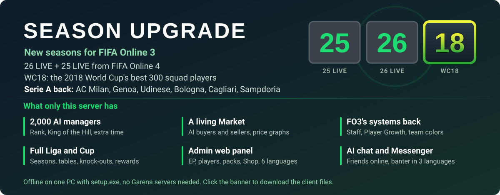

[](https://www.mediafire.com/file/505f9vtgtkfu69w/FO3ID-Season-25-26-LIVE-WC18-client.rar/file)

# FO3ID Private Server

[English](README.md) | **Bahasa Indonesia** | [简体中文](README.zh-CN.md) | [ไทย](README.th.md) | [Tiếng Việt](README.vi.md) | [한국어](README.ko.md)

> Terjemahan dari [README.md](README.md). Kalau ada yang berbeda, README.md yang terbaru.

**Baru:** kartu 25 LIVE dan 26 LIVE dari FIFA Online 4 sebagai dua season baru (stat dianggap +0, karakteristik dan badge season FO4), dengan 26 LIVE sebagai season default, dan WC18: 300 pemain skuad terbaik Piala Dunia 2018 (di +1 tiap kartu bernilai rating akhir turnamen - 5). Lihat `tools/fo4_season.py`.

Private server lokal untuk **FIFA Online 3 Indonesia** (Garena, client build 654420), ditulis
dengan Python. Garena menutup server resminya pada 2020-06-30; proyek ini membuat ulang backend
yang diajak bicara oleh client, jadi game bisa dimainkan offline di satu PC.

> Tidak berafiliasi dengan EA, Spearhead, atau Garena. Repositori ini **tidak berisi file game**
> (tanpa client, database, aset, atau musik), jadi kamu perlu instalasi FO3 ID sendiri. Proyek ini
> **tidak** menyertakan, mengubah, atau mengakali anti-cheat client (XIGNCODE3 / HackShield); itu
> di luar cakupan. Dibuat untuk pelestarian game dan riset.

## Yang sudah jalan

Diuji di client asli (UI bahasa Indonesia):

- Login → pilih / buat manager (pemilih klub dari 501 klub berlisensi) → lobi (FREEROAM).
- **Single → Liga** (satu musim penuh: kalender, pertandingan, klasemen, hadiah, promosi) dan
  **Cup** (undian, grup, gugur, perpanjangan waktu, adu penalti).
- **Market** (beli / jual; harga kartu mengikuti rating dan grade-nya: median harga fifaaddict
  semua kartu dengan rating itu), **Upgrade** (grade +1…+10), trade pemain **Tukar** dan
  **Tukar Scout** (semua kartu Market, bukan hanya yang berlisensi di region ini), Tim inti /
  Tim Cadangan, simpan skuad dan taktik.
- **Shop** dengan semua tab (pak pemain, item konsumsi, paket, MP Shop, paket bulanan dan paket
  berantai, bonus spesial), buka pak dengan grade acak, Item saya, Bag, hadiah login harian.
  **Gudang** (Item saya > Gudang): pindahkan pak dan item konsumsi ke sana dan kembali.
  Pak tambahan: **All Season +8** (musim apa saja, +1…+8) dan satu pak untuk '07 serta tiap
  musim yang ada di fifaaddict.
- Selalu VIP + benefit warnet resmi (IGR), hapus / pulihkan manager, kartu musim '17.
- Daftar formasi (formasi klub sendiri + 33 formasi umum game, dibaca dari tabel formasi client)
  dan level manager / pemain: EXP setelah tiap pertandingan, pemain LV.1-23 (+1 ke semua atribut
  per level), manager LV.1-100.
- Suara game dan musik menu EA Trax. `tools/eatrax_song.py` menaruh lagumu sendiri di urutan
  pertama, tapi game lalu crash setelah pertandingan (lihat masalah yang diketahui di bawah).
- Halaman admin web di http://127.0.0.1:8088/ (EP, pemain, pak, hadiah, hadiah harian, hadiah match, pengaturan match, ekonomi, chat AI, Shop, log)
  dengan pilihan bahasa (issue #15): Bahasa Indonesia, English, 简体中文, ไทย, Tiếng Việt, 한국어;
  browser mengingat pilihannya.
- Jersey klub asli di pertandingan (kit id = `teamid << 5 | type`; `<< 10` yang lama menghasilkan
  papan catur).
- Pertandingan berjalan sampai babak kedua dengan **team color** aktif (dulu warna musim membuatnya
  crash saat turun minum), lalu menampilkan layar EXP dan hadiah.

Sudah ditambahkan dan lolos tes, tapi belum dicek di client:

- Bonus **team color** itu sendiri: starting XI mendapat bonus OVR untuk pemain dari klub yang sama
  (4-5 pemain +1 sampai 10-11 +4), negara atau musim yang sama (5-6 +1 sampai 9-11 +3); per pemain
  hanya yang terbaik yang dihitung.
- **Opsi > Kontrol** (tombol keyboard dan gamepad) tersimpan: server selalu mengirim susunan tombol
  bawaan game, jadi layar itu bisa menerapkan dan menyimpan perubahan (dulu perubahan hilang).
- **Pilihan kit** di layar pengaturan pertandingan (kandang / tandang per sisi) dipakai di
  pertandingan.
- **Pilih manager** menampilkan pemain paling mahal klub dengan kit klub (dulu menampilkan pemain
  Barcelona bawaan game).
- Crash yang diperbaiki: popup pengumuman saat mulai (URL web kosong), tutorial liga Beginner's
  Guide (script tidak ada).
- **Peluang upgrade**: peluang dasar per grade tujuan, dikali label "Rasio bonus keberhasilan" yang
  ditampilkan tab Upgrade dari grade bahan (Kosong x1, Low x1.1, Normal x1.25, High x1.5). Upgrade
  yang gagal dari +5 ke atas turun satu grade.
- **Pak Top 200**: pak tambahan sekarang memberi 200 kartu terbaik musimnya ("17 Top 200",
  "07 Top 200", …); **All Season Top 300 +8** memberi kartu musim apa saja dengan rating 81 ke atas.
- **Upgrade dengan kartu +0** (issue #5): kartu +0 milik klub menjaga grade tujuan di 100%
  (+4 dengan +0 tetap +4) dan kartu +10 juga bisa memakainya; kartu yang dipertahankan keluar dari
  Tim Cadangan saat mengambil slot skuad kartu yang dipakai.
- **Upgrade 2.5** (layar Upgrade client yang lebih baru, `features...enhancement.v2_5`):
  - **poin upgrade**: upgrade yang gagal memberi poin; "Gunakan poin" memakainya untuk +10%;
    beli lagi gratis di Shop > Paket (Upgrade Point 100 / 500 / 1.000);
  - **item boost** Enhancement Boost Gold / Silver / Bronze (+15 / +10 / +5%), gratis di
    Shop > Dapat dikonsumsi;
  - **event upgrade** permanen (+10% untuk tujuan +1…+9, `GET /events`);
  - "Coba pengembalian lagi" mengembalikan grade yang hilang karena gagal, dengan poin.
- **Tukar v2** (`trade2`): trade dinilai dari nilainya (TP) dalam 15 level, masing-masing dengan
  grade tawaran maksimum; tab menampilkan apa yang didapat manager lain "kemarin" di level itu;
  kartu musim legenda dihitung 1.5x; tanpa batas harian atau nilai. Tukar Scout tetap jalan di
  sampingnya.
- **Tukar Scout**: dua scout lain dari client, Scout Khusus (event; quest musim legenda) dan
  VVIP Scout (tawaran terbaik; quest 1 miliar EP). Scout Amatir dihapus agar daftar pas di 5 baris
  (dulu saat daftar bisa di-scroll, quest yang terpenuhi menyalakan kartu scout lain atau tidak
  sama sekali).
- **Team color upgrade** ("Upgraded Team" di client): starter dengan grade +2, +5, atau +8 ke
  atas; 5-6 / 7-8 / 9-11 pemain memberi +1 / +2 / +3, +2 / +3 / +4 dan +3 / +4 / +5 OVR. Yang
  satu-grade ("+3 club" … "+10 Golden summit") butuh ke-11 starter di grade itu atau lebih:
  +4 (club +3/+4), +5 (silver +5…+7), +6 (Golden passion +8/+9), +7 (Golden summit +10). Pemain
  mendapat warna upgrade terbaiknya di atas warna klub / negara / musim terbaiknya.
- **Semua team color yang ada namanya di client** (sekarang 188):
  - 27 klub (Real Madrid … Jeonbuk): tingkatan Single team ditambah boost khusus klub dari
    tooltip game, mis. Barcelona MF agility +3;
  - 30 negara: tingkatan Satu Negara ditambah mis. Spanyol MF ball control +2;
  - warna musim dengan nama dari game (World Best sampai +5, World Legend, 2014 WC All-Star, …);
  - sekitar 75 spesial: '14 WC dan EC per negara, nation BEST, MSN / BBC Trio, Arsenal
    Invincibles, Galácticos, LEGENDS, TOP 100, Power Header, New Star, ….

  Boost dan daftar pemain aslinya adalah data server dan sudah hilang. Daftar pemain diambil dari
  database pemain (musim, klub, pemain yang disebut namanya, batas stat); boost dari satu baris
  tooltip yang masih ada di game. Tidak dimasukkan: warna [Test], "+2~7", "14 WC Single Nation"
  dan empat entri klub ganda.
- **Formasi** tidak lagi terbuka dengan "Tidak cukup pemain" (layar itu memuat preset skuad 1,
  yang tidak pernah dikirim server). Lubang di XI (issue #7, upgrade dua starter dari satu pemain)
  diisi dari bangku cadangan, dan bangku cadangan tidak pernah berisi kartu kedua dari satu pemain.
  Tiap starter mendapat data `starting`-nya (workrate dan posisi di lapangan): tanpa itu game
  menampilkannya di bangku cadangan.
- **Tim > Peran** menyimpan kapten dan tiap eksekutor bola mati (issue #8:
  `PUT /game/my/team/captain` dan `/game/my/team/kickers/<0-4>` belum ada). Lima slot eksekutor
  (sepak pojok kiri, sepak pojok kanan, tendangan bebas, penalti, tendangan bebas 2) tetap di
  tempatnya; slot kosong diisi seorang starter.
- **Tim > Locker room** jalan (issue #13): model dan lengan jersey, tato, gelang, sarung tangan
  (kiper: 39 desain sarung tangan), kaus kaki, pelindung lutut, 614 sepatu per merek, dan nomor
  punggung (mengambil nomor menukarnya dengan pemakainya). Tabel item
  `/static/db/LOCKERROOMITEM` belum ada, jadi semua daftar kosong dan panel sepatu rusak.
  Tampilan pemain disimpan di kartunya, dan Item saya berisi tiket locker room permanen, yang
  dibutuhkan game untuk menampilkan tampilan itu di pertandingan. Hanya model gelang, sarung
  tangan, dan pelindung lutut milik client yang ditawarkan (masing-masing satu).
- **Kontrol Shop di halaman admin** (issue #10): semua tab Shop (pak pemain, item konsumsi, paket,
  paket bulanan, Rekomendasi, MP Shop, Bonus spesial, paket berantai). Pak baru (menurut musim,
  top N, OVR, grade maks., posisi, liga), kotak acak, kartu EP, paket dan paket bulanan, dengan
  ikon mana saja dari 147 ikon shop client. Produk bawaan bisa diubah, disembunyikan, atau diberi
  harga tetap, dan seluruh Shop bisa dibuat gratis atau tidak. Perubahan masuk ke
  `gamedata/shop.json`.
- Kupon **Simulasi Liga** (item 2001, Shop > Dapat dikonsumsi): tombol Simulasi di Liga memberi
  hasil pertandingan tanpa bermain, satu kupon per pertandingan. Layar simulasi memutar gol,
  tembakan, penyelamatan, dan kartu pertandingan sesuai hasilnya (`eventlist` kosong, jadi tampil
  0-0), dan layar hasil setelahnya menampilkan skor, rating dan statistik pemain, penguasaan bola,
  dan MOTM (dulu kosong), lalu hadiah EP dan kembali ke menu Liga. Tombol itu menghitung kupon di
  Item saya dan tetap mati karena itemnya belum ada. Kupon baru bisa dibuat di halaman admin
  (jenis "Kupon Simulasi Liga").
- **Layar skuad sebelum pertandingan** (Liga dan Cup, issue #16): tukar posisi, pergantian pemain,
  dan perubahan formasi sekarang bertahan dan tersimpan ke klub (`PUT /match/<id>/side/<side>/squad`
  belum punya handler, jadi tiap perubahan batal sendiri). Daftar formasi terisi, dan bar stamina
  tampil penuh (kelelahan tidak disimpan antar pertandingan).
- **Rating FW / MF / DF tim sesuai pemainnya** (issue #18): di layar skuad dan lobi, nilainya rata-rata
  rating yang tampil di daftar pemain (rating di posisi pemain ditambah grade upgrade, level, dan team
  color). Dulu dihitung dari rating kartu saja, sekitar 12 lebih rendah.
  Sebelum match (Liga, Cup, Rank) daftar pemain tidak memasukkan team color, jadi bar di sana juga
  tanpa team color; bonusnya tetap berlaku di dalam match.
- **Tab Rekor liga** (issue #19): tabel klasemen tampil (tab-nya error karena tabel `league2difficulty`
  tidak ada; tabel itu sekarang juga menentukan siapa naik atau turun di akhir musim). Rekorku
  menampilkan pertandingan, rating, gol, assist, umpan, tekel, dan penyelamatan tiap pemain dari
  pertandingan musim ini yang dimainkan, dan Rekor gabungan menampilkan best XI dan pemimpin statistik
  musim ini. Hanya pemain sendiri yang dihitung, dan pertandingan simulasi tidak menambah statistik pemain.
- **Squad A / B / C di Formasi** (issue #20): kotak di kiri tombol formasi memilih satu dari tiga
  squad tersimpan (dulu kosong karena server tidak mengirim jumlah squad). Tiap squad menyimpan XI,
  formasi, dan perannya sendiri.
- **Setelan kontroler dan kamera tetap berlaku di match** (issue #21): setelah Opsi > Konfirmasi,
  game membaca opsi tersimpan dari balasan server, yang dulu kosong, jadi tiap match kembali ke opsi
  saat login (keyboard, kamera lama). Di match, F3-F9 mengganti kamera (F5 = Co-op).
- **Ganti tim menampilkan klub dan pemainmu** (issue #23): layar klub item ini sekarang menampilkan
  liga, rival, stadion, tahun dibangun, dan kapasitas, serta pemainmu dengan seragam klub baru beserta
  tanggal lahir, tinggi, dan berat. Info klub dari server dulu tidak memuat semua itu, dan tanpa
  seragam pemain 3D tidak pernah digambar.
- **Tinggi dan zoom kamera bisa diatur** (issue #24): di Opsi > Kamera setting, gauge Customise (tinggi dan
  zoom; zoom, kecepatan, dan ayunan untuk kamera Pro) dulu kosong dan tidak bisa diubah karena
  server mengirim setelan kamera kosong. Sekarang mulai dari 10 (dari 20).
- **Semua timnas ada di Tim lain** (issue #24): liga Internasional (negara terakhir di daftar) berisi
  40 timnas, termasuk Italia, Inggris, Jerman, Spanyol, dan Prancis. Skuad timnas diambil dari
  tautan timnas tiap pemain; dulu hanya timnas yang pemainnya tanpa klub berlisensi yang muncul.
- **Posisi pemain di layar hasil** (issue #26): setelah match, lapangan di layar hasil menumpuk semua
  pemain di gawang karena game melaporkan semua pemain sebagai kiper. Sekarang server memberi tiap
  pemain posisi slot squad-nya.
- **Kartu hadiah setelah match** (issue #26): kartu di layar hadiah dulu kosong. Sekarang ada tiga
  kartu: kartu yang kamu pilih berisi EP (1.000 sampai 10.000), pack pemain (Semua Pemain atau
  '14 Top 200) atau item Lucky EP, dan dua kartu lainnya menunjukkan hadiah yang bisa didapat.
- **Pak draft dan EXP capsule** (issue #27): Shop > Pak pemain menjual pak draft ("06 Draft Pick 3",
  "2017 Draft Pick 5", "World Legend Draft Pick 3"). "Gunakan" membuka layar pilih pemain, terisi kartu
  termahal musim itu; pilih N kartu musim itu (cari nama, liga atau klub) dan salah satunya yang dibuka.
  Shop > Dapat dikonsumsi menjual EXP capsule (1.000, 5.000, Max = LV.23, satu untuk LV.10 ke bawah,
  satu untuk kartu 2017): pilih pemain, dia dapat EXP-nya. Request layar draft
  (`/item/draftpack/<id>/players/<n>`, `/transfer/price/default/<grade>`) dan jenis item capsule belum
  ada. Admin page bisa membuat lagi keduanya (isian "Draft" di pak, jenis item "EXP Capsule").
- **Multiple > Rank: manajer lain dan pertandingan sungguhan** (issue #30): layar rank sebelumnya
  berhenti di error UI karena server tidak mengirim divisi, hadiah, dan rekor ladder. Sekarang
  layarnya terbuka, dan manajer virtual mengisi peringkatnya: 3 teratas (VS Manager Top) dan
  peringkat teman berisi 20 manajer, masing-masing dengan nama, klub, divisi, dan rekor yang berubah
  sepanjang hari seiring mereka bermain. Awalnya ada 100, ditambah 1.850 lainnya, lalu tiap hari bergabung 0-3
  manajer baru, sampai 2.000 (digandakan untuk issue #36). Tiap manajer punya gaya main sendiri (penguasaan bola, serangan balik, pressing tinggi,
  umpan panjang, parkir bus, atau menyerang total: formasi, taktik, dan pergerakan pemain), memakai
  kit klubnya dan kartu acak dari klub dan musim mana pun di sekitar ratingnya, tiap kartu dengan
  grade (+1 untuk pemula sampai +6 ke atas) dan level masing-masing. Dari hari ke hari mereka membeli
  dan menjual kartu, meng-upgrade-nya (upgrade yang gagal dari +5 ke atas turun satu grade), dan
  menaikkan levelnya. Rank 1 on 1 dan VS Manager memainkan pertandingan sungguhan melawan salah satu
  dari lima manajer dengan rating terdekat: layar skuad, pengaturan game, lalu pertandingan penuh
  dengan AI game di pihak lawan, lalu hasil, hadiah, dan rating rank baru, yang tampil di panel layar
  Rank, di jendela rekor (pertandingan terakhir, grafik musim), dan di daftar pertandingan
  Info Manager. Selama match lawan ikut chat di chat match sesuai kepribadiannya (saat kick-off, gol
  di kedua sisi, tembakan meleset, penyelamatan kiper, dan membalas saat kamu mengetik), lalu
  berkomentar soal hasilnya saat kembali ke layar Rank; tab Chat AI di halaman admin bisa
  mematikannya atau memilih bahasanya (Indonesia, Inggris, Vietnam). Messenger sekarang bisa dibuka
  (dulu tertahan menunggu daftar notifikasi yang tidak pernah dikirim server) dan menampilkan status
  ke-20 teman itu: online, sibuk (sedang main Rank), atau offline, sesuai jam main mereka
  (08:00-02:00 WIB); tombol Info seorang teman menampilkan profil dan skuadnya.
- **Market jadi hidup** (issue #30): manajer virtual membeli kartu yang kamu jual ("Dijual" berubah
  jadi "Terjual" dengan sendirinya dalam beberapa menit, lebih cepat kalau harganya lebih murah,
  dengan popup "terjual seharga" dan notifikasi yang menyebut nama pembelinya; Batal dan Ulang jalan)
  dan ikut menjual kartu mereka sendiri di samping stok +1..+3, juga dengan grade lain, sedikit di
  bawah harga pasar, dengan Kuantitas yang berubah tiap jam. Tab Market Price di jendela kartu
  menampilkan grafik harga 30 hari terakhir.
- **Pengaturan ekonomi** (issue #30): tab Ekonomi yang baru di halaman admin membuat game sesulit
  yang kamu mau: pengali harga pemain dan pak, EP awal manajer baru, opsi Shop gratis, dan pasar
  dinamis. Di pasar dinamis, harga tiap pemain di Market naik-turun dari hari ke hari (sampai
  sekitar 13%), manajer virtual sesekali menjual kartu dengan harga miring, dan kamu boleh memasang
  harga sampai 105% dari harga pasar (kartunya lebih lama terjual), jadi beli murah lalu jual mahal
  itu menguntungkan. Preset: Santai (seperti sebelumnya: Shop gratis, harga tetap), Realistis (Shop
  berbayar seharga nilai kartunya, pasar dinamis, EP awal 300.000), dan Sulit (harga x2,
  EP awal 100.000). EP dari match tetap diatur di tab Hadiah match.
  Selama Shop berbayar, kupon Simulasi Liga seharga hadiah satu rondenya, dan dengan pasar dinamis pak
  seharga nilai kartunya di harga tertinggi (+13%), karena pak bisa dibuka kapan saja. Pilihan Aturan
  ketat (aktif di Sulit) membuat Upgrade, Tukar dan Scout tidak mencetak EP: biaya Upgrade sebesar
  nilai yang rata-rata ditambahkannya (restore dibayar EP), tawaran Tukar dan Scout paling tinggi
  senilai kartu yang diserahkan. Tanpa itu (Santai, Realistis) berlaku aturan game asli: biaya Upgrade
  2% dari nilai kartu, restore dengan poin upgrade, tawaran tanpa batas.
  Barang tanpa EP di dalamnya (boost, poin upgrade, kapsul EXP, ganti nama atau tim) punya harga
  dasar dikali pengali harga pemain, jadi di Sulit harganya dua kali lipat.
  Perubahan langsung sampai ke game yang sedang jalan: server menyuruh game membuang daftar Shop yang
  disimpannya selama sesi, jadi tab Shop menampilkan harga baru saat dibuka berikutnya; tab yang sudah
  dibuka sejak game dimulai tetap memakai harga lama sampai game di-restart. Pengecekan stok terbatas di
  Shop tidak lagi berakhir dengan "Kesalahan UI telah terjadi".
- **AI Chat sepuluh kali lebih banyak** (issue #30): obrolan manajer virtual punya 20 kalimat untuk tiap
  momen dan kepribadian di tiap bahasa, total 2.700: basa-basi dan obrolan bola saat kick-off, reaksi atas
  gol, peluang gagal dan penyelamatan, candaan saat kamu mengetik, dan komentar soal hasil akhir. Tidak ada
  kalimat yang memuat kata yang akan disensor filter chat game (filter itu juga menyensor kata yang ada di
  dalam kata lain).
- **Manajer virtual menyusun skuad dengan gayanya sendiri** (issue #30): tiap manajer punya tema skuad
  tetap. Bisa kartu apa saja yang dekat ratingnya; klub top (Real Madrid, Barcelona, Atletico, kedua klub
  Manchester, Chelsea, Liverpool, Arsenal, Tottenham, Bayern, Dortmund, Juventus, Milan, Inter, Roma,
  Napoli, PSG), pemain klub itu sekarang atau dulu; negara top (Brasil, Argentina, Spanyol, Jerman,
  Prancis, Inggris, Italia, Belanda, Portugal, Belgia, Uruguay, Kroasia); salah satu team color game
  (satu season kartu atau set bernama); seorang pemain bintang bersama rekan klub atau negaranya; meta;
  atau satu stat (kecepatan, fisik, teknik, umpan, bertahan, menembak, pemain muda, pemain lawas).
  Manajer yang lebih kuat lebih sering mengikuti meta dan team color. Tema hanya mengambil kartu yang
  dekat ratingnya, jadi skuadnya tidak jadi lebih kuat.
- **Pengaturan sebelum match** (issue #31): layar pengaturan game di Multiple > Rank punya stepper
  yang berfungsi untuk stadion (70 stadion yang datanya lengkap di client), waktu (siang atau
  malam), cuaca (cerah, hujan, salju, mendung: senja di malam hari), durasi match (6, 8, 10, atau
  12 menit), dan bola (9 bola). Pilihan terakhir tetap berlaku di match berikutnya, termasuk di Liga
  dan Cup; layar sebelum match di keduanya hanya menampilkan nilainya, jadi semuanya juga bisa
  diatur di tab Pengaturan match yang baru di halaman admin, dengan opsi tambahan
  "Kandang tim tuan rumah" atau "Acak". Server memperbaiki dua label di teks bahasa Indonesia client
  (siang dulu tertulis "Waktu", mendung "Malam"); layar Liga/Cup masih menyebut mendung "Salju".
- **Keyboard dan gamepad tetap memakai preset kontrolnya sendiri** (issue #32): Opsi > Kontrol hanya
  menyimpan satu preset, untuk perangkat yang sedang dipakai, dan mengembalikan perangkat lainnya ke
  preset pertamanya saat kamu berganti perangkat. Sekarang server mengingat preset terakhir tiap
  perangkat dan memulihkannya setelah Konfirmasi (layar itu menampilkannya saat dibuka lagi; match
  memakainya sejak kick-off).
  Agar layar langsung menampilkannya saat berganti perangkat, jalankan sekali
  `python tools/control_presets.py` saat game tertutup: tool ini mem-patch layar Kontrol di client
  (cadangannya disimpan; `--remove` mengembalikan aslinya).
- **Menu Manager terisi** (issue #33): Info manager menampilkan catatanmu, bukan "-": pertandingan, gol,
  kemenangan dan win streak di Liga, Cup dan Rank, juara liga dan tingkat yang dicapai, cup yang
  dimenangkan beserta hadiahnya, kartu yang dibeli dan dijual beserta yang termahal, waktu bermain, serta
  perkenalan dan fotomu. Semuanya dihitung mulai versi ini. Manager Ranking menampilkan nilai timmu
  selama 30 hari terakhir dibanding rata-rata 20 temanmu dan peringkatmu di antara mereka, beserta
  perubahan peringkat sejak kemarin.
- **Misi dan achievement** (issue #33): Manager > Daftar pencapaian berisi baris lencana (level manajer,
  pertandingan, kemenangan, upgrade, grade tertinggi, nilai tim, gol, kemenangan Rank); tiap achievement
  punya 5 grade hadiah EP, pak dan item yang bisa diklaim, dan lencananya bisa dipakai setelah satu baris
  selesai. Ada juga baris Misi harian (main, menang, cetak gol, main Rank) yang direset pukul 00:00 WIB.
  Tombol Quest di bar atas membuka quest mingguan (direset Senin pukul 00:00 WIB) dengan hitung mundur;
  quest yang selesai memberi GP untuk kotak hadiah di jendela itu (EP, Lucky EP,
  pak, boost upgrade, Kotak Emas). Server menghitung pertandingan yang kamu mainkan dan upgrade yang
  berhasil. Tab Misi baru di halaman admin menyalakan atau mematikannya dan mengatur bahasanya
  (Indonesia, Inggris, Vietnam) serta pengali target dan hadiah; hadiah EP juga ikut harga pemain di tab
  Ekonomi.
- **Wasit saat kick-off** (issue #33): kedua asisten wasit diambil dari data kosong (wasit itu tidak ada
  di daftar game), dengan kepala, rambut dan badan yang tidak ada asetnya, jadi tampak rusak saat
  line-up. Sekarang server memakai wasit yang memang ada di game.
- **Komentator Vietnam dari klien FO3 VN** (issue #34): dengan game tertutup, jalankan
  `python tools/commentary.py "<folder klien FO3 VN>"`. Skrip menyalin `audiodata\speechdata\vie_vn` dari
  klien VN ke samping komentator Inggris klien ini (`eng_us`) dan hanya mencantumkan bahasa Vietnam sebagai
  bahasa komentator di `data\loc\locale.big` (cadangannya disimpan); game lalu membaca komentatornya dari
  `vie_vn`. `--remove` mengembalikan komentator Inggris.
- **Hadiah naik level manajer** (issue #35): tiap level manajer dari 2 sampai 100 memberi hadiah level
  FO3 (tabel di fifaaddict): EP ditambah item seperti pak Top 300, Top 100 dan Best, pak liga 65+ dan
  GK 65+, kupon Simulasi Liga, kupon ganti tim, dan EXP capsule. Hadiahnya masuk ke Bag ("Hadiah naik
  level Lv.N"); layar setelah match menampilkannya di popup naik level, dan ikon infonya menampilkan
  hadiah level-level berikutnya. Item FO3 yang tidak dipakai server ini (pak staff, Red Ball, kupon locker
  room dan reward boost, EXP transfer) dilewati. Hadiah EP ikut harga pemain di tab Ekonomi.
- **Klub** (issue #36): Klub sudah jalan. Dirikan klub sendiri (10.000 EP; "Konfirmasi" setelah
  "Klub telah dibuat" tidak lagi tetap abu-abu) atau gabung ke salah satu dari 60 klub AI yang dikelola
  manajer virtual, masing-masing dengan ketua, anggota, level, deskripsi, dan berita. Manajer yang belum
  punya klub minta bergabung ke klubmu (Manajemen > permohonan, atau langsung masuk selama klubmu
  menerima anggota tanpa pemeriksaan). Anggota online sesuai jam main mereka, mengumpulkan poin
  aktivitas, menulis di papan klub, dan mengobrol di tab Klub pada jendela chat: mereka membalas sapaan
  dan pesanmu, menyambut anggota baru, dan memberi selamat atau semangat atas hasil match-mu, dalam
  bahasa chat yang diatur di halaman admin (Indonesia, Inggris, Vietnam). Poin klub minggu itu memberi
  boost untuk match (EXP manajer, EXP pemain, EP), dan kalau kamu sendiri mengumpulkan 30 poin dalam
  sehari, 1.000 EP masuk ke Bag. Belum dikerjakan: match klub, fasilitas klub, dan peringkat klub.
- **Pertandingan persahabatan melawan AI** (issue #36): Multiple > Persahabatan kembali menampilkan
  tombol-tombolnya. Quick match dan Random match mempertemukanmu dengan manajer virtual; di room buatan
  sendiri kamu main vs COM (klub dan level yang dipilih di pemilih AI, Amateur sampai Legendary) atau
  melawan teman yang kamu undang dari daftar. Hasilnya dihitung sebagai pertandingan persahabatan di
  Info Manager, bukan di rating Rank, dan lawan ikut chat seperti di Rank.
- **Perpanjangan waktu dan adu penalti di Rank dan King of the Hill**: skor imbang setelah 90 menit (Rank
  1 vs 1, Rank Manager, King of the Hill) lanjut ke perpanjangan waktu lalu adu penalti; menang adu penalti
  dihitung menang untuk rating, rekor, dan hadiah match.
- **King of the Hill** (issue #36): liga regional Esports punya musim baru tiap bulan. Pilih satu dari 19
  wilayah Indonesia; papan peringkatnya berisi manajer virtual dari wilayah itu, dan Mulai
  mempertemukanmu dengan salah satu dari mereka yang rating-nya dekat dengan rating King of the Hill-mu.
  Layar hadiah menampilkan poin yang didapat atau hilang.
  Tab Pengaturan match di halaman admin mengganti region ke kota-kota Indonesia, Singapura / Malaysia,
  Thailand atau Vietnam (nama berbahasa Vietnam), atau wilayah kustom yang ditulis di sana, satu baris
  "Region: kota, kota" per region (misalnya Sa Pa ditambahkan ke Miền Bắc).
- **Gambar pengumuman saat login** (issue #36): tab Pengumuman di halaman admin mengunggah JPG atau PNG
  (disesuaikan ke popup 800×720, dengan pratinjau) untuk popup Pemberitahuan saat login, atau
  menghapusnya.
- **Riwayat klub sampai musim ini** (PR #39 dari fifamvp): tab Karakteristik di info pemain menampilkan karir
  klub kartu (`features.seasoncare`). Riwayat bawaan FO3 berhenti sekitar 2017 dan hanya tampil di kartu musim
  22-24; sekarang tampil di semua kartu pemain yang punya riwayat, dan tab Aset di halaman admin (Riwayat klub,
  atau `python tools/club_history.py fetch`) mengambil karir sampai musim berjalan dari Wikidata (tahun, klub,
  pinjaman; klub yang belum punya nama di FO3 diberi nama di client). Lalu tekan Database > Terapkan ke game.
- **Unduh gambar yang belum ada lewat halaman admin** (issue #36): tab Aset mengunduh wajah pemain (foto musim
  tiap kartu dan foto pemainnya), logo
  klub, logo liga, dan foto staff yang belum ada dari fifaaddict.com di latar belakang (satu jenis dalam
  satu waktu; bisa dihentikan dan dilanjutkan kapan saja). Tab ini menjalankan `tools/fa_faces.py`, yang
  sekarang juga menerima `--leagues`. "Default ball" di layar pengaturan game menampilkan bola EA SPORTS,
  bendera kecil memakai gambar bendera besar, dan layar Cup mendapat trofi dan skin-nya.
  Foto pemain yang tidak ada (atau ditolak) di fifaaddict diambil dari FC Online (FO4) (id pemain EA
  yang sama; pemain baru server dapat gambar kartu FO4-nya dari fifaaddict), pemindaian mencakup semua kartu di database, penolakan
  membuat unduhan menunggu lebih lama lalu lanjut, dan *Unduh semua yang belum ada* mengambil semua jenis sekaligus.
- **Nama hadiah saat memakai paket bahasa** (issue #36): dengan paket bahasa Vietnam, daftar achievement
  menampilkan "undefined" sebelum tiap hadiah dan memunculkan error UI, karena server hanya memberi nama
  item hadiah dalam bahasa Indonesia dan Korea. Sekarang item hadiah punya nama di tiap bahasa client.
- **Exhibition melawan AI** (issue #36): Multiple > Exhibition membuka room-nya. Pilih klub berlisensi
  dengan tombol panah atau Pilih Team, undang teman dari daftar (manajer virtual, yang masuk dengan klub
  pilihannya sendiri dan langsung siap), lalu Siap memainkan skuad asli kedua klub. Lima match sehari;
  kartumu tidak mendapat EXP dari match ini. Live Center terbuka tanpa dua error UI yang dulu muncul.
- **Live Boost dari Team of the Week EA FC**: Tim > Live Boost menampilkan Team of the
  Week minggu ini (dari fut.gg; server mengambil yang baru setelah rilis hari Rabu, jadi butuh internet).
  Semua kartu pemain itu mendapat +5 di setiap atribut selama seminggu (rating +5): skuad, Market dan
  match. Hanya pemain yang ada di FO3 (dan pemain baru 26 LIVE) yang tampil, tanpa kartu pemain wanita.
  Memiliki 11 di antaranya (+1 ke atas) memberi 100.000 EP sekali seminggu (Terima).
- **Editor quest mingguan** (tab Misi di admin): daftar quest yang diundi tiap minggu (jenis, target, GP,
  nama sendiri dengan {0} untuk targetnya), jumlah per minggu (maks. 6) dan kotak hadiah GP di jendela
  Quest (maks. 5), plus pratinjau minggu ini dan minggu depan. Quest yang sudah selesai minggu ini tetap
  selesai.
- **Hadiah login harian di game**: hadiah hari ini tetap masuk Bag saat login pertama; sekarang muncul
  notifikasi, dan entrinya membuka popup berisi hari ke berapa dan itemnya.
- **Hadiah waktu bermain**: hadiah saat waktu main hari ini mencapai 10, 30 dan 60 menit (hari dihitung
  dari 00:00 WIB; jeda lebih dari 20 menit tidak dihitung), masuk Bag dengan notifikasi yang sama.
  Targetnya diatur di tab Daily reward di halaman admin.
- **Global chat**: tab Channel di jendela chat sekarang jalan: pesanmu tampil, dan manajer virtual yang
  online sesekali membalas dan mengobrol sendiri (dalam bahasa tab Chat AI).
- **Obrolan sepak bola di global chat**: manajer virtual di tab Channel membahas sepak bola hari itu:
  pencarian Google yang sedang naik dan soal sepak bola serta judul Google News, global dan dari negara
  yang dicentang dalam bahasanya (X, Instagram dan TikTok butuh login, Reddit menolak server), diambil sekali sehari. Tiap manajer
  suka membahas klubnya, pemain bintangnya atau negaranya kalau ada di berita, lalu yang lain menanggapi.
  Berita global selalu aktif; Indonesia, Malaysia, Vietnam, Thailand dan Korea dicentang manual di tab
  Chat AI di halaman admin, yang juga menampilkan topik saat ini.
- **Hadiah Rank di halaman admin**: tab Match mengubah hadiah musim tiap divisi (utama dan tambahan) dan
  langkah jumlah menang mingguan, yang juga tampil di layar Rank. Sekarang hadiahnya benar-benar masuk
  Bag: langkah mingguan dengan popup bawaan game di layar Rank, hadiah musim saat musim baru mulai
  (hadiah utama dari mode dengan rating terbaik, hadiah tambahan dari tiap mode lain yang dimainkan).
- **Hadiah King of the Hill di halaman admin**: tab Pengaturan match mengubah hadiah mingguan (target
  menang atau main dalam seminggu, minggu = tanggal 1-7, 8-14, 15-21, 22-28, plus hadiah divisi bila
  menangnya cukup) dan hadiah musim (divisi di akhir bulan bila menangnya cukup, plus peringkat di
  region). Layar King of the Hill menampilkannya; setelah minggu atau musim yang dimainkan selesai, layar
  hadiahnya muncul saat King of the Hill dibuka dan hadiah yang tercapai masuk Bag.
- **Liga penuh** (issue #40): satu musim Liga berisi semua klub liga kita yang skuadnya lengkap
  (Premier League 20 klub, 38 pekan; maksimal 24), bukan 10 lagi. EP dan EXP per posisi menyesuaikan.
- **Klub yang tidak ada di FO3 ID**: AC Milan, Genoa, Udinese, Bologna, Cagliari dan Sampdoria kembali ke
  game (kitnya masih ada di file game; `tools/fo4_season.py install` menambahkannya dengan warna dari kitnya),
  dengan skuad 26 LIVE lengkap (`fetch` mendaftar, `collect` + `import` membaca statistiknya). Kartu '17
  pemain mereka yang tadinya ada di timnas kembali ke klubnya. Serie A di Liga sekarang 19 klub, dan
  pemilih klub juga menampilkannya. Caranya: fetch, collect + import, build, lalu install dengan game
  tertutup (atau Terapkan ke game di halaman admin).
  Kartu FO3 lama pemain klub Italia yang tadinya di Rest of the World (mis. Pirlo '06 di Milan; 322
  kartu) juga kembali ke klubnya; `restore` mengembalikannya.
- **Database kartu dan klub di halaman admin** (issue #38): tab Database mengubah satu kartu pemain per
  musim (spid = musim × 1.000.000 + player id; cari dengan nama, spid atau player id): 33 atribut,
  posisi, kaki utama dan kaki lemah, skill move, work rate, karakteristik, klub (transfer) dan tampilan
  3D-nya (kepala dari baris 3D mana pun, misalnya wajah kartu lain; model dan warna rambut, jenggot,
  kulit, mata dan badan pada kepala generik, warna rambut 0 = pirang; kepala scan membawa rambutnya
  sendiri). Musim buatan: kode, nama dan lencana, diisi salinan kartu lain (bisa +N ke semua atribut),
  masing-masing dengan pak Top 200 dan team color sendiri. Perubahan kartu masuk ke
  `gamedata/fifadb.sqlite` dan `gamedata/card_edits.json` (nilai asli dan baru: Kembalikan memulihkan
  kartu, dan `tools/fo4_season.py build` memasangnya lagi), musim ke `gamedata/seasons.json`; Ekspor /
  Impor mod memindahkan semuanya ke server lain dalam satu file JSON. Game membaca salinan DB-nya
  sendiri: tutup game, tekan Terapkan ke game (menjalankan `tools/fo4_season.py install` di latar), lalu
  jalankan `play.bat`. Tab ini juga mengganti logo klub di cache client (logo asli disimpan di
  `gamedata/crest_backup`) dan, di dialog kartu, foto pemain dengan PNG/JPG sendiri atau foto spid / player id
  lain (dari cache atau fifaaddict.com) untuk semua kartunya
  atau satu kartu saja (issue #36; `gamedata/faces/p<id>.png`, disajikan sebelum foto cache; kolom Wajah
  3D juga mencari kepala dengan nama pemain). Jersey dan klub baru belum ada.
- **Wajah 3D dari foto** (tab Database, dialog kartu): untuk pemain berwajah generik, foto close-up dari
  depan menjadi kulit wajah pada kepala 3D pemain lain yang sudah di-scan (donor: bentuk kepala dan
  rambutnya ikut, matanya tetap milik donor). Klik 11 titik di foto (mata, hidung, sudut mulut, dagu, dahi,
  pelipis, rahang), pilih donor, tekan Buat; Terapkan ke game memasang kepalanya di client (`data_7.big`,
  dibangun ulang dari aslinya) untuk semua kartu pemain itu yang memakai baris player id-nya atau kepala
  generik. Tersimpan di `gamedata/photo_heads`. Dari jarak kamera pertandingan mirip fotonya, dengan
  cahaya dari foto dan bentuk kepala donor.
  *Ambil dari ikon* mengisi foto, titik, dan donor dari ikon FO3 pemain (dari cache, kalau tidak ada dari
  fifaaddict.com): detektor wajah YuNet (OpenCV Zoo, MIT; diunduh sekali ke `gamedata/yunet`) mencari mata,
  hidung, dan mulut, donornya kepala scan yang paling mirip warna kulit dan rambutnya (warna dan bentuk, dari
  ikonnya sendiri), tanpa janggut. Tombol di tab Database melakukannya untuk semua pemain generik di klub yang
  punya ikon (pemain baru tanpa ikon FO3 dilewati).
  Warna kulit dibandingkan foto dengan foto (ikon donor sendiri) dan dengan tekstur wajah yang akan
  dibawanya (foto yang terang terbaca lebih terang dari tekstur: dulu pemain berkulit gelap dapat donor
  berkulit terang); pemain Asia Timur/Tenggara dapat donor dari negara-negara itu, yang lain sebaliknya
  (mata donor tetap dipakai); gigi saat senyum diganti bibir tertutup donor. *Buat ulang semua wajah 3D
  dari ikon* membuat ulang wajah yang sudah ada.
- **Dunia FO3 klasik** (issue #38): *Dunia game* di tab Database memilih Modern (klub AI, pilihan klub
  dan pak This Season memakai kartu 26 LIVE, seperti sebelumnya; musim buatan juga muncul di pencarian
  Market) atau Klasik FO3: semua klub memakai skuad 2017 asli FO3, This Season = '17, dan musim tambahan
  (25 / 26 LIVE, WC18, musim buatan) tidak ada di pak, Market, Tukar maupun skuad manajer virtual: hanya
  halaman admin yang bisa memberikannya. Klub dan koleksimu tidak berubah, dan kartu asli FO3 tidak pernah
  ditimpa (musim baru ditambahkan di sampingnya). Tersimpan di `gamedata/world.json`; berlaku setelah
  restart (`play.bat`).
- **Manajer virtual baru kapan saja**: tab Chat AI di halaman admin punya *Generate ulang*: kerumunan
  manajer virtual baru (nama, level, klub, skuad, gaya, rating Rank, region, klub AI) langsung, dengan id
  yang sama sehingga teman, klub dan riwayat tetap jalan; *Kembalikan ke awal* memunculkan lagi kerumunan
  pertama. Hanya tombol ini yang mengubahnya: setiap start kerumunan tetap sama (`gamedata/vm_gen.json`).
- **Team color buatan di halaman admin**: tab Team color membuat team color baru. Kartu anggotanya dipilih
  dengan filter (musim, klub sekarang atau dulu, negara, pemain, OVR minimal, N kartu Market terbaik;
  kartu harus memenuhi semua filter yang diisi) dan ada satu boost (OVR atau satu atribut, untuk semua
  posisi atau FW / MF / DF / GK), dengan tingkat seperti team color spesial bawaan (5-6 / 7-8 / 9-11
  pemain di XI). Tersimpan di `gamedata/teamcolors.json`; tampil di daftar Team colour game mulai login
  berikutnya, tanpa restart. Skuad manajer virtual tidak memakai team color dan musim buatan, dan file
  mod ikut membawanya.
- **Staff** (Tim > Manajemen Staff): sistem staff FO3 aktif lagi. *Rekrut*: pak staff dengan EP (Basic
  FW / MF / DF / GK / ALL, Pro, Premium, Direktur Teknik, Premium Medical) dan, tiap hari, pak ALL gratis
  untuk login dan satu lagi untuk main 3 match. *Staff yang dimiliki*: 7 frame peran (FW, MF, DF, pelatih
  kepala, GK, pelatih kebugaran, direktur teknik); staff di frame-nya memberi boost ke pemain inti grup
  posisinya (pelatih kebugaran, pelatih kepala, dan direktur teknik: semua pemain inti) di daftar skuad dan
  di match, selama kontrak 50 match yang diperpanjang dengan EP. *Latihan*: masukkan staff lain ke satu
  staff untuk menaikkan grade (0.5 sampai 5 bintang) dan boost-nya. *Pembinaan*: kirim staff ke luar negeri
  5-10 match untuk mengganti atau menambah boost. Nama dan stat boost mengikuti daftar fo3staff di
  fifaaddict; grade, harga, dan kontrak buatan server (angka Garena hilang), dan harga EP ikut harga pemain
  di tab Ekonomi. Klien hanya punya foto 7 staff; `python -I tools/fa_faces.py --staffs` menambahkan sisanya dari fifaaddict.
  Virtual manager bertanding dengan team color-nya, seperti kamu, dan punya staff sesuai level (satu
  frame peran lagi tiap 12 level).
  Issue #41: *Rekrut* bisa membeli sampai 10 staff sekaligus; tab Pak & Bag di halaman admin menambah
  staff apa saja (0.5-5 bintang) ke akun dan menghapusnya; gambar pak taruh di
  `assets/externalAssets/shop/<icon>.png` (170×120: broall, brofw, bromf, brodf, brogk (Basic), silall (Pro), goldall (Premium), position (Technical Director), medical (Premium Medical), staffpack_2103 (free pack)), tanpa itu tile memakai foto staff; pack
  bahasa yang tidak punya nama pak 11-13 (yang Thai) mendapatkannya.
- **Perkembangan pemain** (Tim > Manajemen pemain > Perkembangan, fitur FO3 yang dimatikan di FO3 ID):
  kartu level 23 memakai poin taktik untuk menaikkan statnya +1 per langkah, maksimal 60 poin per kartu;
  biaya tiap langkah tergantung nilai stat (4 di bawah 60 sampai 60 mulai 140, tabel growth FO3 dari
  fifaaddict). Stat yang naik berlaku di semua tampilan, rating tim, dan pertandingan. Poin taktik didapat
  dari rekor pertandingan yang dimainkan langsung (gol, assist, operan, tekel, penyelamatan... ditambah
  hasil; bukan simulasi), sampai total 1.200; layar hadiah setelah match menampilkannya. Item "Reset poin
  taktik" (Shop) mengembalikan poin satu kartu. Kartu manajer virtual juga berkembang, makin kuat
  manajernya makin banyak.
- **Kotak acak bisa dibuka** (Kotak Platinum dan lainnya, issue #12): layar kotak menampilkan
  hadiahnya dari `staticdata.availables`, yang belum ada, jadi tiap kotak gagal saat "Gunakan".
- **Kartu baru masuk Tim Cadangan**: kartu dari pak, trade, Market, Bag, atau halaman admin tampil
  "-" di kolom Tim pada Skuad, siap untuk Tukar Scout. Tombolnya memindahkan kartu ke Tim inti (RES
  hijau: Tim inti di luar 18 pemain skuad), yang bisa menampung seluruh klub (200). Halaman admin bisa
  memindahkan semua kartu Tim Cadangan ke Tim inti sekaligus.
- **Pencarian Market** menemukan kartu dari semua musim: game hanya mencari musim di
  `/static/roster`, yang tidak punya 29 musim dengan kartu Market (World Legend, World Best,
  '14 TOTS, …), jadi mis. WL R. Gullit tidak pernah muncul. Daftar musim di filter Market jalan
  (issue #14: memilih musim memunculkan "cannot convert 39 to Array", karena `value` tiap musim
  harus berupa list) dan menampilkan nama musim dari client (World Legend, 02 Chinese Legend, …).
  Pencarian Market tidak lagi menampilkan kartu engine yang dipakai klub AI Liga dan Cup (badge '17,
  rating sampai 127, mis. L. Messi 125; lagi pula memang tidak bisa dibeli): musim 0 mereka
  dikeluarkan dari `/static/roster`, yang entri "default"-nya sekarang musim '17 milik client sendiri
  (88), jadi "2017" hanya muncul sekali di daftar musim.
- **Semua kartu yang bisa diperdagangkan** ada di Market, di trade, dan di pak: kartu dihitung
  kalau fifaaddict mencantumkannya atau game sendiri menandainya bisa diperdagangkan
  (`permid.transferable`). fifaaddict saja melewatkan 6.599 kartu (4.313 di antaranya '17);
  Market sekarang berisi 44.703. Pak baru **Semua Pemain** bisa memberi kartu mana saja di
  antaranya. Kartu event FO3 yang tadinya tidak bisa diperdagangkan juga ikut (Cafu, Kahn, Rivaldo
  dan legenda musim 26 lainnya, legenda EL / CEL...): install menandai semua kartu bisa
  diperdagangkan di client, karena pencarian Market hanya menampilkan yang begitu, dan daftar musim
  Market mendapat musim yang belum ada (26, 32, 38, 41, 57).
  Klub yang dipilih di filter pencarian Market juga menampilkan kartu mantan pemainnya (dari karir klub,
  tabel playerhistory): install mem-patch TransferUtil.teamidQuery di Module.big.
- **Tim > Klub > Informasi tim** (issue #9) menampilkan tanggal mulai, stadion kandang, dan
  "tahun dibangun / kapasitas" (`coach.career`, `coach.stadium`, `GET /stadium/<id>` dari tabel
  stadion client), dan panel pemainnya (stepper, pemain 3D, harga, grade), yang tetap kosong tanpa
  stadion. Nama dari database client dibaca sebagai UTF-8 (`tools/re/eadb.py` membacanya latin-1).
- **Cahaya saat buka pak** mengikuti nilai kartu: tidak ada di bawah 10 juta EP, lalu level 1-3
  mulai 10 juta, 100 juta, dan 1 miliar EP.

Masalah yang diketahui, belum terpecahkan: dengan lagu EA Trax sendiri yang dipasang
`tools/eatrax_song.py`, game kehabisan memory pool RAssets setelah tiap pertandingan, saat layar Cup
atau lobi dimuat lagi (crash di `FifaRNA::Crowd::PlacementData::Seats[]`); dengan musik bawaan game
tidak. Crash yang sama terjadi dengan lagu sebagai PCM mentah (37,7 MB), sebagai EALayer3 (6,5 MB,
`tools/re/ealayer3.py`) yang ditambahkan sebagai track ke-10, dan sebagai EALayer3 yang mengganti
TrackID 1 dengan bank musik lebih kecil dari aslinya, jadi ukuran musik bukan penyebabnya. Pakai
musik bawaan game: `python -I tools/eatrax_song.py --restore` mengembalikannya.

Belum dikerjakan: main online melawan orang lain (ranked PvP, friendly, King of the Hill, match klub), Road to World, simulasi liga.

## Kebutuhan

- Windows, Python 3.12, `pip install cryptography` (messenger + ekstraksi DB).
- Instalasi client FO3 ID (path bawaan `D:\FO3ID\32795`; kalau di tempat lain, isi `FO3_GAME`
  dengan foldernya; server memberi peringatan saat mulai kalau cache gambar client tidak
  ditemukan di sana).
- Opsional: ffmpeg (hanya untuk `tools/eatrax_song.py`).

## Pemasangan

**Paling mudah: setup.exe.** Tutup game lalu jalankan `FO3ID-Server-Setup-<versi>.exe`: ia menanyakan
folder game FO3 ID, memasang server beserta Python-nya sendiri (ke `C:\FO3ID Server`), membuat
sertifikat, menambah entri hosts, mengekstrak database pemain, mem-patch game (`installer/setup_pc.py`,
lognya di `installer/setup.log`) dan membuat shortcut **FO3ID** di desktop: klik dua kali untuk main.
Tidak ada file game di dalamnya, jadi game harus sudah terpasang; season FO4, karir klub dan wajah 3D
didapat lewat tools di bawah. Uninstall mengembalikan file asli game. Cara membuatnya:
`python installer/build.py` (butuh Inno Setup 6; Python dan paketnya diunduh sekali).

Secara manual:

1. Ekstrak database pemain dari client-mu:
   `python extract_fifadb.py D:\FO3ID\32795` → `gamedata/fifadb.sqlite`.
2. Harga market opsional: `python tools/fa_sync.py` → `gamedata/fa_prices.json` (scraper
   fifaaddict.com yang sopan; tanpanya harga dihitung dari rumus rating).
3. Sertifikat TLS untuk host API client yang di-hardcode, `APSEODESK172` (self-signed diterima):

   ```
   openssl req -x509 -newkey rsa:2048 -nodes -days 3650 -subj "/CN=APSEODESK172" -addext "subjectAltName=DNS:APSEODESK172" -keyout key.pem -out cert.pem
   python -c "open('certs/server.pem','w').write(open('cert.pem').read()+open('key.pem').read())"
   ```

4. File hosts (sebagai admin): `127.0.0.1 APSEODESK172`.
5. Build launcher sekali (`launcher/fifalauncher.cs`, baris build ada di dalamnya), lalu klik dua
   kali **`play.bat`**: file itu membuka jendela server (`python start_all.py` = `http_config.py 443
   --tls` + `messenger.py`; tutup jendela itu untuk menghentikan server) dan menjalankan game tanpa
   prompt UAC.
   Sebelumnya ia menjalankan `tools/fo4_season.py install --if-needed`: kalau client belum punya
   kartu, klub, wajah 3D dan patch server ini (PC lain, client baru, ada perubahan sejak install
   terakhir), semuanya dipasang (satu-dua menit, game tertutup); install terakhir dicatat di
   `fo3id_install.json` di folder game. Pindah PC: salin juga `gamedata/` dan `backup/` (tidak ada di git).

6. Atau manual: `python start_all.py`, lalu jalankan client dengan argumen server (yang dikirim
   `launcher/fifalauncher.exe` dan `launch_game.ps1`):

   ```
   fifazf.exe -QUICKMATCH/SERVER=127.0.0.1:28000 -QUICKMATCH/PROTOCOL=tcp -QUICKMATCH/NOTISERVER=127.0.0.1:28001 -FIFA/LAUNCHER/PID=<pid> -PUBLISHER/GARENA/TOKEN=testtoken -LOCALE/PUBLISHING_REGION=ID -DUMPTRUCK/SERVER=127.0.0.1 region id token testtoken
   ```

## File

| File | Fungsi |
|---|---|
| `http_config.py` | Backend REST yang dipanggil client (`https://APSEODESK172`): login, akun, manager, pembuatan klub, skuad, liga, cup, market, upgrade, trade, shop, item, Bag, hadiah harian, tabel statis, dan `/cdn/` (menyajikan logo dan kartu dari `_cache` milik client). State disimpan di `gamedata/state.json`. Env: `FO3_LANGUAGE` (bawaan `ind`), `FO3_GAME` (folder client), `FO3_ASSETS`, `FO3_HALF_LENGTH`, `FO3_ADMIN_PORT`. |
| `messenger.py` | Server notifikasi di `:28002`. Frame `<u16 LE len><u16 type=2><Blowfish-CBC(key "kueec", IV 0) of JSON+"\n">`; menjawab `auth`, `ping`, `signon`. `python messenger.py --selftest`. |
| `admin.py` + `admin/index.html` | Halaman admin (dijalankan `http_config.py`, hanya localhost, tanpa password). Tab Shop-nya menyimpan ke `gamedata/shop.json`. Semua kata di halaman itu, termasuk pesan error, ada di tabel `I18N` di akhir `admin.py`, satu per bahasa; bahasa baru cukup satu tabel lagi, dan `python admin.py` mengecek bahwa semua tabel punya key yang sama. |
| `responses/` | Body JSON per endpoint (`/a/b/c` → `responses/a_b_c.json`, dibaca ulang tiap request). Bentuknya diambil dari kode AS3 client. |
| `extract_fifadb.py` | DB pemain client (`data_0.big`, RefPack + Blowfish) → SQLite. |
| `gen_teams.py` | Skuad awal dan ringkasan klub dari `gamedata/fifadb.sqlite`. |
| `tools/eatrax_song.py` | Menaruh lagu di urutan pertama musik menu EA Trax sebagai EALayer3, mengganti TrackID 1 (mengubah `data_0.big` / `data_1.big` dengan menambahkan di akhir; `--restore` mengembalikan aslinya). Membuat game crash setelah pertandingan, lihat masalah yang diketahui. |
| `tools/fa_sync.py` | Sinkronisasi harga fifaaddict.com. |
| `tools/fo4_season.py` | Menambahkan kartu 26 LIVE dan 25 LIVE FIFA Online 4 (data fifaaddict, stat dianggap +0) sebagai dua season baru dengan badge season FO4: `fetch`, `collect` + `import`, `build`, `install` (menulis ulang isi `data_0.big` di tempat, karena ukurannya tidak boleh berubah, dan menambahkan di akhir `Label.big` dan `Module.big`; `restore` mengembalikan semuanya). `hud` hanya menambal `Module.big`, untuk client yang sudah di-install sebelumnya: kotak nama pemain di match dulu menampilkan badge '17 pada semua kartu 2017 dan FO4, sekarang badge season kartunya sendiri. `wc18` mengambil 300 pemain skuad terbaik Piala Dunia 2018 untuk `build` (rating FIFA 18 World Cup dari futwiz, skuad dan klub dari Wikipedia): season WC18 (kode 78), kartu di +1 bernilai rating Piala Dunia - 5, dengan badge "18" hijau seperti badge Piala Dunia FO3 sendiri; team color "2018 WC All-Star" (season) dan "18 WC <negara>" (kartu tiap negara), Karakteristik dari kartu FO3 pemain dan kartu FIFA 18-nya. |
| `tools/fa_faces.py` | Menambahkan wajah mini pemain yang tidak ada di cache client (fifaaddict menyajikan PNG 128x128 yang sama); `--crests` menambahkan logo klub yang tidak ada (kebanyakan klub tidak punya di cache, jadi game menampilkan logo bawaan); `--staffs` menambahkan foto staff (cache hanya punya 7 dari 71 staff yang diberikan server). Bisa dilanjutkan, `--remove` membatalkannya. Foto pemain yang tidak ada di fifaaddict diambil dari FC Online (FO4); `--all` mengambil semua jenis. |
| `tools/club_history.py` | Karir klub sampai musim berjalan untuk tab Karakteristik di info pemain: pemain bola di Wikidata dicocokkan ke pemain FO3 lewat tanggal lahir dan nama, klubnya (P54: tahun, pinjaman; tanpa timnas dan tim junior) dipetakan ke ID tim EA (riwayat FO3, lalu nama di TEAMNAMES, kalau tidak ada ID baru yang diberi nama di TEAMNAMES), disimpan di `gamedata/club_history.json`; `fo4_season.py install` memasangnya di client. `show NAMA` menampilkan riwayat seorang pemain. |
| `tools/photo_head.py` | Wajah 3D dari foto: membaca dan menulis file kepala scan client (RX3 / chunkzip, tekstur wajah DXT1 512×512), me-warp foto ke tekstur wajah lewat 11 titik dan memadukannya (OpenCV), lalu membangun ulang `data_7.big` dengan file kepala foto (mesh dan rambut donor dengan id kepala baru mulai 99.000.000). `uv HEADASSETID OUT.png` menyimpan tekstur wajah sebuah kepala. Titik bisa dari YuNet (`landmarks`) dan donor dari `donor_looks` / `suggest`. |
| `tools/draft_icons.py` | Menggambar ikon Shop untuk pak draft (cache client tidak punya gambar draft) ke `assets/externalAssets/shop/`, yang dilayani server sebelum gambar milik client; `<icon> <tag> <picks>` menggambar satu lagi, untuk pak buatan halaman admin. Butuh Pillow. |
| `tools/re/` | Alat bantu reverse engineering: `bigdir.py` (tabel arsip BIg4), `refpack.py` (codec RefPack), `eadb.py` (tabel database "DB" EA), `abc*.py` (parser / grep / penambang skema bytecode AS3), `gfxx.py` (SWF UI), `memgrab.py`, `dbwin.py` (output debug client), `relay_emu.py` (codec paket relay PvP dan relay uji), `gamectl.ps1` (mengendalikan jendela client untuk tes). |
| `blaze.py`, `server.py`, `test_client.py`, `analyze_capture.py` | Framing EA Blaze (Fire/TDF) dan server tes loopback dari fase pertama proyek; ternyata client memakai REST + messenger. |
| `analysis/` | Script analisis client awal (string, section PE, endpoint jaringan). |
| `FO3ID-private-server.md`, `reports/` | Temuan dan laporan progres (`reports/` dalam bahasa Indonesia). |

## Tes

```
python run_tests.py
```

Menjalankan self-test Blaze/loopback dan `test_league.py`, yang menjalankan semua fitur backend
(pembuatan klub, liga, cup, market, upgrade, trade, shop, hadiah harian, API admin, hapus manager)
pada akun baru. Butuh `gamedata/fifadb.sqlite`.

## Kontributor

- **SoloPlayer** — pemilik proyek, menguji di client asli.
- **Claude** (asisten AI Anthropic, lewat Claude Code) — reverse engineering dan sebagian besar
  kode server, ditulis bersama pemilik.

## Lisensi

[GNU GPL v3](LICENSE) untuk kode dan dokumentasi di repositori ini. FIFA Online 3, client, data,
aset, dan musiknya milik pemiliknya masing-masing dan tidak termasuk.
