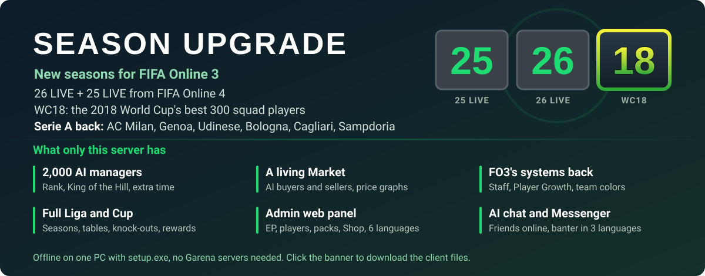

[](https://www.mediafire.com/file/ettm1y9u3s0r3t2/FO3ID-Season-25-26-LIVE-WC18-SerieA-client.zip/file)

# FO3ID Private Server

[English](README.md) | [Bahasa Indonesia](README.id.md) | [简体中文](README.zh-CN.md) | [ไทย](README.th.md) | [Tiếng Việt](README.vi.md) | **한국어**

> [README.md](README.md)의 번역본입니다. 내용이 다르면 README.md가 최신입니다.

**새 기능:** FIFA Online 4의 25 LIVE·26 LIVE 카드를 새 시즌 두 개로 추가(능력치는 +0 기준, FO4의 특성과 시즌 아이콘 사용), 기본 시즌은 26 LIVE. 또 WC18: 2018 월드컵 엔트리 중 상위 300명(+1에서 각 카드는 대회 최종 능력치 - 5). `tools/fo4_season.py` 참고.

**FIFA Online 3 인도네시아**(Garena, 클라이언트 빌드 654420)용 로컬 사설 서버로, Python으로
작성했습니다. Garena는 2020-06-30에 공식 서버를 종료했습니다. 이 프로젝트는 클라이언트가 접속하는
백엔드를 다시 구현해서, PC 한 대에서 오프라인으로 게임을 할 수 있게 합니다.

> EA, Spearhead, Garena와 관련이 없습니다. 이 저장소에는 **게임 파일이 없습니다**(클라이언트,
> 데이터베이스, 에셋, 음악 모두 없음). FO3 ID를 직접 설치해야 합니다. 클라이언트의 안티치트
> (XIGNCODE3 / HackShield)를 포함하거나 수정하거나 우회하지 **않으며**, 이는 범위 밖입니다. 게임 보존과
> 연구를 위해 만들었습니다.

게임 화면은 인도네시아어입니다. 아래의 Liga, Cup, Market, Tukar, Tim inti, Tim Cadangan, Item saya,
Gudang 등은 게임에 표시되는 화면 이름이라, 게임에서 찾기 쉽도록 원문 그대로 둡니다.

## 되는 것

실제 클라이언트(인도네시아어 UI)에서 테스트함:

- 로그인 → 감독 선택 / 생성(라이선스 구단 501개 중 선택) → 로비(FREEROAM).
- **Single → Liga**(시즌 전체: 일정, 경기, 순위표, 보상, 승격)와 **Cup**(추첨, 조별 리그, 토너먼트,
  연장전, 승부차기).
- **Market**(구매 / 판매. 카드 가격은 능력치와 강화 등급을 따름: 같은 능력치인 모든 카드의 fifaaddict
  가격 중앙값), **Upgrade**(강화 +1…+10), **Tukar**와 **Tukar Scout** 선수 트레이드(이 지역 라이선스
  카드만이 아니라 Market의 모든 카드), Tim inti(1군) / Tim Cadangan(2군), 스쿼드와 전술 저장.
- **Shop**(상점)의 모든 탭(선수 팩, 소모품, 패키지, MP Shop, 월정액 패키지와 연속 패키지, 특별 보너스),
  랜덤 강화 등급으로 팩 개봉, Item saya(내 아이템), Bag(선물함), 출석 보상.
  **Gudang**(Item saya > Gudang, 창고): 팩과 소모품을 넣었다 뺄 수 있음.
  추가 팩: **All Season +8**(모든 시즌, +1…+8), 그리고 '07과 fifaaddict에 있는 시즌마다 팩 하나씩.
- 항상 VIP + 공식 PC방(IGR) 혜택, 감독 삭제 / 복구, '17 시즌 카드.
- 포메이션 목록(구단 자체 포메이션 + 클라이언트의 포메이션 표에서 읽은 게임 공용 포메이션 33개)과
  감독 / 선수 레벨: 경기마다 EXP, 선수 LV.1-23(레벨당 모든 능력치 +1), 감독 LV.1-100.
- 게임 사운드와 EA Trax 메뉴 음악. `tools/eatrax_song.py`로 내 노래를 맨 앞에 넣을 수 있지만, 그러면
  경기 후 게임이 튕깁니다(아래 알려진 문제 참고).
- 웹 관리자 페이지 http://127.0.0.1:8088/ (EP, 선수, 팩, 선물, 출석 보상, 경기 보상, 경기 설정, 경제, AI 채팅, 상점, 로그), 언어 전환 가능
  (issue #15): Bahasa Indonesia, English, 简体中文, ไทย, Tiếng Việt, 한국어. 브라우저가 선택을 기억합니다.
- 경기에서 실제 구단 유니폼(kit id = `teamid << 5 | type`, 예전의 `<< 10`은 체크무늬로 나옴).
- **team color**(팀 컬러)를 켠 상태로 후반전까지 경기가 진행되고(예전에는 시즌 컬러 때문에 하프타임에
  튕김), 이후 EXP와 보상 화면이 나옵니다.

추가했고 테스트도 통과했지만 아직 클라이언트에서 확인하지 않은 것:

- **team color** 보너스 자체: 선발 11명 중 같은 구단 선수에게 OVR 보너스(4-5명 +1 ~ 10-11명 +4),
  같은 국가나 같은 시즌(5-6명 +1 ~ 9-11명 +3). 선수마다 가장 좋은 하나만 적용.
- **Opsi > Kontrol**(키보드와 게임패드 키)이 저장됨: 서버가 항상 게임 기본 키 배치를 보내므로 화면에서
  변경을 적용하고 저장할 수 있음(예전에는 변경이 사라졌음).
- 경기 설정 화면의 **유니폼 선택**(양 팀 홈 / 어웨이)이 경기에 반영됨.
- **감독 선택** 화면에 구단에서 가장 비싼 선수가 구단 유니폼을 입고 나옴(예전에는 게임 기본 바르셀로나
  선수가 나왔음).
- 수정한 튕김: 시작 공지 팝업(웹 URL 비어 있음), Beginner's Guide 리그 튜토리얼(스크립트 없음).
- **강화 확률**: 목표 등급별 기본 확률에, Upgrade 탭이 재료 카드 등급에 따라 보여 주는
  "Rasio bonus keberhasilan" 표시를 곱함(Kosong x1, Low x1.1, Normal x1.25, High x1.5). +5 이상에서
  강화에 실패하면 한 등급 내려감.
- **Top 200 팩**: 추가 팩이 이제 해당 시즌 최고 카드 200장을 줌("17 Top 200", "07 Top 200", …).
  **All Season Top 300 +8**은 모든 시즌에서 능력치 81 이상인 카드를 줌.
- **+0 카드로 강화**(issue #5): 구단의 +0 카드는 목표 카드 등급을 100% 유지(+4에 +0을 쓰면 그대로 +4)하고
  +10 카드도 쓸 수 있음. 유지된 카드가 사용된 카드의 스쿼드 자리를 차지하면 Tim Cadangan에서 빠짐.
- **Upgrade 2.5**(클라이언트의 새 강화 화면, `features...enhancement.v2_5`):
  - **강화 포인트**: 강화 실패 시 포인트 지급. "Gunakan poin"으로 포인트를 써서 +10%. Shop > Paket에서
    무료로 더 살 수 있음(Upgrade Point 100 / 500 / 1.000);
  - **부스트 아이템** Enhancement Boost Gold / Silver / Bronze(+15 / +10 / +5%), Shop > Dapat dikonsumsi에서
    무료;
  - 상시 **강화 이벤트**(목표 +1…+9에 +10%, `GET /events`);
  - "Coba pengembalian lagi"로 실패해서 잃은 등급을 포인트로 되찾음.
- **Tukar v2**(`trade2`): 트레이드를 가치(TP)에 따라 15단계로 평가하고, 단계마다 최대 제안 등급이 있음.
  탭에 다른 감독이 "어제" 그 단계에서 무엇을 받았는지 표시. 레전드 시즌 카드는 1.5배로 계산. 하루 제한이나
  가치 제한 없음. Tukar Scout도 함께 사용 가능.
- **Tukar Scout**: 클라이언트의 다른 스카우트 두 명, Scout Khusus(이벤트, 레전드 시즌 퀘스트)와
  VVIP Scout(최고 제안, 10억 EP 퀘스트). 목록이 5줄에 맞도록 Scout Amatir를 뺌(예전에 목록이 스크롤되면
  달성한 퀘스트가 다른 스카우트 카드를 켜거나 아무것도 켜지 않았음).
- **강화 팀 컬러**(클라이언트의 "Upgraded Team"): 강화 등급 +2, +5, +8 이상인 선발 선수. 5-6 / 7-8 /
  9-11명이면 +1 / +2 / +3, +2 / +3 / +4, +3 / +4 / +5 OVR. 단일 등급 컬러("+3 club" … "+10 Golden summit")는
  선발 11명 모두 그 등급 이상이어야 함: +4(club +3/+4), +5(silver +5…+7), +6(Golden passion +8/+9),
  +7(Golden summit +10). 선수는 가장 좋은 구단 / 국가 / 시즌 컬러에 더해 가장 좋은 강화 컬러를 받음.
- **클라이언트에 이름이 있는 모든 팀 컬러**(현재 188개):
  - 구단 27개(Real Madrid … Jeonbuk): Single team 단계에 게임 툴팁에 나온 구단별 보너스를 더함,
    예: Barcelona MF agility +3;
  - 국가 30개: Satu Negara 단계에 예: Spanyol MF ball control +2를 더함;
  - 게임 이름 그대로의 시즌 컬러(World Best 최대 +5, World Legend, 2014 WC All-Star, …);
  - 스페셜 약 75개: 국가별 '14 WC와 EC, nation BEST, MSN / BBC Trio, Arsenal Invincibles, Galácticos,
    LEGENDS, TOP 100, Power Header, New Star, ….

  원래의 보너스 수치와 선수 목록은 서버 데이터라 사라졌습니다. 선수 목록은 선수 데이터베이스(시즌, 구단,
  이름이 나온 선수, 능력치 제한)에서, 보너스 수치는 게임에 남아 있는 툴팁 한 줄에서 가져옵니다. 제외한 것:
  [Test] 컬러, "+2~7", "14 WC Single Nation", 중복된 구단 항목 4개.
- **Formasi**(포메이션)를 열 때 더 이상 "Tidak cukup pemain"(선수 부족)이 뜨지 않음(이 화면은 서버가 보낸
  적 없는 프리셋 스쿼드 1을 불러옴). 선발의 빈자리(issue #7, 같은 선수의 선발 카드 두 장으로 강화)는 벤치에서
  채우고, 벤치에는 같은 선수의 두 번째 카드가 들어가지 않음. 선발 선수마다 `starting` 데이터(워크레이트와
  경기장 위치)를 줌. 이게 없으면 게임이 그 선수를 벤치에 표시함.
- **Tim > Peran**에서 주장과 세트피스 키커를 저장함(issue #8: `PUT /game/my/team/captain`과
  `/game/my/team/kickers/<0-4>`가 없었음). 키커 다섯 자리(왼쪽 코너킥, 오른쪽 코너킥, 프리킥, 페널티킥,
  프리킥 2)는 자리를 유지하고, 빈자리는 선발 선수 한 명이 맡음.
- **Tim > Locker room**(라커룸) 작동(issue #13): 유니폼 스타일과 소매, 타투, 손목밴드, 장갑(골키퍼: 장갑
  디자인 39종), 양말, 무릎 보호대, 브랜드별 축구화 614켤레, 등번호(이미 누가 쓰는 번호를 고르면 그 선수와
  맞바꿈). 아이템 표 `/static/db/LOCKERROOMITEM`이 없어서 모든 목록이 비어 있었고 축구화 패널이 깨졌었음.
  선수의 외형은 카드에 저장되고, Item saya에는 영구 라커룸 이용권이 있어 게임이 경기에서 그 외형을 보여 줌.
  손목밴드, 장갑, 무릎 보호대는 클라이언트 자체 모델만 제공(각 하나).
- **관리자 페이지의 상점 관리**(issue #10): 상점의 모든 탭(선수 팩, 소모품, 패키지, 월정액 패키지, 추천,
  MP Shop, 특별 보너스, 연속 패키지). 새 팩(시즌, 상위 N, OVR, 최대 강화 등급, 포지션, 리그 기준), 랜덤 박스,
  EP 카드, 패키지, 월정액 패키지를 클라이언트의 상점 아이콘 147개 중 아무거나로 만들 수 있음. 기본 상품은
  수정, 숨기기, 고정 가격 지정이 가능하고, 상점 전체를 무료로 하거나 되돌릴 수 있음. 변경 사항은
  `gamedata/shop.json`에 저장.
- **Simulasi Liga**(리그 시뮬레이션) 쿠폰(아이템 2001, Shop > Dapat dikonsumsi): Liga의 Simulasi 버튼으로
  경기를 하지 않고 결과를 받음, 경기당 쿠폰 한 장. 시뮬레이션 화면은 결과에 맞춰 골, 슈팅, 선방, 카드를
  보여 주고(`eventlist`가 비어 있어서 0-0으로 나왔음), 이어지는 결과 화면에 스코어, 선수 평점과 기록,
  점유율, MOTM이 나온 뒤(예전에는 빈 화면) EP 보상을 받고 Liga 메뉴로 돌아감. 이 버튼은 Item saya의
  쿠폰 수를 세는데, 아이템이 없어서 계속 꺼져 있었음. 관리자 페이지에서 새 쿠폰을 만들 수 있음(종류
  "리그 시뮬레이션 쿠폰").
- **경기 전 스쿼드 화면**(Liga와 Cup, issue #16): 자리 바꾸기, 교체, 포메이션 변경이 이제 유지되고 구단에
  저장됨(`PUT /match/<id>/side/<side>/squad` 처리기가 없어서 변경할 때마다 저절로 되돌아갔음). 포메이션 목록이
  채워지고, 체력 바가 가득 찬 상태로 표시됨(경기 사이 피로는 유지하지 않음).
- **팀 FW / MF / DF 능력치가 선수와 일치**(issue #18): 스쿼드 화면과 로비에서 선수 목록에 표시되는 능력치의
  평균(선수 자리의 능력치에 강화 등급, 레벨, 팀 컬러를 더한 값)임. 전에는 카드 기본 능력치로 계산해서 약 12 낮았음.
  경기 전(리그, 컵, 랭크) 선수 목록에는 팀 컬러가 빠져 있으므로 그 화면의 막대도 팀 컬러를 빼고 계산함. 보너스는 경기에서 그대로 적용됨.
- **Rekor liga 탭**(issue #19): 순위표가 표시됨(`league2difficulty` 테이블이 없어서 탭이 오류가 났음. 이 테이블은
  이제 시즌 종료 때 승격·강등도 정함). Rekorku는 이번 시즌 치른 경기에서 선수별 경기 수, 평점, 골, 도움, 패스,
  태클, 선방을 보여 주고, Rekor gabungan은 시즌 베스트 11과 부문별 1위를 보여 줌. 내 선수만 집계하며, 시뮬레이션
  경기는 선수 기록을 더하지 않음.
- **Formasi의 Squad A / B / C**(issue #20): 포메이션 버튼 왼쪽 칸에서 저장된 스쿼드 3개 중 하나를 고름(서버가
  스쿼드 수를 보내지 않아 비어 있었음). 스쿼드마다 선발, 포메이션, 역할을 따로 저장함.
- **컨트롤러·카메라 설정이 경기에서도 유지됨**(issue #21): Opsi > Konfirmasi 뒤 게임은 서버 응답에서 저장된
  옵션을 다시 읽는데, 응답에 옵션이 없어서 경기마다 로그인 때 옵션(키보드, 이전 카메라)으로 돌아갔음. 경기 중
  F3-F9로 카메라를 바꿈(F5 = Co-op).
- **Ganti tim(팀 변경)에 클럽과 내 선수가 보임**(issue #23): 이 아이템의 클럽 화면에 리그, 라이벌, 홈구장,
  건립 연도, 수용 인원과, 새 클럽 유니폼을 입은 내 선수 및 생년월일·키·몸무게가 나옴. 서버의 클럽 정보에 이런
  내용이 없었고, 유니폼이 없으면 3D 선수가 아예 그려지지 않았음.
- **카메라 높이·줌 조절 가능**(issue #24): Opsi > Kamera setting의 Customise 게이지(높이와 줌, Pro 카메라는
  줌·속도·흔들림)에 값이 없고 바꿀 수 없었음. 서버가 빈 카메라 설정을 보냈기 때문. 이제 10(최대 20)에서 시작함.
- **Tim lain에 모든 국가대표팀**(issue #24): International 리그(목록의 마지막 국가)에 이탈리아, 잉글랜드,
  독일, 스페인, 프랑스를 포함한 국가대표팀 40개가 나옴. 국가대표팀 선수단은 각 선수의 국가대표 연결로 만듦.
  전에는 라이선스 클럽이 없는 선수들의 팀만 나왔음.
- **결과 화면의 선수 위치**(issue #26): 경기 후 결과 화면의 경기장에 모든 선수가 골문에 겹쳐 있었음. 게임이
  모든 선수를 골키퍼로 보내기 때문. 이제 서버가 스쿼드 자리대로 각 선수의 포지션을 넣음.
- **경기 후 보상 카드**(issue #26): 보상 화면의 카드가 비어 있었음. 이제 카드 3장이 나오고, 고른 카드는
  EP(1,000~10,000), 선수 팩(Semua Pemain 또는 '14 Top 200) 또는 Lucky EP 아이템을 줌. 나머지 두 장은 받을 수
  있었던 보상을 보여 줌.
- **드래프트 팩과 경험치 캡슐**(issue #27): Shop > Pak pemain에서 드래프트 팩("06 Draft Pick 3",
  "2017 Draft Pick 5", "World Legend Draft Pick 3")을 판매. "Gunakan"을 누르면 그 시즌에서 가장 비싼 카드로
  채워진 선수 선택 화면이 열리고, 그 시즌 카드 N장을 고르면(이름, 리그, 클럽으로 검색) 그중 한 장이 열림.
  Shop > Dapat dikonsumsi에서 경험치 캡슐(1,000, 5,000, Max = LV.23, LV.10 이하용 1종, 2017 카드용 1종)을
  판매: 선수를 고르면 그 경험치를 받음. 드래프트 화면의 요청(`/item/draftpack/<id>/players/<n>`,
  `/transfer/price/default/<grade>`)과 캡슐 아이템 종류가 없었음. 관리 페이지에서 둘 다 더 만들 수 있음
  (팩의 "Draft" 항목, 아이템 종류 "EXP Capsule").
- **Multiple > Rank: 다른 감독과 실제 경기**(issue #30): 서버가 디비전, 보상, 래더 기록을 보내지 않아 랭크
  화면이 UI 오류에서 멈췄음. 이제 화면이 열리고 가상 감독들이 순위를 채움: 상위 3명(VS Manager Top)과 친구
  순위 20명. 감독마다 이름, 구단, 디비전, 전적이 있고, 전적은 하루 동안 경기를 치르면서 바뀜. 처음에는
  100명에 1,850명이 더 있고, 매일 0-3명이 새로 들어와 최대 2,000명까지 늘어남(issue #36에서 두 배로). 각 감독은 자기 스타일(점유율 축구, 역습, 전방
  압박, 롱볼, 텐백, 총공격: 포메이션, 전술, 선수 움직임)로 자기 구단 유니폼을 입고 경기함. 스쿼드는
  구단·시즌과 상관없이 자기 레이팅과 비슷한 카드를 무작위로 골라 채우고, 카드마다 강화 등급(초보는 +1,
  고수는 +6 이상)과 레벨이 따로 있음. 날마다 카드를 사고팔고, 강화하고(+5 이상에서 실패하면 한 등급 내려감),
  레벨을 올림. Rank 1 on 1과 VS Manager에서는 내 레이팅에 가장 가까운 감독 5명 중 한 명과 실제 경기를 함:
  스쿼드 화면, 경기 설정, 상대 쪽을 게임 AI가 맡는 풀 경기, 그 뒤 결과, 보상, 새 랭크 레이팅. 결과와
  레이팅은 랭크 화면의 패널, 기록 창(최근 경기, 시즌 그래프), Info Manager의 경기 목록에 표시됨. 경기 중
  상대는 자기 성격대로 경기 채팅을 하고(킥오프, 양 팀의 골, 빗나간 슈팅, 선방, 내가 채팅하면 대답) 랭크
  화면으로 돌아오면 결과에 한마디를 남김. 관리자 페이지의 AI 채팅 탭에서 채팅을 끄거나 언어(인도네시아어,
  영어, 베트남어)를 고를 수 있음. Messenger(메신저)가 열리고(전에는 서버가 보낸 적 없는 알림 목록을
  기다렸음) 친구 20명이 각자 플레이하는 시간대(08:00-02:00 WIB)에 따라 온라인, 바쁨(랭크 경기 중),
  오프라인으로 표시됨. 친구의 Info 버튼을 누르면 프로필과 스쿼드가 나옴.
- **Market이 살아 움직임**(issue #30): 내가 올린 카드를 가상 감독들이 구매함. "Dijual"(판매 중)이 몇 분 안에
  저절로 "Terjual"(판매 완료)로 바뀌고(싸게 올릴수록 더 빨리), "terjual seharga" 팝업과 구매자 이름이 적힌
  알림이 뜸. Batal(취소)과 Ulang(재등록)도 작동함. 가상 감독들도 자기 카드를 올림: +1..+3 기본 매물과 함께
  다른 등급 카드까지 시세보다 조금 싸게 나오고, Kuantitas(수량)는 매시간 바뀜. 카드 창의 Market Price 탭에
  최근 30일 가격 그래프가 나옴.
- **경제 설정**(issue #30): 관리자 페이지의 새 Ekonomi(경제) 탭에서 게임 난이도를 마음대로 조절할 수 있음:
  선수와 팩 가격 배율, 새 감독의 시작 EP, 상점 무료 여부, 변동 Market. 변동 Market에서는 선수마다 가격이
  하루하루 조금씩 오르내리고(위아래로 최대 약 13%), 가상 감독들이 가끔 싼 매물을 올리며, 판매가를 시세의
  105%까지 정할 수 있어서(대신 팔리기까지 더 오래 걸림) 싸게 사서 비싸게 팔면 이득임. 프리셋: 쉬움(예전과
  같음: 무료 상점, 고정 가격), 현실적(카드 가치대로 값을 매긴 유료 상점, 변동 Market, 시작 EP 300,000),
  어려움(가격 x2, EP 100,000). 경기 EP는 그대로 경기 보상 탭에서 정함.
  상점이 유료일 때는 리그 시뮬레이션 쿠폰이 한 라운드 보상만큼의 값이고, 변동 Market에서는 팩 가격이 카드가
  가장 비쌀 때의 가치(+13%)임. 팩은 아무 날에나 열 수 있기 때문. 엄격한 규칙(어려움에서 켜짐)을 켜면 강화,
  Tukar, Scout로 EP를 불릴 수 없음: 강화 비용은 평균적으로 늘어나는 가치만큼이고(복구는 EP로 냄), Tukar와
  Scout의 제안은 내준 카드의 가치를 넘지 않음. 끄면(쉬움, 현실적) 게임 원래 규칙: 강화 비용은 카드 가치의 2%,
  복구는 강화 포인트, 제안은 상한 없음.
  EP가 들어 있지 않은 상품(강화 부스트, 강화 포인트, EXP 캡슐, 이름이나 팀 변경)은 기본 가격 × 선수 가격 배율이라
  어려움에서는 두 배임.
  실행 중인 게임에도 바로 반영됨: 서버가 게임에 세션 동안 보관하는 Shop 목록을 버리라고 알려서, Shop 탭을 다음에 열면
  새 가격이 보임. 게임을 시작한 뒤 이미 연 탭은 게임을 다시 시작할 때까지 예전 가격을 유지함. Shop의 한정 재고 확인에서
  더 이상 "Kesalahan UI telah terjadi"가 뜨지 않음.
- **AI 채팅 10배**(issue #30): 가상 감독의 채팅은 언어마다 상황과 성격별로 20문장씩, 모두 2,700문장임: 킥오프 때의
  잡담과 축구 이야기, 골·빗나간 슛·선방에 대한 반응, 채팅을 치면 받아치는 농담, 경기 결과에 대한 한마디. 게임의 채팅
  필터가 가릴 단어는 넣지 않음(이 필터는 더 긴 단어 속에 든 단어도 가림).
- **가상 감독이 저마다의 방식으로 스쿼드를 짬**(issue #30): 감독마다 고정된 스쿼드 테마가 있음. 자기 레이팅 근처의 아무
  카드; 상위 클럽(레알 마드리드, 바르셀로나, 아틀레티코, 맨체스터 두 팀, 첼시, 리버풀, 아스널, 토트넘, 바이에른, 도르트문트,
  유벤투스, 밀란, 인테르, 로마, 나폴리, PSG)의 현역 또는 출신 선수; 상위 국가(브라질, 아르헨티나, 스페인, 독일, 프랑스,
  잉글랜드, 이탈리아, 네덜란드, 포르투갈, 벨기에, 우루과이, 크로아티아); 게임의 팀컬러 하나(카드 시즌 또는 이름 있는 세트);
  스타 한 명과 그의 클럽 또는 국가 동료; 메타; 또는 능력치 하나(속도, 피지컬, 기술, 패스, 수비, 슈팅, 어린 선수, 올드
  스쿨). 강한 감독일수록 메타와 팀컬러를 더 자주 따름. 테마는 레이팅 근처의 카드만 고르므로 스쿼드가 더 강해지지는 않음.
- **경기 전 설정**(issue #31): Multiple > Rank의 경기 설정 화면에서 경기장(클라이언트에 온전히
  들어 있는 70곳), 시간대(낮 또는 밤), 날씨(맑음, 비, 눈, 흐림: 밤에는 해질녘), 경기 시간(6, 8, 10,
  12분), 공(9종)을 바꿀 수 있음. 마지막 선택은 Liga와 Cup을 포함한 다음 경기에도 유지됨. Liga와 Cup의
  경기 전 화면은 값을 보여 주기만 하므로 관리자 페이지의 새 경기 설정 탭에서도 정할 수 있고, 여기서는
  "홈 팀 경기장"이나 "무작위"도 고를 수 있음. 서버가 클라이언트의 인도네시아어 문자열에서 잘못된 라벨
  두 개를 고침: 낮이 "Waktu"(시간), 흐림이 "Malam"(밤)으로 나왔음. Liga/Cup 화면에는 흐림이 여전히
  눈을 뜻하는 "Salju"로 표시됨.
- **키보드와 게임패드가 각자 컨트롤 프리셋을 유지함**(issue #32): Opsi > Kontrol에는 사용 중인 장치의
  프리셋 하나만 저장되고, 다른 장치로 바꾸면 그 장치는 첫 번째 프리셋으로 돌아감. 이제 서버가 장치마다
  마지막 프리셋을 기억했다가 Konfirmasi 뒤에 복원함(화면에는 다음에 열 때 표시되고, 경기에서는
  킥오프부터 적용됨).
  장치를 바꾸는 즉시 화면에 해당 프리셋이 보이게 하려면, 게임을 끈 상태에서 `python tools/control_presets.py`를
  한 번 실행하면 됨. 클라이언트의 Kontrol 화면을 패치함(백업을 남기며, `--remove`로 원래대로 되돌림).
- **매니저 메뉴가 채워짐**(issue #33): Info Manager에 "-" 대신 기록이 표시됨: 리그, 컵, 랭크의 경기 수, 골, 승리와
  연승, 리그 우승과 도달한 난이도, 우승한 컵과 상금, 사고판 카드 수와 각각 가장 비싼 카드, 플레이 시간, 소개와 사진.
  모두 이 버전부터 집계됨. Manager Ranking은 최근 30일 팀 가치를 친구 20명의 평균과 비교해 보여 주고, 그중 내 순위와
  어제 대비 순위 변화를 표시함.
- **미션과 업적**(issue #33): Manager > Daftar pencapaian에 배지 줄(감독 레벨, 경기, 승리, 강화, 최고 등급, 팀 가치,
  골, 랭크 승리)이 생김. 업적마다 EP, 팩, 아이템을 받는 5단계 보상이 있고, 한 줄을 모두 끝내면 그 배지를 달 수 있음.
  매일 00:00 WIB에 초기화되는 일일 미션 줄(경기, 승리, 골, 랭크)도 있음. 상단 바의 Quest 버튼은 카운트다운과 함께
  주간 퀘스트(매주 월요일 00:00 WIB 초기화)를 열고, 완료한 퀘스트는 창 안의 보상 상자(EP, Lucky EP, 팩,
  강화 부스트, Kotak Emas)에 쓰는 GP를 줌. 서버가 직접 플레이한 경기와 성공한 강화를 셈. 관리자 페이지의 새 Misi 탭에서
  켜고 끄거나 언어(인도네시아어, 영어, 베트남어)와 목표·보상 배율을 정할 수 있고, EP 보상은 경제 탭의 선수 가격도 따름.
- **킥오프 때의 심판**(issue #33): 부심 두 명이 빈 기록(게임의 심판 목록에 없는 심판)으로 만들어져 머리, 머리카락,
  몸이 없는 에셋이었기 때문에 입장 줄에서 일그러져 보였음. 이제 서버가 게임에 실제로 있는 심판을 씀.
- **FO3 VN 클라이언트의 베트남어 해설**(issue #34): 게임을 끈 상태에서
  `python tools/commentary.py "<FO3 VN 클라이언트 폴더>"`를 실행함. VN 클라이언트의 `audiodata\speechdata\vie_vn`을 이
  클라이언트의 영어 해설(`eng_us`) 옆에 복사하고, `data\loc\locale.big`의 해설 언어 목록에 베트남어만 남김(백업을
  남김). 그러면 게임이 `vie_vn`에서 해설을 읽음. `--remove`로 영어 해설로 되돌림.
- **감독 레벨업 보상**(issue #35): 감독 레벨 2부터 100까지 레벨마다 FO3의 레벨업 보상(fifaaddict 표)을 줌: EP와 함께
  Top 300, Top 100, Best 팩, 리그 65+와 GK 65+ 팩, 리그 시뮬레이션 쿠폰, 팀 변경 쿠폰, EXP 캡슐 같은 아이템. 보상은
  가방("Hadiah naik level Lv.N")으로 들어가고, 경기 후 화면의 레벨업 팝업에 표시되며, 정보 아이콘은 다음 레벨들의 보상을
  보여 줌. 이 서버에서 쓰지 않는 FO3 아이템(스태프 팩, Red Ball, 라커룸·보상 부스트 쿠폰, EXP 이전)은 빠짐. EP 보상은 경제
  탭의 선수 가격을 따름.
- **클럽**(issue #36): Klub 메뉴가 작동함. 클럽을 직접 만들거나(10,000 EP; "Klub telah dibuat" 뒤의 "Konfirmasi"가 더
  이상 회색으로 남지 않음) 가상 감독들이 운영하는 AI 클럽 60개 중 하나에 가입할 수 있음. 클럽마다 클럽장, 멤버, 레벨,
  소개, 소식이 있음. 클럽이 없는 감독들이 내 클럽에 가입을 신청함(Manajemen > permohonan, 심사 없이 멤버를 받도록 해
  두면 바로 가입함). 멤버는 각자 플레이하는 시간대에 따라 온라인이 되고, 활동 포인트를 쌓고, 게시판에 글을 올리고,
  채팅 창의 Klub 탭에서 대화함: 내 인사와 메시지에 답하고, 새 멤버를 환영하고, 내 경기 결과를 축하하거나 격려함.
  언어는 관리자 페이지에서 정한 채팅 언어(인도네시아어, 영어, 베트남어)를 따름. 그 주의 클럽 포인트는 경기
  부스트(감독 EXP, 선수 EXP, EP)를 주고, 하루에 내가 30포인트를 모으면 가방에 1,000 EP가 들어옴. 아직 안 한 것: 클럽
  경기, 클럽 시설, 클럽 랭킹.
- **AI와의 친선전**(issue #36): Multiple > Persahabatan에 버튼이 다시 나옴. Quick match와 Random match는 가상 감독을
  상대로 찾아 줌. 직접 만든 방에서는 vs COM(AI 선택창에서 고른 구단과 레벨, Amateur~Legendary)이나 목록에서 초대한
  친구와 경기함. 결과는 Info Manager에 친선전으로 집계되고 랭크 레이팅에는 들어가지 않으며, 상대는 랭크에서처럼
  채팅함.
- **Rank와 King of the Hill의 연장전과 승부차기**: 90분 후 동점이면(Rank 1 vs 1, Rank Manager, King of the Hill)
  연장전 후 승부차기로 감. 승부차기 승리는 레이팅, 기록, 경기 보상에서 승리로 계산됨.
- **King of the Hill**(issue #36): Esports 지역 리그에 매달 새 시즌이 열림. 인도네시아의 19개 지역 중 하나를 고르면 그
  지역의 가상 감독들이 순위표에 나오고, Mulai를 누르면 내 King of the Hill 레이팅에 가까운 감독 중 한 명과 경기함.
  보상 화면에 얻거나 잃은 포인트가 표시됨.
  관리자 페이지의 경기 설정 탭에서 지역을 인도네시아, 싱가포르/말레이시아, 태국, 베트남(베트남어 이름) 도시나, 권역마다 "권역: 도시, 도시" 한 줄로 직접 쓴 사용자 지정 지역(예: Miền Bắc에 Sa Pa
  추가)으로 바꿀 수 있음.
- **로그인 공지 이미지**(issue #36): 관리자 페이지의 Pengumuman(공지) 탭에서 로그인할 때 뜨는 공지 팝업의 JPG 또는 PNG
  이미지를 올리거나(800×720 팝업에 맞춰지며 미리 보기가 있음) 지울 수 있음.
- **이번 시즌까지의 클럽 경력**(fifamvp의 PR #39): 선수 정보의 특성(Karakteristik) 탭이 카드의 클럽 경력을
  보여 줍니다(`features.seasoncare`). FO3 자체 경력은 2017년 무렵에서 끝나고 22-24 시즌 카드에만 나왔지만, 이제
  경력이 있는 선수의 모든 카드에 나오며, 관리자 페이지 Aset 탭(클럽 경력, 또는 `python tools/club_history.py fetch`)이
  Wikidata에서 현재 시즌까지의 경력(연도, 클럽, 임대)을 받습니다. FO3에 이름이 없는 클럽은 클라이언트에 이름이
  추가됩니다. 그다음 데이터베이스 > 게임에 적용을 누르세요.
- **관리자 페이지에서 없는 이미지 받기**(issue #36): Aset(이미지) 탭이 없는 선수 얼굴(카드마다 시즌 사진과 선수 사진), 구단 엠블럼, 리그 로고, 스태프
  사진을 fifaaddict.com에서 백그라운드로 내려받음(한 번에 한 종류씩, 언제든 멈추고 이어서 받을 수 있음). 이 탭은
  `tools/fa_faces.py`를 실행하며, 이 도구는 이제 `--leagues`와 `--uniforms`(클럽 선택 화면의 유니폼 이미지, issue #43)도 받음. 경기 설정 화면의 "Default ball"에 EA SPORTS 공이
  나오고, 작은 국기는 큰 국기 이미지를 쓰며, Cup 화면에 트로피와 스킨이 나옴.
  fifaaddict에 없는(또는 거절된) 선수 사진은 FC Online(FO4)에서 받음(같은 EA 선수 ID; 서버의 새 선수는 fifaaddict의 FO4 카드 사진). 데이터베이스의
  모든 카드를 훑고, 거절되면 멈추지 않고 점점 더 기다렸다 이어가며, *없는 것 모두 다운로드*가 모든 종류를 한 번에 받음.
- **언어 팩을 쓸 때의 보상 이름**(issue #36): 베트남어 팩에서는 업적 목록의 보상마다 앞에 "undefined"가 붙고 UI 오류가
  났음. 서버가 보상 아이템 이름을 인도네시아어와 한국어로만 붙였기 때문. 이제 클라이언트의 모든 언어에 이름이 있음.
- **AI와 Exhibition**(issue #36): Multiple > Exhibition에서 방이 열림. 화살표나 Pilih Team으로 라이선스 클럽을
  고르고, 목록에서 친구(가상 감독, 자기가 고른 클럽으로 들어와 바로 준비함)를 초대한 뒤 Siap을 누르면 두 클럽의
  실제 스쿼드로 경기함. 하루 5경기, 내 카드는 이 경기로 EXP를 얻지 않음. Live Center는 전에 나던 UI 오류 두 개
  없이 열림.
- **EA FC 이주의 팀(Team of the Week) 라이브 부스트**: Tim > Live Boost에 이번 주 Team of the
  Week가 나옴(fut.gg에서 가져옴; 서버가 수요일 발표 후 새 주를 받아오므로 인터넷 필요). 그 선수들의 모든 카드가
  한 주 동안 모든 능력치 +5(OVR +5): 스쿼드, 이적시장, 경기. FO3에 있는 선수(와 26 LIVE 신규 선수)만 나오고 여자
  선수 카드는 없음. 그중 11명(+1 이상)을 가지면 주 1회 100,000 EP(Terima).
- **주간 퀘스트 편집기**(관리자 Misi 탭): 매주 뽑을 퀘스트 목록(종류, 목표, GP, {0}이 목표인 직접 지은 이름),
  주당 개수(최대 6)와 퀘스트 창의 GP 보상 상자(최대 5), 이번 주와 다음 주 미리보기. 이번 주에 이미 완료한
  퀘스트는 완료 상태로 남음.
- **게임 안 일일 로그인 보상**: 그날의 보상은 여전히 첫 로그인 때 가방으로 들어가고, 이제 알림이 뜨며 그 항목을
  누르면 며칠째인지와 아이템이 담긴 팝업이 열림.
- **플레이 시간 보상**: 오늘 플레이 시간이 10, 30, 60분이 되면 보상(하루는 00:00 WIB부터, 20분 넘는 휴식은
  제외), 같은 알림과 함께 가방으로. 목표는 관리자 페이지의 Daily reward 탭에서 설정.
- **글로벌 채팅**: 채팅 창의 Channel 탭이 동작함: 내 메시지가 표시되고, 접속 중인 가상 감독들이 가끔 답하거나
  혼자 이야기함(AI 채팅 탭의 언어로).
- **글로벌 채팅의 축구 이야기**: Channel 탭의 가상 감독들이 그날의 축구를 이야기함: 어떤 지역에서 뜨는 구글
  검색어 중 축구 관련 항목과 그 언어의 구글 뉴스 헤드라인(X, 인스타그램, 틱톡은 로그인이 필요하고 레딧은 서버를
  거부), 하루 한 번 갱신. 감독마다 뉴스에 나온 자기 클럽, 스타 선수, 나라 이야기를 즐겨 하고 다른 감독이 답함. 세계
  뉴스는 항상 켜져 있고 인도네시아, 말레이시아, 베트남, 태국, 한국은 관리자 페이지 AI 채팅 탭에서 직접 체크하며
  현재 주제도 보여 줌.
- **관리자 페이지의 랭크 보상**: Match 탭에서 디비전별 시즌 보상(주/부)과 주간 승리 단계를 수정하며 랭크 화면에도
  표시됨. 이제 실제로 가방으로 지급됨: 주간 단계는 랭크 화면의 게임 자체 팝업과 함께, 시즌 보상은 다음 시즌이
  시작될 때(레이팅이 가장 높은 모드의 주 보상, 플레이한 다른 모드마다 부 보상).
- **관리자 페이지의 King of the Hill 보상**: 경기 설정 탭에서 주간 보상(1-7일, 8-14일, 15-21일, 22-28일 한 주의
  승리 수 또는 경기 수 목표, 그리고 승리가 충분할 때 디비전 보상)과 시즌 보상(승리가 충분할 때 월말 디비전 보상,
  그리고 지역 내 순위 보상)을 수정함. King of the Hill 화면에 표시되며, 플레이한 주나 시즌이 끝나면 King of the
  Hill을 열 때 보상 화면이 나오고 달성한 보상이 가방으로 들어감.
- **전체 리그**(issue #40): Liga 한 시즌에 내 리그의 스쿼드가 갖춰진 모든 클럽이 참가함(Premier League 20개 클럽,
  38라운드, 최대 24개) 10개가 아님. 순위별 EP와 경험치는 클럽 수에 맞춰 조정됨.
- **FO3 ID에 없던 클럽**: AC Milan, Genoa, Udinese, Bologna, Cagliari, Sampdoria가 게임에 돌아옴(유니폼은 게임 파일에 남아
  있었음; `tools/fo4_season.py install`이 유니폼에서 읽은 색으로 클럽을 추가), 26 LIVE 전체 스쿼드 포함(`fetch`가 목록,
  `collect` + `import`가 능력치). 국가대표팀에 있던 이 선수들의 '17 카드도 클럽으로 돌아감. Liga의 세리에 A는 19개 클럽이고
  클럽 선택 화면에도 나옴. 방법: fetch, collect + import, build 후 게임을 끈 상태에서 install(또는 관리자 페이지의 Terapkan ke game).
  Rest of the World에 있던 이탈리아 클럽 선수들의 예전 FO3 카드(예: Milan의 Pirlo '06, 322장)도 클럽으로 돌아감;
  `restore`가 되돌림.
- **관리자 페이지의 카드와 클럽 데이터베이스**(issue #38): 데이터베이스 탭에서 선수 카드를 시즌별로 한 장씩
  수정(spid = 시즌 × 1,000,000 + 선수 ID; 이름, spid 또는 선수 ID로 검색): 능력치 33개, 포지션, 주발과 약발,
  개인기, 공수 가담, 특성, 클럽(이적), 3D 외형(아무 3D 행의 머리, 예: 다른 카드의 얼굴; 일반형 머리에서는 헤어
  모델과 색, 수염, 피부, 눈, 체형, 머리색 0 = 금발; 스캔 머리는 자체 헤어 유지). 직접 만든 시즌: 코드, 이름,
  배지로 만들고 다른 카드의 복사본으로 채움(모든 능력치 +N 가능), 시즌마다 Top 200 팩과 팀 컬러. 카드 수정은
  `gamedata/fifadb.sqlite`와 `gamedata/card_edits.json`(원래 값과 새 값: Kembalikan으로 되돌리고
  `tools/fo4_season.py build`가 다시 적용), 시즌은 `gamedata/seasons.json`에 저장; Ekspor / Impor mod로 전부를
  JSON 파일 하나로 다른 서버에 옮김. 게임은 자체 DB 사본을 읽음: 게임을 닫고 Terapkan ke game(백그라운드에서
  `tools/fo4_season.py install` 실행)을 누른 뒤 `play.bat` 실행. 이 탭은 클라이언트 캐시의 클럽 엠블럼도 바꿈(원본은
  `gamedata/crest_backup`), 카드 창에서는 선수 사진을 내 PNG/JPG나 다른 spid / 선수 ID의 사진(캐시
  또는 fifaaddict.com)으로 바꿈(모든 카드 또는 이 카드만; issue #36;
  `gamedata/faces/p<id>.png`, 캐시보다 먼저 제공; 3D 얼굴 칸은 선수 이름으로 머리를 찾음). 유니폼과 새 클럽은 아직 없음.
- **사진으로 만든 3D 얼굴**(Database 탭, 카드 창): 일반 얼굴을 쓰는 선수의 정면 클로즈업 사진을 다른 선수의
  스캔된 3D 머리에 얼굴 피부로 입힘(기증자: 머리 모양과 머리카락이 따라오고 눈은 기증자의 것). 사진에 11개 점(눈,
  코, 입꼬리, 턱, 이마, 관자놀이, 턱선)을 클릭하고 기증자를 고른 뒤 만들기를 누르면, Terapkan ke game이 이 선수의
  선수 ID 행이나 일반 머리를 쓰는 모든 카드에 그 머리를 클라이언트에 넣음(`data_7.big`, 원본에서 다시 만듦).
  `gamedata/photo_heads`에 저장. 경기 카메라 거리에서 사진과 닮아 보이며, 조명은 사진의 것, 머리 모양은 기증자의 것.
  *선수 사진에서 가져오기*는 선수의 FO3 사진(캐시, 없으면 fifaaddict.com)에서 사진, 점, 기증자를 채움: YuNet 얼굴
  검출기(OpenCV Zoo, MIT; `gamedata/yunet`에 한 번 받음)가 눈, 코, 입을 찾고, 피부색과 머리카락(색과 모양, 기증자 자신의
  사진 기준)이 가장 비슷한 수염 없는 스캔 머리를 기증자로 고름. Database 탭의 버튼은 사진이 있는 클럽의 모든 일반 얼굴
  선수에게 이를 적용(FO3 사진이 없는 새 선수는 제외).
  피부색은 사진끼리(기증 선수 자신의 사진) 그리고 가져올 얼굴 텍스처와 비교함(밝은 사진은 텍스처보다 밝게 읽혀
  예전에는 피부가 어두운 선수가 밝은 기증자를 받았음); 동아시아/동남아시아 선수는 그 나라들의 기증자를, 나머지는
  그 외 기증자를 받음(기증자의 눈이 유지되므로); 웃는 사진의 치아는 기증자의 다문 입술로 바뀜. *모든 3D 얼굴을
  사진으로 다시 만들기*는 기존 얼굴을 다시 만듦.
- **클래식 FO3 세계**(issue #38): Database 탭의 *Dunia game*에서 모던(AI 클럽, 클럽 선택, This Season 팩이
  26 LIVE 카드 사용, 기존과 같음; 직접 만든 시즌도 마켓 검색에 표시) 또는 클래식 FO3를 고름: 모든 클럽이 FO3 원래의
  2017 스쿼드(FO3 ID에 없던 AC 밀란, 제노아, 우디네세, 볼로냐, 칼리아리, 삼프도리아는 모든 연도의 FO3 카드, issue #43), This Season = '17, 추가 시즌(25 / 26 LIVE, WC18, 직접 만든 시즌)은 팩, 마켓, 트레이드, 가상 감독 스쿼드에
  나오지 않고 관리자 페이지로만 줄 수 있음. 내 클럽과 컬렉션은 그대로이고 FO3 원래 카드는 덮어쓰지 않음(새 시즌은 옆에
  추가). `gamedata/world.json`에 저장되며 재시작(`play.bat`) 후 적용.
- **가상 감독 새로 만들기**: 관리자 페이지 Chat AI 탭의 *Generate ulang*으로 가상 감독 무리(이름, 레벨, 클럽,
  스쿼드, 스타일, Rank 점수, 지역, AI 클럽)를 바로 새로 만듦. ID는 같아 친구, 클럽, 기록은 그대로 작동하고
  *Kembalikan ke awal*로 첫 무리를 되돌림. 이 버튼만 무리를 바꾸며 실행할 때마다 같음(`gamedata/vm_gen.json`).
- **관리자 페이지의 직접 만든 팀 컬러**: 팀 컬러 탭에서 새 팀 컬러를 만듦. 카드는 필터(시즌, 현재 또는 과거
  클럽, 국가, 선수, 최소 OVR, 마켓 최고 N장; 입력한 모든 필터를 만족)로 고르고 부스트 하나(OVR 또는 능력치 하나,
  모든 포지션 또는 FW / MF / DF / GK)를 가지며, 단계는 기본 스페셜 팀 컬러와 같음(XI의 5-6 / 7-8 / 9-11명).
  `gamedata/teamcolors.json`에 저장되고 재시작 없이 다음 로그인부터 게임의 Team colour 목록에 보임. 가상 감독
  스쿼드는 직접 만든 팀 컬러와 시즌을 쓰지 않고, 모드 파일에도 포함됨.
- **스태프**(Tim > Manajemen Staff): FO3 스태프 시스템이 다시 작동함. *Rekrut*(영입): EP로 사는 스태프 팩(Basic
  FW / MF / DF / GK / ALL, Pro, Premium, 기술 이사, Premium Medical)과 매일 로그인하면 무료 ALL 팩 하나, 3경기를
  하면 하나 더. *Staff yang dimiliki*(보유 스태프): 역할 칸 7개(FW, MF, DF, 수석 코치, GK, 피지컬 코치, 기술 이사);
  자기 칸에 배치된 스태프는 해당 포지션 그룹의 선발 선수(피지컬 코치, 수석 코치, 기술 이사는 모든 선발 선수)를 스쿼드
  목록과 경기에서 강화하며, 계약은 50경기이고 EP로 재계약함. *Latihan*(훈련): 다른 스태프를 재료로 넣어 등급(0.5~5성)과
  부스트를 올림. *Pembinaan*(연수): 스태프를 5~10경기 동안 해외로 보내 부스트 하나를 바꾸거나 올림. 이름과 부스트
  능력치는 fifaaddict의 fo3staff 목록을 따르고, 등급·가격·계약은 서버 자체 값이며(Garena 데이터는 사라짐), EP 가격은
  경제 탭의 선수 가격을 따름. 클라이언트에는 스태프 7명의 사진만 있으며, `python -I tools/fa_faces.py --staffs`가 나머지를 fifaaddict에서 추가함.
  가상 감독도 경기에서 당신처럼 팀 컬러 보너스를 받고, 레벨에 맞는 스태프를 가짐(12레벨마다 역할 칸 하나 추가).
  이슈 #41: *Rekrut*에서 스태프를 한 번에 10명까지 영입; 관리자 페이지 Pak & Bag 탭에서 아무 스태프(0.5-5성)를 계정에
  추가/삭제; 팩 그림은 `assets/externalAssets/shop/<icon>.png`(170×120: broall, brofw, bromf, brodf, brogk (Basic), silall (Pro), goldall (Premium), position (Technical Director), medical (Premium Medical), staffpack_2103 (free pack)), 없으면 스태프 사진;
  팩 11-13 이름이 없는 언어 팩(태국어)에는 이름이 채워짐.
- **선수 성장**(Tim > Manajemen pemain > Perkembangan, FO3 ID에서 꺼져 있던 FO3 기능): 23레벨 카드는 전술 포인트로
  능력치를 1씩 올리며 카드당 최대 60포인트; 한 단계 비용은 능력치 값에 따름(60 미만 4부터 140 이상 60까지,
  fifaaddict의 FO3 성장표). 오른 능력치는 모든 화면, 팀 평점, 경기에 반영. 전술 포인트는 직접 플레이한 경기의
  기록(골, 어시스트, 패스, 태클, 선방... 그리고 결과, 시뮬레이션 제외)으로 최대 1,200까지 얻고 경기 후 화면에
  표시됨. "Reset poin taktik" 아이템(Shop)은 카드 한 장의 포인트를 돌려줌. 가상 감독의 카드도 감독이 강할수록 더 성장.
- **랜덤 박스 열림**(Kotak Platinum 등, issue #12): 박스 화면은 `staticdata.availables`에서 보상 목록을
  가져오는데, 이게 없어서 모든 박스가 "Gunakan"(사용)에서 실패했음.
- **새 카드는 Tim Cadangan으로**: 팩, 트레이드, Market, Bag, 관리자 페이지에서 얻은 카드는 Skuad의 Tim
  열에 "-"로 표시되며 바로 Tukar Scout에 쓸 수 있음. 카드의 버튼을 누르면 Tim inti로 옮겨짐(초록색 RES:
  스쿼드 18명 밖의 Tim inti). Tim inti는 구단 전체(200명)를 담을 수 있음. 관리자 페이지에서 Tim Cadangan
  카드를 한 번에 모두 Tim inti로 옮길 수 있음.
- **Market 검색**이 모든 시즌의 카드를 찾음: 게임은 `/static/roster`에 있는 시즌만 검색하는데, 여기에
  Market 카드가 있는 시즌 29개(World Legend, World Best, '14 TOTS, …)가 빠져 있어서 예를 들어 WL R. Gullit이
  나오지 않았음. Market 필터의 시즌 목록이 작동하고(issue #14: 시즌을 고르면 "cannot convert 39 to Array"
  오류가 났음. 시즌마다 `value`가 리스트여야 함) 클라이언트의 시즌 이름(World Legend, 02 Chinese Legend, …)을
  보여 줌. Liga와 Cup의 AI 구단이 쓰는 엔진용 카드('17 시즌 아이콘, 능력치 최대 127, 예: L. Messi 125.
  어차피 살 수도 없었음)는 더 이상 나오지 않음: 이 카드들의 시즌 0이 `/static/roster`에서 빠졌고, 여기의
  "default" 항목은 이제 클라이언트 자체의 '17 시즌(88)이라 시즌 목록에 "2017"이 한 번만 나옴.
- **거래 가능한 모든 카드**가 Market, 트레이드, 팩에 있음: fifaaddict에 있거나 게임 자체가 거래 가능으로
  표시한(`permid.transferable`) 카드를 포함. fifaaddict만 쓰면 6,599장(그중 4,313장이 '17)이 빠짐. Market에는
  이제 44,703장이 있음. 새 **Semua Pemain**(모든 선수) 팩은 그중 아무 카드나 줄 수 있음.
  거래 불가였던 FO3 이벤트 카드도 포함(카푸, 칸, 히바우두 등 시즌 26 레전드, EL / CEL 레전드...): install이
  클라이언트의 모든 카드를 거래 가능으로 표시(Market 검색은 그런 카드만 보여 줌)하고, Market 시즌 목록에 없던
  시즌(26, 32, 38, 41, 57)을 추가함.
  Market 검색 필터에서 고른 클럽은 그 클럽 출신 선수의 카드도 보여 줌(클럽 경력, playerhistory 테이블): install이
  Module.big의 TransferUtil.teamidQuery를 패치함.
- **Tim > Klub > Informasi tim**(issue #9)에 창단일, 홈 경기장, "건설 연도 / 수용 인원"이 표시됨
  (`coach.career`, `coach.stadium`, 클라이언트 경기장 표에서 가져온 `GET /stadium/<id>`). 경기장 정보가 없으면
  비어 있던 선수 패널(넘기기, 3D 선수, 가격, 강화 등급)도 나옴. 클라이언트 데이터베이스의 이름을 UTF-8로 읽음
  (`tools/re/eadb.py`는 latin-1로 읽었음).
- **팩 개봉 빛 효과**가 카드 가치를 따름: 1천만 EP 미만은 없음, 1천만, 1억, 10억 EP부터 1-3단계.

알려진 문제, 미해결: `tools/eatrax_song.py`로 직접 넣은 EA Trax 노래가 있으면 경기가 끝날 때마다 Cup 화면이나
로비를 다시 불러오는 중에 게임의 RAssets 메모리 풀이 부족해짐(`FifaRNA::Crowd::PlacementData::Seats[]`에서
튕김). 게임 원래 음악으로는 그렇지 않음. 노래를 원시 PCM(37.7 MB)으로 넣어도, 10번째 트랙으로 추가한
EALayer3(6.5 MB, `tools/re/ealayer3.py`)로 넣어도, 원본보다 작은 음악 뱅크로 TrackID 1을 교체한 EALayer3로
넣어도 똑같이 튕겼으므로 음악 크기가 원인은 아님. 게임 원래 음악을 쓰세요:
`python -I tools/eatrax_song.py --restore`로 되돌릴 수 있습니다.

아직 안 한 것: 다른 사람과의 온라인 대전(랭크 PvP, 친선전, King of the Hill, 클럽 경기), Road to World, 리그 시뮬레이션.

## 필요한 것

- Windows, Python 3.12, `pip install cryptography`(messenger + 데이터베이스 추출용).
- 설치된 FO3 ID 클라이언트(기본 경로 `D:\FO3ID\32795`. 다른 곳에 있으면 `FO3_GAME`을 그 폴더로 설정.
  거기서 클라이언트 이미지 캐시를 찾지 못하면 서버가 시작할 때 경고함).
- 선택: ffmpeg(`tools/eatrax_song.py`에만 필요).

## 설치

**가장 쉬운 방법: setup.exe.** 게임을 닫고 `FO3ID-Server-Setup-<버전>.exe`를 실행하면 FO3 ID 게임 폴더를 묻고,
자체 Python과 함께 서버를 설치하고(`C:\FO3ID Server`), 인증서를 만들고, hosts 항목을 추가하고, 선수 데이터베이스를
추출하고, 게임을 패치한 뒤(`installer/setup_pc.py`, 로그는 `installer/setup.log`) 바탕화면에 **FO3ID** 바로가기를
만듦: 더블클릭하면 플레이. 게임 파일은 들어 있지 않으므로 게임이 이미 설치되어 있어야 함. FO4 시즌, 클럽 경력,
3D 얼굴은 아래 도구로 추가. 제거하면 게임 원래 파일이 돌아옴. 만드는 법: `python installer/build.py`
(Inno Setup 6 필요, Python과 패키지는 처음 한 번 내려받음).

직접 설치:

1. 클라이언트에서 선수 데이터베이스 추출:
   `python extract_fifadb.py D:\FO3ID\32795` → `gamedata/fifadb.sqlite`.
2. 선택 사항인 시장 가격: `python tools/fa_sync.py` → `gamedata/fa_prices.json`(fifaaddict.com을 예의 있게
   수집. 없으면 능력치 공식으로 가격 계산).
3. 클라이언트에 하드코딩된 API 호스트 `APSEODESK172`용 TLS 인증서(자체 서명 가능):

   ```
   openssl req -x509 -newkey rsa:2048 -nodes -days 3650 -subj "/CN=APSEODESK172" -addext "subjectAltName=DNS:APSEODESK172" -keyout key.pem -out cert.pem
   python -c "open('certs/server.pem','w').write(open('cert.pem').read()+open('key.pem').read())"
   ```

4. hosts 파일(관리자 권한): `127.0.0.1 APSEODESK172`.
5. 런처를 한 번 빌드하고(`launcher/fifalauncher.cs`, 빌드 명령은 파일 안에 있음) **`play.bat`**을 더블
   클릭: 서버 창을 열고(`python start_all.py` = `http_config.py 443 --tls` + `messenger.py`, 서버를 멈추려면
   그 창을 닫기) UAC 창 없이 게임을 실행합니다.
   그 전에 `tools/fo4_season.py install --if-needed`를 실행: 클라이언트에 이 서버의 카드, 클럽, 3D 얼굴, 패치가
   없으면(다른 PC, 새 클라이언트, 마지막 install 이후 변경) 설치함(1~2분, 게임 종료 상태). 마지막 install은 게임
   폴더의 `fo3id_install.json`에 기록됨. PC를 옮길 때는 `gamedata/`와 `backup/`도 복사(git에 없음).

6. 직접 하려면: `python start_all.py`를 실행한 뒤 서버 인자로 클라이언트를 실행
   (`launcher/fifalauncher.exe`와 `launch_game.ps1`이 넘기는 인자):

   ```
   fifazf.exe -QUICKMATCH/SERVER=127.0.0.1:28000 -QUICKMATCH/PROTOCOL=tcp -QUICKMATCH/NOTISERVER=127.0.0.1:28001 -FIFA/LAUNCHER/PID=<pid> -PUBLISHER/GARENA/TOKEN=testtoken -LOCALE/PUBLISHING_REGION=ID -DUMPTRUCK/SERVER=127.0.0.1 region id token testtoken
   ```

## 파일

| 파일 | 역할 |
|---|---|
| `http_config.py` | 클라이언트가 호출하는 REST 백엔드(`https://APSEODESK172`): 로그인, 계정, 감독, 구단 생성, 스쿼드, 리그, 컵, 마켓, 강화, 트레이드, 상점, 아이템, Bag, 출석 보상, 정적 표, `/cdn/`(클라이언트 자체 `_cache`에서 엠블럼과 카드 제공). 데이터는 `gamedata/state.json`에 저장. 환경 변수: `FO3_LANGUAGE`(기본값 `ind`), `FO3_GAME`(클라이언트 폴더), `FO3_ASSETS`, `FO3_HALF_LENGTH`, `FO3_ADMIN_PORT`. |
| `messenger.py` | `:28002`의 알림 서버. 프레임 `<u16 LE len><u16 type=2><Blowfish-CBC(key "kueec", IV 0) of JSON+"\n">`. `auth`, `ping`, `signon`에 응답. `python messenger.py --selftest`. |
| `admin.py` + `admin/index.html` | 관리자 페이지(`http_config.py`가 시작, 이 PC에서만 접속, 비밀번호 없음). 상점 탭은 `gamedata/shop.json`에 저장. 오류 메시지를 포함한 페이지의 모든 문구는 `admin.py` 끝의 `I18N` 표에 언어마다 하나씩 있음. 새 언어는 표 하나만 추가하면 되고, `python admin.py`가 모든 표의 키가 같은지 검사함. |
| `responses/` | 엔드포인트별 JSON 본문(`/a/b/c` → `responses/a_b_c.json`, 요청마다 다시 읽음). 구조는 클라이언트의 AS3 코드에서 가져옴. |
| `extract_fifadb.py` | 클라이언트 선수 DB(`data_0.big`, RefPack + Blowfish) → SQLite. |
| `gen_teams.py` | `gamedata/fifadb.sqlite`로 초기 스쿼드와 구단 요약 생성. |
| `tools/eatrax_song.py` | 노래를 EALayer3로 EA Trax 메뉴 음악의 맨 앞에 넣어 TrackID 1을 교체(`data_0.big` / `data_1.big` 끝에 덧붙여 수정, `--restore`로 원본 복구). 경기 후 게임이 튕김, 알려진 문제 참고. |
| `tools/fa_sync.py` | fifaaddict.com 가격 동기화. |
| `tools/fo4_season.py` | FIFA Online 4의 26 LIVE·25 LIVE 카드(fifaaddict 데이터, 능력치는 +0 기준)를 FO4 시즌 아이콘과 함께 새 시즌 두 개로 추가: `fetch`, `collect` + `import`, `build`, `install`(`data_0.big`은 크기가 바뀌면 안 되므로 그 자리에 다시 쓰고 `Label.big`과 `Module.big`은 끝에 덧붙여 수정, `restore`로 모두 원본 복구). `hud`는 시즌을 먼저 설치한 클라이언트용으로 `Module.big`만 패치함: 경기 중 선수 이름 상자가 2017·FO4 카드 모두에 '17 배지를 보였으나 이제 카드 자신의 시즌을 보임. `wc18`은 `build`용으로 2018 월드컵 엔트리 상위 300명을 읽음(futwiz의 FIFA 18 월드컵 능력치, 위키백과의 엔트리와 소속 클럽): 시즌 WC18(코드 78), +1 카드의 OVR은 월드컵 능력치 - 5, FO3 자체 월드컵 아이콘과 같은 초록색 "18" 아이콘. 팀 컬러 "2018 WC All-Star"(시즌)와 "18 WC <국가>"(국가별 카드), 특성은 선수의 FO3 카드와 FIFA 18 카드에서 가져옴. |
| `tools/fa_faces.py` | 클라이언트 캐시에 없는 선수 미니 얼굴 추가(fifaaddict가 같은 128x128 PNG 제공). `--crests`는 없는 구단 엠블럼 추가(대부분의 구단이 캐시에 없어 게임이 기본 엠블럼을 보여 줌). `--staffs`는 스태프 사진 추가(캐시에는 서버가 주는 71명 중 7명만 있음). 중단 후 이어서 실행 가능, `--remove`로 되돌림. fifaaddict에 없는 선수 사진은 FC Online(FO4)에서 받음; `--all`은 모든 종류를 받음. |
| `tools/club_history.py` | 선수 정보 특성 탭의 현재 시즌까지 클럽 경력: Wikidata의 축구 선수를 생년월일과 이름으로 FO3 선수와 맞추고, 그 클럽(P54: 연도, 임대, 국가대표·유소년팀 제외)을 EA 팀 ID로 연결합니다(FO3 자체 경력, TEAMNAMES 이름, 없으면 TEAMNAMES에 이름을 넣은 새 ID). 결과는 `gamedata/club_history.json`, `fo4_season.py install`이 클라이언트에 넣습니다. `show 이름`은 선수의 경력을 출력합니다. |
| `tools/photo_head.py` | 사진으로 만든 3D 얼굴: 클라이언트의 스캔 머리 파일(RX3 / chunkzip, 512×512 DXT1 얼굴 텍스처)을 읽고 쓰며, 사진을 11개 점으로 얼굴 텍스처에 맞춰 변형해 섞고(OpenCV), 사진 머리 파일(기증자의 메시와 머리카락, 99,000,000부터의 새 머리 ID)로 `data_7.big`을 다시 만듦. `uv HEADASSETID OUT.png`는 머리의 얼굴 텍스처를 저장. 점은 YuNet(`landmarks`), 기증자는 `donor_looks` / `suggest`로 정할 수 있음. |
| `tools/draft_icons.py` | 드래프트 팩의 상점 아이콘을 `assets/externalAssets/shop/`에 그림(클라이언트 캐시에 드래프트 이미지가 없음). 서버는 이 이미지를 클라이언트 이미지보다 먼저 제공. `<icon> <tag> <picks>`로 관리자 페이지에서 만든 팩용 아이콘을 하나 더 그림. Pillow 필요. |
| `tools/re/` | 리버스 엔지니어링 도구: `bigdir.py`(BIg4 아카이브 표), `refpack.py`(RefPack 코덱), `eadb.py`(EA "DB" 데이터베이스 표), `abc*.py`(AS3 바이트코드 파서 / 검색 / 구조 추출), `gfxx.py`(UI SWF), `memgrab.py`, `dbwin.py`(클라이언트 디버그 출력), `relay_emu.py`(PvP 릴레이 패킷 코덱과 테스트 릴레이), `gamectl.ps1`(테스트용 클라이언트 창 조작). |
| `blaze.py`, `server.py`, `test_client.py`, `analyze_capture.py` | 프로젝트 초기 단계의 EA Blaze 프레이밍(Fire/TDF)과 루프백 테스트 서버. 나중에 클라이언트가 REST + messenger를 쓰는 것으로 밝혀짐. |
| `analysis/` | 초기 클라이언트 분석 스크립트(문자열, PE 섹션, 네트워크 엔드포인트). |
| `FO3ID-private-server.md`, `reports/` | 조사 결과와 진행 보고서(`reports/`는 인도네시아어). |

## 테스트

```
python run_tests.py
```

Blaze/루프백 자체 테스트와 `test_league.py`를 실행합니다. `test_league.py`는 새 계정으로 모든 백엔드 기능
(구단 생성, 리그, 컵, 마켓, 강화, 트레이드, 상점, 출석 보상, 관리자 API, 감독 삭제)을 돌려 봅니다.
`gamedata/fifadb.sqlite`가 필요합니다.

## 기여자

- **SoloPlayer** — 프로젝트 소유자, 실제 클라이언트에서 테스트.
- **Claude**(Anthropic의 AI 어시스턴트, Claude Code 사용) — 리버스 엔지니어링과 서버 코드 대부분을 소유자와
  함께 작성.

## 라이선스

이 저장소의 코드와 문서는 [GNU GPL v3](LICENSE)를 따릅니다. FIFA Online 3와 그 클라이언트, 데이터, 에셋,
음악은 각 소유자의 것이며 이 라이선스에 포함되지 않습니다.
