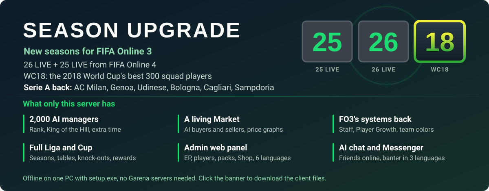

[](https://www.mediafire.com/file/505f9vtgtkfu69w/FO3ID-Season-25-26-LIVE-WC18-client.rar/file)

# FO3ID Private Server

**English** | [Bahasa Indonesia](README.id.md) | [简体中文](README.zh-CN.md) | [ไทย](README.th.md) | [Tiếng Việt](README.vi.md) | [한국어](README.ko.md)

**New:** FIFA Online 4's 25 LIVE and 26 LIVE cards as two new seasons (stats as +0, FO4's traits and season badges), with 26 LIVE as the default season, and WC18: the 2018 World Cup's best 300 squad players (at +1 each card shows its final tournament rating - 5). See `tools/fo4_season.py`.

A local private server for **FIFA Online 3 Indonesia** (Garena, client build 654420), written in
Python. Garena shut the official servers down on 2020-06-30; this project re-implements the
backend the client talks to, so the game can be played offline on one PC.

> Not affiliated with EA, Spearhead or Garena. This repository contains **no game files** (no
> client, database, assets or music) — you need your own FO3 ID install. It does **not** include,
> modify or circumvent the client's anti-cheat (XIGNCODE3 / HackShield); that is out of scope.
> Built for game preservation and research.

## What works

Tested in the real client (Indonesian UI):

- Login → manager select / create (club picker over 501 licensed clubs) → lobby (FREEROAM).
- **Single → Liga** (full season: calendar, matches, table, rewards, promotion) and **Cup**
  (draw, groups, knock-out, extra time, penalties).
- **Market** (buy / sell; a card's price follows its rating and grade: the median fifaaddict
  price of all cards with that rating), **Upgrade** (grade +1…+10), **Tukar** and
  **Tukar Scout** player trades (every Market card, not only the region's licensed ones),
  Tim inti / Tim Cadangan, squad and tactics saving.
- **Shop** with every tab (player packs, consumables, packages, MP Shop, monthly and chained
  packages, special bonus), pack opening with random grades, Item saya, Bag, daily login reward.
  **Gudang** (Item saya > Gudang): move packs and consumables there and back.
  Extra packs: **All Season +8** (any season, +1…+8) and one pack for '07 and every season
  fifaaddict lists.
- Always VIP + official PC warnet (IGR) perks, manager delete / restore, season '17 cards.
- Formation list (the club's own + the game's 33 common formations, read from the client's
  formations table) and manager / player levels: EXP after every match, player LV.1-23
  (+1 to every attribute per level), manager LV.1-100.
- Game sound and the EA Trax menu music. `tools/eatrax_song.py` puts your own song first in it,
  but the game then crashes after matches (see the known issue below).
- Admin web page on http://127.0.0.1:8088/ (EP, players, packs, gifts, daily rewards, match rewards, match settings, economy, AI chat, Shop, log)
  with a language switch (issue #15): Bahasa Indonesia, English, 简体中文, ไทย, Tiếng Việt, 한국어;
  the browser remembers the choice.
- Real club kits in matches (kit id = `teamid << 5 | type`; the old `<< 10` gave a checkerboard).
- Matches play through the second half with **team color** on (season colors used to crash it at
  half time), then show the EXP and reward screens.

Added, passing the tests but not yet checked in the client:

- **Team color** bonus itself: the starting XI gets an OVR bonus for players from the same club
  (4-5 players +1 up to 10-11 +4), nation or season (5-6 +1 up to 9-11 +3); per player only the
  best one counts.
- **Opsi > Kontrol** (keyboard and gamepad keys) is saved: the server always sends the game's own
  default key layout, so the screen can apply and save changes (it used to drop them).
- **Kit choice** on the game setting screen (home / away per side) is kept for the match.
- **Manager select** shows the club's most valuable player in the club's kit (it showed the
  game's default Barcelona player).
- Fixed crashes: the startup notice popup (empty web URL), the Beginner's Guide league tutorial
  (missing script).
- **Upgrade chance**: a base chance by target grade, times the "Rasio bonus keberhasilan" label
  the Upgrade tab shows from the material's grade (Kosong x1, Low x1.1, Normal x1.25,
  High x1.5). A failed upgrade from +5 or higher drops one grade.
- **Top 200 packs**: the extra packs now give their season's 200 best cards ("17 Top 200",
  "07 Top 200", …); **All Season Top 300 +8** gives any season's cards rated 81 and up.
- **Upgrade with a +0 card** (issue #5): a club's own +0 card keeps the target's grade at 100%
  (+4 with +0 stays +4) and a +10 may take one; the kept card leaves Tim Cadangan when it takes
  the used card's squad slot.
- **Upgrade 2.5** (the client's newer Upgrade screen, `features...enhancement.v2_5`):
  - **upgrade points**: a failed upgrade grants points; "Gunakan poin" spends them for +10%;
    buy more free in Shop > Paket (Upgrade Point 100 / 500 / 1.000);
  - **boost items** Enhancement Boost Gold / Silver / Bronze (+15 / +10 / +5%), free in
    Shop > Dapat dikonsumsi;
  - a permanent **upgrade event** (+10% for targets +1…+9, `GET /events`);
  - "Coba pengembalian lagi" gives back a grade lost to a failure, for points.
- **Tukar v2** (`trade2`): a trade is rated by its value (TP) in 15 levels, each with a maximum
  offer grade; the tab shows what another manager got "yesterday" at that level; legend-season
  cards count 1.5x; no daily or value limit. Tukar Scout keeps working beside it.
- **Tukar Scout**: the client's two other scouts, Scout Khusus (event; legend-season quest) and
  VVIP Scout (best offers; 1 billion EP quest). Scout Amatir is gone so the list fits its 5 rows
  (once it scrolled, a met quest lit another scout's card or none).
- **Upgrade team colors** (the client's "Upgraded Team"): starters of grade +2, +5 or +8 and
  higher; 5-6 / 7-8 / 9-11 of them give +1 / +2 / +3, +2 / +3 / +4 and +3 / +4 / +5 OVR. The
  single-grade ones ("+3 club" … "+10 Golden summit") need all 11 starters at that grade or higher:
  +4 (club +3/+4), +5 (silver +5…+7), +6 (Golden passion +8/+9), +7 (Golden summit +10). A
  player gets his best upgrade color on top of his best club / nation / season color.
- **Every team color the client names** (188 now):
  - 27 clubs (Real Madrid … Jeonbuk): Single team's tiers plus the club's own boost from the
    game's tooltip, e.g. Barcelona MF agility +3;
  - 30 nations: Satu Negara's tiers plus e.g. Spanyol MF ball control +2;
  - season colors under the game's names (World Best up to +5, World Legend, 2014 WC All-Star, …);
  - about 75 specials: '14 WC and EC per nation, nation BEST, MSN / BBC Trio, Arsenal
    Invincibles, Galácticos, LEGENDS, the TOP 100s, Power Header, New Star, ….

  The original boosts and player lists were server data and are gone. Player lists come from the
  player database (season, club, named players, stat limits); boosts come from the one tooltip
  line the game still has. Left out: the [Test] colors, "+2~7", "14 WC Single Nation" and four
  duplicate club entries.
- **Formasi** no longer opens with "Tidak cukup pemain" (it loads preset squad 1, which the
  server never sent). A hole in the XI (issue #7, an upgrade of two starters of one player) is
  filled from the bench, and the bench never holds a second card of a player. Every starter gets
  his `starting` data (workrate and pitch spot): without it the game shows him on the bench.
- **Tim > Peran** saves the captain and each set-piece taker (issue #8: `PUT /game/my/team/captain`
  and `/game/my/team/kickers/<0-4>` were missing). The five kicker slots (left corner, right
  corner, free kick, penalty, free kick 2) keep their place; an empty one takes a starter.
- **Tim > Locker room** works (issue #13): shirt style and sleeves, tattoo, wristband, gloves
  (keepers: 39 glove designs), socks, knee pads, 614 boots by brand, and shirt numbers (taking
  a number swaps it with its wearer). The item table `/static/db/LOCKERROOMITEM` was missing, so
  every list was empty and the boots panel broke. A player's look is saved on the card, and
  Item saya holds a permanent locker room ticket, which the game needs to show the look in matches.
  Only the client's own wristband, glove and knee pad models are offered (one of each).
- **Shop control on the admin page** (issue #10): every Shop tab (player packs, consumables,
  packages, monthly packages, Featured, MP Shop, Special bonus, chained packages). New packs (by
  season, top N, OVR, max grade, position, league), random boxes, EP cards, packages and monthly
  packages, with any of the client's 147 shop icons. Built-in products can be changed, hidden or
  given a fixed price, and the whole Shop can be made free or not. Changes go to
  `gamedata/shop.json`.
- **Simulasi Liga** coupon (item 2001, Shop > Dapat dikonsumsi): Liga's Simulasi button gives a
  match result without playing, one coupon per match. The simulation screen plays the match's goals,
  shots, saves and cards, matching the result (`eventlist` was empty, so it showed 0-0), and the
  result screen after it shows the score, player ratings and stats, possession and MOTM (it was blank),
  then the EP reward and back to the Liga menu. The button counts the coupons in Item saya
  and stayed off because the item did not exist. New coupons can be made on the admin page (type
  "Kupon Simulasi Liga").
- **Pre-match squad screen** (Liga and Cup, issue #16): swaps, subs and formation changes now
  stick and are saved to the club (`PUT /match/<id>/side/<side>/squad` had no handler, so each
  change undid itself). The formation list is filled, and the stamina bars show full (no fatigue
  is kept between matches).
- **Team FW / MF / DF ratings match the players** (issue #18): on the squad screens and in the lobby
  they are the average of the ratings the player list shows (rating at the player's slot plus
  upgrade grade, level and team color). They were built from the bare card ratings, about 12 lower.
  Before a match (Liga, Cup, Rank) the list shows no team color, so its bars leave it out too; the
  bonus still applies in the match.
- **Rekor liga tabs** (issue #19): the standings table shows (its tab broke on the missing
  `league2difficulty` table, which now also decides who goes up or down at season end). Rekorku
  lists each player's matches, rating, goals, assists, passes, tackles and saves from the season's
  played matches, and Rekor gabungan shows the season's best XI and stat leaders. Only my own
  players are counted, and simulated matches add no player stats.
- **Squad A / B / C in Formasi** (issue #20): the box left of the formation button picks one of
  three saved squads (it was empty: the server sent no squad count). Each squad keeps its own XI,
  formation and roles.
- **Controller and camera settings stay in matches** (issue #21): after Opsi > Konfirmasi the game
  reads the saved options back from the reply, which had none, so every match put back the options
  from login (keyboard, old camera). In a match, F3-F9 switch the camera (F5 = Co-op).
- **Ganti tim shows the club and your player** (issue #23): the item's club screen now shows the
  league, rival, stadium, year built and capacity, and your player in the new club's kit with
  birth date, height and weight. The server's club info had none of these, and without the kit
  the 3D player was never drawn.
- **Camera height and zoom can be changed** (issue #24): in Opsi > Kamera setting the Customise gauges
  (height and zoom; zoom, speed and swing for the Pro camera) had no value and could not be
  changed, because the server sent an empty camera setting. They now start at 10 (of 20).
- **Every national team in Tim lain** (issue #24): the International league (the last nation in
  the list) has 40 national teams, Italy, England, Germany, Spain and France among them. A
  national team's squad comes from each player's national-team link; before, only teams whose
  players had no licensed club were listed.
- **Player positions on the result screen** (issue #26): after a match the result screen's pitch
  stacked every player at the goal, because the game reports all of them as goalkeepers. The
  server now gives each player the position of their squad slot.
- **Reward cards after a match** (issue #26): the reward screen's cards were empty. Now three
  cards are dealt: the one you pick gives EP (1,000 to 10,000), a player pack (Semua Pemain or
  '14 Top 200) or a Lucky EP item, and the other two show what you could have got.
- **Draft packs and EXP capsules** (issue #27): Shop > Pak pemain sells draft packs ("06 Draft Pick 3",
  "2017 Draft Pick 5", "World Legend Draft Pick 3"). "Gunakan" opens the player picker, filled with the
  season's most valuable cards; pick N cards of that season (search by name, league or club) and one of
  them is opened. Shop > Dapat dikonsumsi sells EXP capsules (1,000, 5,000, Max = LV.23, one for LV.10
  and below, one for 2017 cards): pick a player and he gets the EXP. The draft screen's requests
  (`/item/draftpack/<id>/players/<n>`, `/transfer/price/default/<grade>`) and the capsule item type were
  missing. The admin page makes more of both (a pack's "Draft" field, item type "EXP Capsule").
- **Multiple > Rank: other managers and real matches** (issue #30): the ranked screen stopped on a UI
  error, as the server sent no divisions, rewards or ladder record. It now opens, and virtual managers
  fill its rankings: the top 3 (VS Manager Top) and a friends ranking of 20, each with a name, a club,
  a division and a record that moves through the day as they play. 100 start, joined by 1,850
  more and then 0-3 newcomers a day, up to 2,000 (doubled for issue #36). Each one plays his own style (possession, counter, high press, long ball, park
  the bus or all-out attack: formation, tactics and runs) in his club's kit, with random cards of any
  club and season around his rating, each card at its own grade (+1 for beginners up to +6 and more)
  and level. From day to day they buy and sell cards, upgrade them (a failed upgrade from +5 drops a
  grade) and level them up. Rank 1 on 1 and VS Manager play a real match against one of the five
  managers nearest your rating: squad screen, game setting, then a full match with the game's AI on
  his side, then the result, the rewards and your new rank rating, shown in the Rank screen's panels,
  in the record window (last matches, the season graph) and in Info Manager's match list. During the
  match he chats in the match chat in his own personality (kick-off, goals both ways, missed shots,
  saves, and answers when you type) and has a word on the result back on the Rank screen; the admin
  page's AI chat tab turns it off or picks its language (Indonesian, English, Vietnamese). The
  Messenger opens (it waited for a notification list the server never sent) and shows the 20 friends
  online, busy (in a Rank game) or offline by the hours they play (08:00-02:00 WIB); a friend's Info
  button shows his profile and squad.
- **The Market lives** (issue #30): virtual managers buy the cards you list ("Dijual" turns "Terjual"
  on its own within a few minutes, sooner when cheaper, with a "terjual seharga" toast and a
  notification naming the buyer; Batal and Ulang work) and list cards of their own beside the +1..+3
  stock, other grades too, a little under the market price, with the Kuantitas changing every hour.
  The card window's Market Price tab draws the last 30 days' price.
- **Economy settings** (issue #30): the admin page's new Ekonomi tab makes the game as hard as you
  like: player and pack price multipliers, a new manager's EP, the Shop's free switch, and a dynamic
  Market. There each player's price drifts day by day (up to about 13% either way), virtual managers
  now and then list bargains, and you may ask up to 105% of the price (buyers take longer), so buying
  low and selling high pays. Presets: Easy (as before: free Shop, fixed prices), Realistic (a paid
  Shop at the cards' worth, the dynamic Market, 300,000 starting EP) and Hard (prices x2, 100,000
  EP). Match EP stays on the Match rewards tab.
  While the Shop is paid, a League Simulation coupon costs what its round pays, and with the dynamic
  Market a pack costs its cards' worth at their dearest (+13%), as it can be opened on any day. The
  Strict rules switch (on in Hard) keeps Upgrade, Tukar and Scout from making EP: an Upgrade costs
  what it adds on average (a restore costs EP), a Tukar or Scout offer is worth at most the cards
  given. Off (Easy, Realistic) the game's own rules apply: an Upgrade costs 2% of the card's value, a
  restore takes upgrade points, offers have no cap.
  Items with no EP in them (boosts, upgrade points, EXP capsules, a name or team change) have a set
  price times the player price setting, so Hard doubles it.
  A change reaches a running game: the server tells it to drop the Shop list it keeps for the
  session, so a Shop tab shows the new prices the next time it opens; a tab already opened since the
  game started keeps its old prices until the game restarts. The Shop's limited-stock check no longer
  ends in "Kesalahan UI telah terjadi".
- **Ten times the AI chat** (issue #30): the virtual managers' chat has 20 lines for every moment and
  personality in each language, 2,700 in all: small talk and football talk at kick-off, reactions to
  goals, misses and saves, banter when you type, and a word on the result. No line holds a word the
  game's chat filter would hide (it also hides them inside longer words).
- **Virtual managers build their squads their own way** (issue #30): each one keeps a squad theme. It
  may be any cards near his rating; a top club (Real Madrid, Barcelona, Atletico, the Manchester clubs,
  Chelsea, Liverpool, Arsenal, Tottenham, Bayern, Dortmund, Juventus, Milan, Inter, Roma, Napoli, PSG),
  its players now or formerly; a top nation (Brazil, Argentina, Spain, Germany, France, England, Italy,
  Holland, Portugal, Belgium, Uruguay, Croatia); one of the game's team colors (a card season or a named
  set); a famous player with his club or nation mates; the meta; or one stat (pace, power, technique,
  passing, defence, shooting, young players, old school). Stronger managers follow the meta and team
  colors more often. A theme only takes cards near his rating, so it does not make his squad stronger.
- **Pre-match settings** (issue #31): Multiple > Rank's game setting screen has working steppers for
  the stadium (the 70 stadiums the client has complete), the time of day (day or night), the weather
  (clear, rain, snow, overcast: dusk at night), the match length (6, 8, 10 or 12 minutes) and the ball
  (9 balls). The last choice is kept for the next matches, Liga and Cup included; their pre-match
  screen only shows the values, so the admin page's new Match settings tab sets them too, also as
  "home team's stadium" or "random". The server fixes two labels in the client's Indonesian strings
  (day read "Waktu", overcast "Malam"); Liga/Cup's screen still calls overcast "Salju".
- **Keyboard and gamepad keep their own control preset** (issue #32): Opsi > Kontrol holds one
  preset, for the device in use, and puts the other device back to its first preset when you switch.
  The server now remembers each device's last preset and restores it after Konfirmasi (the screen
  shows it the next time it opens; matches use it from kick-off).
  To see it on the screen right away when you switch, run `python tools/control_presets.py` once
  with the game closed: it patches the client's Kontrol screen (a backup is kept; `--remove` puts
  the original back).
- **The Manager menu is filled in** (issue #33): Info Manager shows your records instead of "-":
  matches, goals, wins and win streaks in League, Cup and Rank, league titles and the level reached,
  cups won and their prize money, cards bought and sold with the dearest of each, play time, and your
  intro and photo. They count from this version on. Manager Ranking shows your team value over the
  last 30 days against your 20 friends' average and ranks you among them, with each one's change
  since yesterday.
- **Missions and achievements** (issue #33): Manager > Daftar pencapaian has badge rows (manager level,
  matches, wins, upgrades, top grade, team value, goals, Rank wins), each achievement with 5 grades of
  EP, packs and items to claim and a badge to wear once a row is done, plus a daily missions row (play,
  win, score, play Rank) that resets at 00:00 WIB. The Quest button on the top bar opens the weekly
  quests (reset on Monday at 00:00 WIB) with a countdown; a finished quest pays
  GP for the window's reward boxes (EP, Lucky EP, a pack, an upgrade boost, Kotak Emas). The server
  counts the matches you play and the upgrades that succeed. The admin page's new Misi tab turns them
  on or off and sets their language (Indonesian, English, Vietnamese) and the target and reward
  multipliers; EP rewards also follow the Ekonomi tab's player prices.
- **Officials at kick-off** (issue #33): the two assistant referees were drawn from an empty record (no
  such referee in the game's list), with heads, hair and bodies that do not exist, so they looked
  deformed in the line-up. The server now names referees the game has.
- **Vietnamese commentary from an FO3 VN client** (issue #34): with the game closed, run
  `python tools/commentary.py "<FO3 VN client folder>"`. It copies the VN client's
  `audiodata\speechdata\vie_vn` next to this client's English commentary (`eng_us`) and lists only
  Vietnamese as commentary language in `data\loc\locale.big` (a backup is kept); the game then reads
  its commentary from `vie_vn`. `--remove` brings English back.
- **Manager level rewards** (issue #35): every manager level from 2 to 100 pays FO3's level reward
  (the table on fifaaddict): EP plus items such as Top 300, Top 100 and Best packs, league 65+ and
  GK 65+ packs, League Simulation coupons, a team change coupon and EXP capsules. It goes to the Bag
  ("Hadiah naik level Lv.N"); the post-match screen shows it in its level-up popup, and its info icon
  lists the coming levels' rewards. FO3 items this server has no use for (staff packs, Red Ball, locker room
  and reward boost coupons, EXP transfer) are left out. EP rewards follow the Ekonomi tab's player
  prices.
- **Clubs** (issue #36): Klub works. Found a club (10,000 EP; "Konfirmasi" after "Klub telah dibuat"
  no longer stays grey) or join one of 60 AI clubs run by the virtual managers, each with its master,
  members, level, description and news. Managers without a club ask to join yours (Manajemen >
  permohonan, or at once while it takes members without a check). Members are online by their play
  hours, earn activity points, post on the board and talk in the chat window's Klub tab: they answer
  your greetings and messages, welcome newcomers and cheer your results, in the admin page's chat
  language (Indonesian, English, Vietnamese). The week's club points give match boosts (manager EXP,
  player EXP, EP), and 30 points of your own in a day pay 1,000 EP to the Bag. Not done: club
  matches, the club facility and the club ranking.
- **Friendly matches against AI** (issue #36): Multiple > Persahabatan shows its buttons again. Quick
  match and Random match find a virtual manager; a custom room plays vs COM (the AI picker's club
  and level, Amateur to Legendary) or a friend you invite from the list. Results count as friendlies
  in Info Manager, not in the Rank rating, and the opponent chats as in Rank.
- **Extra time and penalties in Rank and King of the Hill**: a level score after 90 minutes (Rank 1 vs 1,
  Rank Manager, King of the Hill) goes to extra time and then a penalty shootout; a shootout win counts
  as a win for the rating, the record and the match reward.
- **King of the Hill** (issue #36): the Esports regional league runs a season every month. Pick one
  of 19 Indonesian regions; its leaderboard holds that region's virtual managers, and Mulai plays
  one of them near your King of the Hill rating. The reward screen shows the points won or lost.
  The admin page's Match settings tab switches the regions to the cities of Indonesia, Singapore /
  Malaysia, Thailand or Vietnam (Vietnamese names), or a custom area written there, one "Region: city,
  city" line per region (e.g. Sa Pa added to Miền Bắc).
- **Login notice image** (issue #36): the admin page's Pengumuman tab uploads a JPG or PNG (fitted
  to the 800×720 popup, with a preview) for the Notice popup at login, or deletes it.
- **Club careers up to this season** (PR #39 by fifamvp): the player info's Karakteristik tab shows a card's
  club career (`features.seasoncare`). FO3's own careers end around 2017 and only cards of seasons 22-24
  showed one; now every card of a player with a career does, and the admin page's Aset tab (Club careers,
  or `python tools/club_history.py fetch`) fetches the careers up to the running season from Wikidata
  (years, clubs, loans; a club FO3 has no name for gets one in the client). Then press Database > Apply to the game.
- **Missing pictures from the admin page** (issue #36): the Aset tab downloads the missing player
  faces (each card's season picture and the player's), club crests, league logos and staff pictures
  from fifaaddict.com in the background (one
  kind at a time; stop and resume at any time). It runs `tools/fa_faces.py`, which also takes
  `--leagues` now. The game setting screen's "Default ball" shows the EA SPORTS ball, small flags
  use the big ones, and the cup screens get their trophy and skin.
  Player pictures fifaaddict lacks (or refuses) come from FC Online (FO4) instead (same EA player id;
  the server's new players get their FO4 cards' pictures from fifaaddict), the scan covers every card of the DB, a refusal makes it wait longer
  and go on instead of stopping, and *Download all missing* fetches every kind in one run.
- **Reward names with a language pack** (issue #36): with the Vietnamese pack the achievement list
  showed "undefined" before each reward and a UI error, as the server named reward items in
  Indonesian and Korean only. Every client language gets a name now.
- **Exhibition against AI** (issue #36): Multiple > Exhibition opens its room. Pick a licensed club with
  the arrows or Pilih Team, invite a friend from the list (a virtual manager, who joins with a club of
  his own and is ready), then Siap plays both clubs' own squads. Five matches a day; your cards earn no
  EXP from them. The Live Center opens without its two old UI errors.
- **Live Boost from EA FC's Team of the Week**: Tim > Live Boost shows this week's
  Team of the Week (from fut.gg; the server fetches the new one after its Wednesday release, so it needs
  the internet). Every card of those players gets +5 on every stat for the week (rating +5): squads,
  Market and matches. Only players FO3 has (and the 26 LIVE new players) are listed, no women's cards.
  Owning 11 of them (+1 or higher) gives 100,000 EP once a week (Terima).
- **Weekly quest editor** (admin Misi tab): the quests a week draws from (type, target, GP, an own name
  with {0} for the target), how many a week (up to 6) and the Quest window's GP reward boxes (up to 5),
  with this week's and next week's draw. A quest already done this week stays done.
- **Daily login reward in the game**: the day's reward still goes to the Bag at the first login; a
  notification now says so, and its entry opens a popup with the day number and the items.
- **Play time rewards**: a reward when today's play time reaches 10, 30 and 60 minutes (the day starts
  at 00:00 WIB; breaks over 20 minutes do not count), into the Bag with the same notification. The
  steps are set on the admin page's Daily reward tab.
- **Global chat**: the chat window's Channel tab works: your lines show, and the online virtual
  managers answer now and then and chat by themselves (in the AI chat tab's language).
- **Football talk in the global chat**: the virtual managers in the Channel tab discuss the day's
  football: Google's rising searches that are about football and Google News headlines, worldwide and of the
  ticked countries in their language (X, Instagram and TikTok need a login, Reddit refuses a server), fetched once a day. Each
  one likes to bring up his club, his star player or his country when the news has them, and others
  answer. The global news is always on; Indonesia, Malaysia, Vietnam, Thailand and Korea are ticked by
  hand on the admin page's AI chat tab, which also lists the topics now.
- **Rank rewards on the admin page**: the Match tab edits each division's season reward (main and sub)
  and the weekly wins steps, which the Rank screen shows. They are now paid into the Bag: a weekly step
  with the game's own popup on the Rank screen, a season's rewards when the next season starts (the main
  one of the mode rated best, the sub one of every other mode played).
- **King of the Hill rewards on the admin page**: the Match settings tab edits the weekly rewards (a goal
  of wins or matches in a week of days 1-7, 8-14, 15-21 or 22-28, plus a division reward with enough
  wins) and the season rewards (the division at the month's end with enough wins, plus the rank in the
  region). The King of the Hill screen shows them; once a week or season you played is over, its reward
  screen shows when King of the Hill opens and what was reached goes to the Bag.
- **Full Liga** (issue #40): a Liga season has every club of my league with a full squad (Premier
  League 20 clubs, 38 rounds; at most 24) instead of 10. EP and EXP by place are scaled to its size.
- **Clubs FO3 ID lacked**: AC Milan, Genoa, Udinese, Bologna, Cagliari and Sampdoria are back in the game
  (their kits were still in its files; `tools/fo4_season.py install` adds them with their colours read from
  the kits), with their full 26 LIVE squads (`fetch` lists them, `collect` + `import` read the stats). FO3's
  own '17 cards of their players, which sat on a national team, are at the club again. Liga's Serie A now
  has 19 clubs; the club picker lists them too. To get it: fetch, collect + import, build, then install
  with the game closed (or Terapkan ke game on the admin page).
  FO3's older cards of Italian clubs' players that sat on Rest of the World (Pirlo '06 at Milan & co.,
  322 cards) are at their club again too; `restore` puts them back.
- **Card and club database on the admin page** (issue #38): the Database tab edits one card of a player
  per season (spid = season × 1,000,000 + player id; search by name, spid or player id): the 33
  attributes, positions, preferred and weak foot, skill moves, work rates, traits, club (a transfer) and
  its 3D look (the head of any 3D row, e.g. another card's face; hair model and colour, beard, skin, eyes
  and body on a generic head, hair colour 0 being blonde; a scanned head keeps its own hair). Own
  seasons: a code, a name and a badge, filled with copies of other cards (+N to every stat if you like),
  each with its own Top 200 pack and team color. Card edits go into `gamedata/fifadb.sqlite` and
  `gamedata/card_edits.json` (original and new values: Kembalikan restores a card, and
  `tools/fo4_season.py build` puts the edits back), seasons into `gamedata/seasons.json`; Ekspor / Impor
  mod moves all of it to another server in one JSON file. The game reads its own copy of the DB: close
  it, press Terapkan ke game (runs `tools/fo4_season.py install` in the background), then start
  `play.bat`. The tab also replaces a club's crest in the client's cache (the original kept in
  `gamedata/crest_backup`) and, in the card dialog, the player's picture with your own PNG/JPG or another spid / player id's picture (from the
  cache or fifaaddict.com) for every
  card of his or one card only (issue #36; `gamedata/faces/p<id>.png`, served before the cache's; the
  3D Face field also finds heads by player name). Kits and new clubs are not done.
- **3D face from a photo** (Database tab, card dialog): for a player with a generic face, a close-up photo
  from the front becomes the face skin on another player's scanned 3D head (the donor: its head shape and
  hair come along, its eyes stay). Click 11 points on the photo (eyes, nose, mouth corners, chin, forehead,
  temples, jaw), pick the donor and press Make; Terapkan ke game puts the head in the client (`data_7.big`,
  rebuilt from its original) for every card of his that shows his player id row or a generic head. Saved
  in `gamedata/photo_heads`. It looks like the photo at match distance, with the photo's light and the
  donor's head shape.
  *Take from the picture* fills in the photo, its points and a donor from the player's FO3 picture (the cache's,
  else fifaaddict.com's): the YuNet face detector (OpenCV Zoo, MIT; fetched once into `gamedata/yunet`) finds
  the eyes, nose and mouth, the donor is the scanned head closest in skin colour and hair (colour and shape,
  from its own picture), clean-shaven. The Database tab's button does it for every generic player of the club
  who has a picture (new players without an FO3 picture are left out).
  The skin is compared picture to picture (the donor's own) and with the face texture it would bring
  (a lit picture reads lighter than a texture: dark-skinned players got light donors before); East and
  Southeast Asian players get donors of those nations and the rest the others (the donor's eyes stay);
  a smile's teeth give way to the donor's closed lips. *Make every 3D face again* remakes the existing
  ones from their pictures.
- **Classic FO3 world** (issue #38): the Database tab's *Dunia game* picks Modern (the AI clubs, the
  club picker and This Season packs use 26 LIVE cards, as before; own seasons also show in the Market
  search) or Classic FO3: every club plays FO3's own 2017 squad, This Season is '17, and the added seasons
  (25 / 26 LIVE, WC18, own seasons) are in no pack, Market, trade or virtual manager's squad: only the
  admin page gives them. Your club and collection stay as they are, and FO3's own cards are never
  overwritten (new seasons are added next to them). Saved in `gamedata/world.json`; counts after a
  restart (`play.bat`).
- **New virtual managers on demand**: the admin page's Chat AI tab has *Generate ulang*: a new crowd of
  virtual managers (names, levels, clubs, squads, styles, Rank ratings, regions, AI clubs) at once, with
  the same ids so friends, clubs and history keep working; *Kembalikan ke awal* brings the first crowd
  back. Only this button changes the crowd: it stays the same on every start (`gamedata/vm_gen.json`).
- **Own team colors on the admin page**: the Team color tab makes new team colors. A color's cards are
  picked by filters (seasons, clubs now or before, nations, players, minimum OVR, best N Market cards; a
  card meets every filter set) and it has one boost (OVR or a stat, for every position or FW / MF / DF /
  GK), in the tiers of the built-in special colors (5-6 / 7-8 / 9-11 players in the XI). Saved in
  `gamedata/teamcolors.json`; it shows in the game's Team colour list from the next login, no restart.
  The virtual managers' squads leave own colors and seasons out, and the mod file carries them too.
- **Staff** (Tim > Manajemen Staff): FO3's staff system works again. *Rekrut*: staff packs for EP
  (Basic FW / MF / DF / GK / ALL, Pro, Premium, Technical Director, Premium Medical) and, each day, a
  free ALL pack for logging in and another for playing 3 matches. *Staff yang dimiliki*: 7 role frames
  (FW, MF, DF, head coach, GK, fitness coach, technical director); a staff in its frame boosts the
  starters of its position group (fitness coach, head coach and technical director: every starter) in
  the squad lists and in matches, for a 50-match contract that is renewed for EP. *Latihan*: feed other
  staff into one to raise its grade (0.5 to 5 stars) and boosts. *Pembinaan*: send a staff abroad for
  5-10 matches to change or raise a boost. Names and boosted stats follow fifaaddict's fo3staff list;
  grades, prices and contracts are the server's own (Garena's are lost), and EP prices follow the
  Ekonomi tab's player prices. The client has pictures of 7 staff only; `python -I tools/fa_faces.py --staffs` adds the others from fifaaddict.
  Virtual managers play with their team colors, as you do, and with staff by level (one role frame
  more every 12 levels).
  Issue #41: *Rekrut* buys up to 10 staff at once; the admin page's Pak & Bag tab adds any staff (0.5-5
  stars) to the account and removes them; pack pictures go in `assets/externalAssets/shop/<icon>.png`
  (170×120: broall, brofw, bromf, brodf, brogk (Basic), silall (Pro), goldall (Premium), position (Technical Director), medical (Premium Medical), staffpack_2103 (free pack)), else the tile shows a staff picture; a language pack without the names of packs
  11-13 (the Thai one) gets them.
- **Player Growth** (Tim > Manajemen pemain > Perkembangan, FO3's "Perkembangan pemain", switched off in FO3 ID):
  a level-23 card spends tactic points ("poin taktik") on +1 steps of its stats, up to 60 points a card; a
  step costs by the stat's value (4 below 60 up to 60 from 140, fifaaddict's FO3 growth table). Grown stats
  count everywhere the game shows them, in the team ratings and in matches. Tactic points come from your
  live matches' records (goals, assists, passes, tackles, saves... plus the result; not simulations), up to
  1,200 earned; the post-match screen shows them. A "Reset poin taktik" item (Shop) gives a card's points
  back. Virtual managers' cards are grown too, more the stronger the manager.
- **Random boxes open** (Kotak Platinum and the rest, issue #12): the box screen lists its prizes
  from `staticdata.availables`, which was missing, so every box failed at "Gunakan".
- **New cards join Tim Cadangan**: a card from a pack, a trade, the Market, the Bag or the admin
  page shows "-" in Skuad's Tim column, ready for Tukar Scout. Its button moves it to Tim inti
  (green RES: Tim inti outside the 18 of the squad), which can hold the whole club (200). The admin
  page can move every Tim Cadangan card to Tim inti at once.
- **Market search** finds cards of every season: the game searches only the seasons in
  `/static/roster`, which lacked 29 seasons with Market cards (World Legend, World Best,
  '14 TOTS, …), so e.g. WL R. Gullit never showed up. The Market filter's season list works
  (issue #14: picking a season threw "cannot convert 39 to Array", as each season's `value` must
  be a list) and shows the client's season names (World Legend, 02 Chinese Legend, …). It no
  longer lists the engine cards the Liga and Cup AI clubs play with ('17 badge, rated up to 127,
  e.g. L. Messi 125; they could not be bought anyway): their season 0 left `/static/roster`, whose
  "default" entry is now the client's own '17 season (88), so "2017" shows once in the season list.
- **Every tradeable card** is on the Market, in the trades and in a pack: a card counts when
  fifaaddict lists it or the game itself marks it tradeable (`permid.transferable`). fifaaddict
  alone left out 6,599 cards (4,313 of them '17); the Market now holds 44,703. The new
  **Semua Pemain** pack can give any of them.
  FO3's untradeable event cards count too (Cafu, Kahn, Rivaldo and the other season-26 legends, the
  EL / CEL legends...): install marks every card tradeable in the client, whose Market search lists
  only those, and the Market's season list gains the seasons it lacked (26, 32, 38, 41, 57).
  A club picked in the Market search's filter lists its former players' cards too (their club careers,
  table playerhistory): install patches TransferUtil.teamidQuery in Module.big.
- **Tim > Klub > Informasi tim** (issue #9) shows the start date, home stadium and "year built /
  capacity" (`coach.career`, `coach.stadium`, `GET /stadium/<id>` from the client's own stadium
  table), and its player panel (stepper, 3D player, price, grade), which stayed empty without a
  stadium. Names from the client's database read as UTF-8 (`tools/re/eadb.py` read latin-1).
- **Pack opening glow** follows the card's value: none below 10 million EP, then levels 1-3 from
  10 million, 100 million and 1 billion EP.

Known issue, not solved: with a custom EA Trax song installed by `tools/eatrax_song.py` the game
runs out of its RAssets memory pool after every match, while the Cup screen or the lobby loads
again (crash in `FifaRNA::Crowd::PlacementData::Seats[]`); with the game's own music it does not.
It crashed the same way with the song as raw PCM (37.7 MB), as EALayer3 (6.5 MB,
`tools/re/ealayer3.py`) added as a 10th track, and as EALayer3 replacing TrackID 1 with the music
bank smaller than the shipped one, so the size of the music is not the cause. Keep the game's own
music: `python -I tools/eatrax_song.py --restore` puts it back.

Not done: online play against other people (ranked PvP, friendly, King of the Hill, club matches), Road to World, league simulation.

## Requirements

- Windows, Python 3.12, `pip install cryptography` (messenger + DB extraction).
- An FO3 ID client install (default path `D:\FO3ID\32795`; elsewhere, set `FO3_GAME` to its
  folder; the server warns at startup when it cannot find the client's image cache there).
- Optional: ffmpeg (only for `tools/eatrax_song.py`).

## Setup

1. Extract the player database from your client:
   `python extract_fifadb.py D:\FO3ID\32795` → `gamedata/fifadb.sqlite`.
2. Optional market prices: `python tools/fa_sync.py` → `gamedata/fa_prices.json` (polite
   fifaaddict.com scraper; without it prices come from a rating formula).
3. TLS certificate for the client's hardcoded API host `APSEODESK172` (self-signed is accepted):

   ```
   openssl req -x509 -newkey rsa:2048 -nodes -days 3650 -subj "/CN=APSEODESK172" -addext "subjectAltName=DNS:APSEODESK172" -keyout key.pem -out cert.pem
   python -c "open('certs/server.pem','w').write(open('cert.pem').read()+open('key.pem').read())"
   ```

4. Hosts file (as admin): `127.0.0.1 APSEODESK172`.
5. Build the launcher once (`launcher/fifalauncher.cs`, build line inside), then double-click
   **`play.bat`**: it opens the server window (`python start_all.py` = `http_config.py 443
   --tls` + `messenger.py`; close that window to stop the server) and starts the game without
   the UAC prompt.
   Before that it runs `tools/fo4_season.py install --if-needed`: when the client lacks this server's
   cards, clubs, 3D faces and patches (another PC, a fresh client, a change since the last install),
   it installs them (a minute or two, game closed); the last install is noted in
   `fo3id_install.json` in the game folder. Moving to another PC: copy `gamedata/` and `backup/` too
   (they are not in git).

6. By hand instead: `python start_all.py`, then start the client with the server arguments
   (what `launcher/fifalauncher.exe` and `launch_game.ps1` pass):

   ```
   fifazf.exe -QUICKMATCH/SERVER=127.0.0.1:28000 -QUICKMATCH/PROTOCOL=tcp -QUICKMATCH/NOTISERVER=127.0.0.1:28001 -FIFA/LAUNCHER/PID=<pid> -PUBLISHER/GARENA/TOKEN=testtoken -LOCALE/PUBLISHING_REGION=ID -DUMPTRUCK/SERVER=127.0.0.1 region id token testtoken
   ```

## Files

| File | Role |
|---|---|
| `http_config.py` | The REST backend the client calls (`https://APSEODESK172`): login, account, coaches, club creation, squad, league, cup, market, upgrade, trades, shop, items, Bag, daily reward, static tables, and `/cdn/` (serves crests and cards from the client's own `_cache`). State lives in `gamedata/state.json`. Env: `FO3_LANGUAGE` (default `ind`), `FO3_GAME` (client folder), `FO3_ASSETS`, `FO3_HALF_LENGTH`, `FO3_ADMIN_PORT`. |
| `messenger.py` | Notification server on `:28002`. Frames `<u16 LE len><u16 type=2><Blowfish-CBC(key "kueec", IV 0) of JSON+"\n">`; answers `auth`, `ping`, `signon`. `python messenger.py --selftest`. |
| `admin.py` + `admin/index.html` | Admin page (started by `http_config.py`, localhost only, no password). Its Shop tab saves to `gamedata/shop.json`. Every word on it, error messages included, is in the `I18N` tables at the end of `admin.py`, one per language; a new language is one more table, and `python admin.py` checks that every table has the same keys. |
| `responses/` | Per-endpoint JSON bodies (`/a/b/c` → `responses/a_b_c.json`, re-read on every request). Shapes come from the client's AS3 code. |
| `extract_fifadb.py` | Client player DB (`data_0.big`, RefPack + Blowfish) → SQLite. |
| `gen_teams.py` | Starter squads and club summaries from `gamedata/fifadb.sqlite`. |
| `tools/eatrax_song.py` | Puts a song first in the game's EA Trax menu music as EALayer3, replacing TrackID 1 (edits `data_0.big` / `data_1.big` by appending; `--restore` puts the originals back). Crashes the game after matches, see the known issue. |
| `tools/fa_sync.py` | fifaaddict.com price sync. |
| `tools/fo4_season.py` | Adds FIFA Online 4's 26 LIVE and 25 LIVE cards (fifaaddict data, stats as +0) as two new seasons with FO4's season badges: `fetch`, `collect` + `import`, `build`, `install` (rewrites entries of `data_0.big` in place, as its size must not change, and appends to `Label.big` and `Module.big`; `restore` puts them back). `hud` patches only `Module.big`, for a client installed before it: a match's player name boxes showed the '17 badge on every 2017 and FO4 card, now each card's own. `wc18` reads the 2018 World Cup's best 300 squad players for `build` (futwiz's FIFA 18 World Cup ratings, Wikipedia's squads and clubs): season WC18 (code 78), a card at +1 showing its World Cup rating - 5, with an "18" badge in the green of FO3's own World Cup ones; team colors "2018 WC All-Star" (the season) and "18 WC <nation>" (each nation's cards), Karakteristik from the player's FO3 card and his FIFA 18 card. |
| `tools/fa_faces.py` | Adds the player mini faces missing from the client's cache (fifaaddict serves the same 128x128 PNGs); `--crests` adds the missing club crests (most clubs have none in the cache, so the game shows a default one); `--staffs` adds the staff pictures (the cache has 7 of the 71 the server hands out). Resumable, `--remove` undoes it. Player pictures fifaaddict lacks come from FC Online (FO4); `--all` fetches every kind. |
| `tools/club_history.py` | Club careers up to the running season for the player info's Karakteristik tab: Wikidata's footballers matched to FO3's players by birth date and name, their clubs (P54: years, loans; no national or youth teams) mapped to EA team ids (FO3's own history, then the TEAMNAMES names, else a new id named in TEAMNAMES), into `gamedata/club_history.json`; `fo4_season.py install` puts them in the client. `show NAME` prints a player's rows. |
| `tools/photo_head.py` | 3D faces from photos: reads and writes the client's scanned head files (RX3 / chunkzip, a 512×512 DXT1 face texture), warps a photo onto the face texture over 11 points and blends it in (OpenCV), and rebuilds `data_7.big` with the photo heads' files (the donor's mesh and hair under a new head id from 99,000,000). `uv HEADASSETID OUT.png` saves a head's face texture. The points can come from YuNet (`landmarks`) and the donor from `donor_looks` / `suggest`. |
| `tools/draft_icons.py` | Draws the draft packs' Shop icons (the client's cache has no draft pictures) into `assets/externalAssets/shop/`, which the server serves before the client's own images; `<icon> <tag> <picks>` draws one more, for a pack made on the admin page. Needs Pillow. |
| `tools/re/` | Reverse-engineering helpers: `bigdir.py` (BIg4 archive tables), `refpack.py` (RefPack codec), `eadb.py` (EA "DB" database tables), `abc*.py` (AS3 bytecode parser / grep / schema miner), `gfxx.py` (UI SWFs), `memgrab.py`, `dbwin.py` (the client's debug output), `relay_emu.py` (PvP relay packet codec and test relay), `gamectl.ps1` (drive the client window for tests). |
| `blaze.py`, `server.py`, `test_client.py`, `analyze_capture.py` | EA Blaze framing (Fire/TDF) and a loopback test server from the first phase of the project; the client turned out to use REST + the messenger instead. |
| `analysis/` | Early client analysis scripts (strings, PE sections, network endpoints). |
| `FO3ID-private-server.md`, `reports/` | Findings and progress reports (`reports/` is in Indonesian). |

## Tests

```
python run_tests.py
```

Runs the Blaze/loopback self-tests and `test_league.py`, which drives every backend feature
(club creation, league, cup, market, upgrade, trades, shop, daily reward, admin API, manager
delete) against a fresh account. Needs `gamedata/fifadb.sqlite`.

## Contributors

- **SoloPlayer** — project owner, testing in the real client.
- **Claude** (Anthropic's AI assistant, via Claude Code) — reverse engineering and most of the
  server code, written together with the owner.

## License

[GNU GPL v3](LICENSE) for the code and documentation in this repository. FIFA Online 3, its
client, data, assets and music belong to their respective owners and are not covered.
