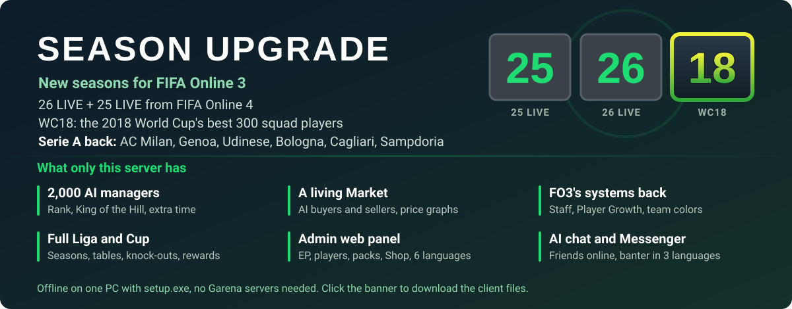

[](https://www.mediafire.com/file/ettm1y9u3s0r3t2/FO3ID-Season-25-26-LIVE-WC18-SerieA-client.zip/file)

# FO3ID Private Server

[English](README.md) | [Bahasa Indonesia](README.id.md) | [简体中文](README.zh-CN.md) | **ไทย** | [Tiếng Việt](README.vi.md) | [한국어](README.ko.md)

> แปลจาก [README.md](README.md) ถ้าเนื้อหาไม่ตรงกัน ให้ถือ README.md เป็นฉบับล่าสุด

**ใหม่:** การ์ด 25 LIVE และ 26 LIVE ของ FIFA Online 4 เป็นสองซีซันใหม่ (ค่าสถานะนับเป็น +0 ใช้คุณลักษณะและไอคอนซีซันของ FO4) โดย 26 LIVE เป็นซีซันเริ่มต้น และ WC18: 300 นักเตะที่ดีที่สุดในรายชื่อทีมฟุตบอลโลก 2018 (ที่ +1 การ์ดแต่ละใบมีเรตติ้งสุดท้ายของทัวร์นาเมนต์ - 5) ดู `tools/fo4_season.py`

เซิร์ฟเวอร์ส่วนตัวแบบโลคัลสำหรับ **FIFA Online 3 อินโดนีเซีย** (Garena, ไคลเอนต์บิลด์ 654420) เขียนด้วย
Python Garena ปิดเซิร์ฟเวอร์ทางการไปเมื่อ 2020-06-30 โปรเจกต์นี้สร้างแบ็กเอนด์ที่ไคลเอนต์คุยด้วยขึ้นมาใหม่
ทำให้เล่นเกมแบบออฟไลน์ได้บนพีซีเครื่องเดียว

> ไม่มีส่วนเกี่ยวข้องกับ EA, Spearhead หรือ Garena รีโพนี้**ไม่มีไฟล์เกม** (ไม่มีไคลเอนต์ ฐานข้อมูล
> แอสเซ็ต หรือเพลง) คุณต้องติดตั้ง FO3 ID เอง โปรเจกต์นี้**ไม่**รวม ไม่แก้ไข และไม่หลบเลี่ยงระบบกันโกงของ
> ไคลเอนต์ (XIGNCODE3 / HackShield) ซึ่งอยู่นอกขอบเขต สร้างขึ้นเพื่อการอนุรักษ์เกมและการวิจัย

หน้าจอเกมเป็นภาษาอินโดนีเซีย ชื่ออย่าง Liga, Cup, Market, Tukar, Tim inti, Tim Cadangan, Item saya,
Gudang ด้านล่างคือชื่อหน้าจอที่เกมแสดง จึงคงไว้ตามต้นฉบับเพื่อให้หาเจอในเกม

## สิ่งที่ใช้งานได้แล้ว

ทดสอบในไคลเอนต์จริงแล้ว (หน้าจอภาษาอินโดนีเซีย):

- ล็อกอิน → เลือก / สร้างผู้จัดการ (เลือกสโมสรได้จาก 501 สโมสรที่มีลิขสิทธิ์) → ล็อบบี้ (FREEROAM)
- **Single → Liga** (ครบทั้งซีซั่น: ตารางแข่ง การแข่งขัน ตารางคะแนน รางวัล การเลื่อนชั้น) และ **Cup**
  (จับสลาก รอบแบ่งกลุ่ม รอบน็อกเอาต์ ต่อเวลา ยิงจุดโทษ)
- **Market** (ซื้อ / ขาย ราคาการ์ดขึ้นกับเรตติ้งและเกรด: ค่ามัธยฐานราคาบน fifaaddict ของการ์ดทุกใบที่มี
  เรตติ้งเท่ากัน), **Upgrade** (เกรด +1…+10), การเทรดนักเตะ **Tukar** และ **Tukar Scout** (การ์ดทุกใบใน
  Market ไม่ใช่แค่ใบที่มีลิขสิทธิ์ในภูมิภาคนี้), Tim inti (ทีมหลัก) / Tim Cadangan (ทีมสำรอง),
  บันทึกสควอดและแท็กติก
- **Shop** (ร้านค้า) ครบทุกแท็บ (แพ็คนักเตะ ไอเทมใช้แล้วหมด แพ็กเกจ MP Shop แพ็กเกจรายเดือนและแพ็กเกจต่อเนื่อง
  โบนัสพิเศษ) เปิดแพ็คได้เกรดสุ่ม, Item saya (ไอเทมของฉัน), Bag (กล่องของขวัญ), รางวัลล็อกอินรายวัน
  **Gudang** (Item saya > Gudang, คลัง): ย้ายแพ็คและไอเทมใช้แล้วหมดเข้าไปและเอาออกได้
  แพ็คเพิ่มเติม: **All Season +8** (ซีซั่นใดก็ได้ +1…+8) และแพ็คหนึ่งแพ็คสำหรับ '07 และทุกซีซั่นที่ fifaaddict มี
- เป็น VIP + สิทธิ์ร้านเกมทางการ (IGR) ตลอด ลบ / กู้คืนผู้จัดการได้ การ์ดซีซั่น '17
- รายการแผนการเล่น (แผนของสโมสรเอง + 33 แผนทั่วไปของเกม อ่านจากตารางแผนการเล่นในไคลเอนต์) และเลเวล
  ผู้จัดการ / นักเตะ: ได้ EXP หลังทุกแมตช์ นักเตะ LV.1-23 (ทุกค่าพลัง +1 ต่อเลเวล) ผู้จัดการ LV.1-100
- เสียงในเกมและเพลงเมนู EA Trax `tools/eatrax_song.py` ใส่เพลงของคุณเองเป็นเพลงแรกได้ แต่หลังจากนั้นเกมจะ
  แครชหลังจบแมตช์ (ดูปัญหาที่ทราบด้านล่าง)
- หน้าเว็บแอดมินที่ http://127.0.0.1:8088/ (EP นักเตะ แพ็ค ของขวัญ รางวัลรายวัน รางวัลหลังแมตช์ ตั้งค่าแมตช์ เศรษฐกิจ แชท AI ร้านค้า บันทึก) พร้อมตัวเลือก
  ภาษา (issue #15): Bahasa Indonesia, English, 简体中文, ไทย, Tiếng Việt, 한국어 เบราว์เซอร์จะจำภาษาที่เลือกไว้
- ชุดแข่งสโมสรจริงในแมตช์ (kit id = `teamid << 5 | type` แบบเก่า `<< 10` จะแสดงเป็นลายตารางหมากรุก)
- แมตช์เล่นได้จนจบครึ่งหลังโดยเปิด **team color** (โบนัสทีม) (เดิมโบนัสซีซั่นทำให้แครชตอนพักครึ่ง) จากนั้น
  แสดงหน้าจอ EXP และรางวัล

เพิ่มแล้วและผ่านเทสต์ แต่ยังไม่ได้ตรวจในไคลเอนต์:

- ตัวโบนัส **team color** เอง: 11 ตัวจริงได้โบนัส OVR สำหรับนักเตะจากสโมสรเดียวกัน (4-5 คน +1 สูงสุด 10-11
  คน +4) ชาติเดียวกันหรือซีซั่นเดียวกัน (5-6 คน +1 สูงสุด 9-11 คน +3) นักเตะแต่ละคนนับเฉพาะโบนัสที่ดีที่สุด
- **Opsi > Kontrol** (ปุ่มคีย์บอร์ดและจอยเกม) บันทึกได้: เซิร์ฟเวอร์ส่งผังปุ่มเริ่มต้นของเกมเสมอ หน้าจอนั้นจึง
  นำการเปลี่ยนแปลงไปใช้และบันทึกได้ (เดิมการเปลี่ยนแปลงหายไป)
- **การเลือกชุดแข่ง** ในหน้าตั้งค่าแมตช์ (เหย้า / เยือนแต่ละฝั่ง) ถูกนำไปใช้ในแมตช์
- **หน้าเลือกผู้จัดการ** แสดงนักเตะที่มีมูลค่าสูงสุดของสโมสรในชุดของสโมสร (เดิมแสดงนักเตะบาร์เซโลนาที่เป็น
  ค่าเริ่มต้นของเกม)
- แก้แครช: ป๊อปอัปประกาศตอนเริ่มเกม (URL เว็บว่าง) และบทสอนลีก Beginner's Guide (ไม่มีสคริปต์)
- **โอกาสอัปเกรด**: โอกาสพื้นฐานตามเกรดเป้าหมาย คูณด้วยป้าย "Rasio bonus keberhasilan" ที่แท็บ Upgrade แสดง
  ตามเกรดของการ์ดวัตถุดิบ (Kosong x1, Low x1.1, Normal x1.25, High x1.5) อัปเกรดล้มเหลวจาก +5 ขึ้นไปจะลด
  หนึ่งเกรด
- **แพ็ค Top 200**: แพ็คเพิ่มเติมตอนนี้ให้การ์ดดีที่สุด 200 ใบของซีซั่นนั้น ("17 Top 200", "07 Top 200", …)
  **All Season Top 300 +8** ให้การ์ดซีซั่นใดก็ได้ที่เรตติ้ง 81 ขึ้นไป
- **อัปเกรดด้วยการ์ด +0** (issue #5): การ์ด +0 ของสโมสรเองรักษาเกรดของการ์ดเป้าหมายไว้ได้ 100% (+4 ใช้ +0
  ยังคง +4) และการ์ด +10 ก็ใช้ได้ การ์ดที่เก็บไว้จะออกจาก Tim Cadangan เมื่อเข้าแทนที่ช่องในสควอดของการ์ดที่ถูกใช้
- **Upgrade 2.5** (หน้าจอ Upgrade ใหม่ของไคลเอนต์ `features...enhancement.v2_5`):
  - **แต้มอัปเกรด**: อัปเกรดล้มเหลวจะได้แต้ม "Gunakan poin" ใช้แต้มเพื่อเพิ่ม +10% ซื้อเพิ่มได้ฟรีใน
    Shop > Paket (Upgrade Point 100 / 500 / 1.000)
  - **ไอเทมบูสต์** Enhancement Boost Gold / Silver / Bronze (+15 / +10 / +5%) ฟรีใน Shop > Dapat dikonsumsi
  - **อีเวนต์อัปเกรด** ถาวร (+10% สำหรับเป้าหมาย +1…+9, `GET /events`)
  - "Coba pengembalian lagi" คืนเกรดที่เสียไปจากการล้มเหลวได้ด้วยแต้ม
- **Tukar v2** (`trade2`): การเทรดถูกประเมินตามมูลค่า (TP) ใน 15 ระดับ แต่ละระดับมีเกรดข้อเสนอสูงสุด แท็บแสดงว่า
  ผู้จัดการคนอื่นได้อะไร "เมื่อวาน" ในระดับนั้น การ์ดซีซั่นตำนานนับ 1.5 เท่า ไม่มีจำกัดรายวันหรือมูลค่า
  Tukar Scout ยังใช้ได้ควบคู่กัน
- **Tukar Scout**: แมวมองอีกสองคนของไคลเอนต์ คือ Scout Khusus (อีเวนต์ เควสต์ซีซั่นตำนาน) และ VVIP Scout
  (ข้อเสนอดีที่สุด เควสต์ 1 พันล้าน EP) เอา Scout Amatir ออกเพื่อให้รายการพอดี 5 แถว (เดิมเมื่อรายการเลื่อนได้
  เควสต์ที่ทำสำเร็จจะไปเปิดการ์ดของแมวมองคนอื่นหรือไม่เปิดเลย)
- **โบนัสทีมจากเกรดอัปเกรด** ("Upgraded Team" ในไคลเอนต์): ตัวจริงที่เกรด +2, +5 หรือ +8 ขึ้นไป 5-6 / 7-8 /
  9-11 คนให้ +1 / +2 / +3, +2 / +3 / +4 และ +3 / +4 / +5 OVR แบบเกรดเดียว ("+3 club" … "+10 Golden summit")
  ต้องให้ตัวจริงทั้ง 11 คนอยู่ที่เกรดนั้นหรือสูงกว่า: +4 (club +3/+4), +5 (silver +5…+7), +6 (Golden passion
  +8/+9), +7 (Golden summit +10) นักเตะได้โบนัสอัปเกรดที่ดีที่สุดเพิ่มจากโบนัสสโมสร / ชาติ / ซีซั่นที่ดีที่สุด
- **team color ทุกอันที่มีชื่อในไคลเอนต์** (ตอนนี้ 188 อัน):
  - 27 สโมสร (Real Madrid … Jeonbuk): ระดับของ Single team บวกโบนัสเฉพาะของสโมสรจาก tooltip ในเกม เช่น
    Barcelona MF agility +3
  - 30 ชาติ: ระดับของ Satu Negara บวกเช่น Spanyol MF ball control +2
  - โบนัสซีซั่นตามชื่อในเกม (World Best สูงสุด +5, World Legend, 2014 WC All-Star, …)
  - โบนัสพิเศษราว 75 อัน: '14 WC และ EC แต่ละชาติ, nation BEST, MSN / BBC Trio, Arsenal Invincibles,
    Galácticos, LEGENDS, TOP 100, Power Header, New Star, …

  ค่าบูสต์และรายชื่อนักเตะต้นฉบับเป็นข้อมูลฝั่งเซิร์ฟเวอร์และหายไปแล้ว รายชื่อนักเตะมาจากฐานข้อมูลนักเตะ
  (ซีซั่น สโมสร นักเตะที่ระบุชื่อ ขีดจำกัดค่าพลัง) ค่าบูสต์มาจาก tooltip บรรทัดเดียวที่เกมยังมีอยู่ ที่ไม่ได้ใส่:
  โบนัส [Test], "+2~7", "14 WC Single Nation" และรายการสโมสรซ้ำสี่รายการ
- **Formasi** (แผนการเล่น) ไม่ขึ้น "Tidak cukup pemain" (นักเตะไม่พอ) ตอนเปิดอีกแล้ว (หน้าจอนี้โหลดสควอดพรีเซ็ต
  1 ซึ่งเซิร์ฟเวอร์ไม่เคยส่งมา) ช่องว่างใน 11 ตัวจริง (issue #7 อัปเกรดตัวจริงสองใบของนักเตะคนเดียวกัน) จะถูกเติม
  จากม้านั่งสำรอง และม้านั่งสำรองจะไม่มีการ์ดใบที่สองของนักเตะคนเดียวกัน ตัวจริงทุกคนได้ข้อมูล `starting`
  (workrate และตำแหน่งในสนาม) ถ้าไม่มี เกมจะแสดงเขาไว้บนม้านั่งสำรอง
- **Tim > Peran** บันทึกกัปตันและผู้เตะลูกตั้งเตะแต่ละคน (issue #8: ไม่มี `PUT /game/my/team/captain` และ
  `/game/my/team/kickers/<0-4>`) ช่องผู้เตะทั้งห้า (เตะมุมซ้าย เตะมุมขวา ฟรีคิก จุดโทษ ฟรีคิก 2) อยู่ที่เดิม
  ช่องที่ว่างจะใช้ตัวจริงหนึ่งคน
- **Tim > Locker room** (ห้องแต่งตัว) ใช้งานได้ (issue #13): แบบเสื้อและแขนเสื้อ รอยสัก ริสต์แบนด์ ถุงมือ (ผู้รักษาประตู:
  ถุงมือ 39 แบบ) ถุงเท้า สนับเข่า รองเท้า 614 คู่แยกตามแบรนด์ และเบอร์เสื้อ (เลือกเบอร์ที่มีคนใช้อยู่จะสลับกับ
  คนนั้น) เดิมไม่มีตารางไอเทม `/static/db/LOCKERROOMITEM` ทุกรายการจึงว่างและแผงรองเท้าพัง ลุคของนักเตะ
  บันทึกไว้บนการ์ด และ Item saya มีตั๋วห้องแต่งตัวแบบถาวร ซึ่งเกมต้องใช้เพื่อแสดงลุคนั้นในแมตช์ ริสต์แบนด์
  ถุงมือ และสนับเข่ามีให้เฉพาะโมเดลของไคลเอนต์เอง (อย่างละหนึ่ง)
- **การควบคุมร้านค้าในหน้าแอดมิน** (issue #10): ทุกแท็บของร้านค้า (แพ็คนักเตะ ไอเทมใช้แล้วหมด แพ็กเกจ
  แพ็กเกจรายเดือน แนะนำ MP Shop โบนัสพิเศษ แพ็กเกจต่อเนื่อง) สร้างแพ็คใหม่ได้ (ตามซีซั่น top N, OVR เกรดสูงสุด
  ตำแหน่ง ลีก) กล่องสุ่ม การ์ด EP แพ็กเกจ และแพ็กเกจรายเดือน ด้วยไอคอนใดก็ได้จาก 147 ไอคอนร้านค้าของไคลเอนต์
  สินค้าเดิมแก้ไข ซ่อน หรือตั้งราคาคงที่ได้ และตั้งให้ทั้งร้านฟรีหรือไม่ฟรีได้ การเปลี่ยนแปลงบันทึกที่
  `gamedata/shop.json`
- คูปอง **Simulasi Liga** (จำลองลีก) (ไอเทม 2001, Shop > Dapat dikonsumsi): ปุ่ม Simulasi ของ Liga ให้ผลแมตช์
  โดยไม่ต้องเล่น หนึ่งคูปองต่อหนึ่งแมตช์ หน้าจอจำลองเล่นประตู การยิง การเซฟ และใบเหลืองแดงของแมตช์ตามผล
  (เดิม `eventlist` ว่าง จึงแสดง 0-0) และหน้าผลหลังจากนั้นแสดงสกอร์ เรตติ้งและสถิตินักเตะ การครองบอล และ MOTM
  (เดิมว่างเปล่า) จากนั้นเป็นรางวัล EP แล้วกลับเมนู Liga ปุ่มนี้นับคูปองใน Item saya และเคยใช้ไม่ได้เพราะไม่มี
  ไอเทมนี้ สร้างคูปองใหม่ได้ในหน้าแอดมิน (ประเภท "คูปองจำลองลีก")
- **หน้าจอสควอดก่อนแมตช์** (Liga และ Cup, issue #16): การสลับตำแหน่ง การเปลี่ยนตัว และการเปลี่ยนแผนการเล่น
  คงอยู่และบันทึกลงสโมสรแล้ว (`PUT /match/<id>/side/<side>/squad` ไม่มีตัวจัดการ ทุกการเปลี่ยนแปลงจึงย้อนกลับเอง)
  รายการแผนการเล่นมีข้อมูลแล้ว และแถบสตามินาแสดงเต็ม (ไม่เก็บความเหนื่อยล้าข้ามแมตช์)
- **ค่า FW / MF / DF ของทีมตรงกับนักเตะ** (issue #18): ในหน้าจอสควอดและล็อบบี้ เป็นค่าเฉลี่ยของเรตติ้งที่รายชื่อนักเตะแสดง
  (เรตติ้งในตำแหน่งที่ยืน บวกเกรดอัปเกรด เลเวล และทีมคัลเลอร์) เดิมคิดจากเรตติ้งการ์ดเปล่า ต่ำกว่าราว 12
  ก่อนแข่ง (ลีก คัพ แรงก์) รายชื่อนักเตะไม่นับทีมคัลเลอร์ แถบค่าตรงนั้นจึงไม่นับด้วย แต่โบนัสยังมีผลในแมตช์
- **แท็บ Rekor liga** (issue #19): ตารางคะแนนแสดงแล้ว (แท็บเดิมพังเพราะไม่มีตาราง `league2difficulty` ซึ่งตอนนี้ใช้ตัดสิน
  การเลื่อนชั้นและตกชั้นตอนจบฤดูกาลด้วย) Rekorku แสดงจำนวนนัด เรตติ้ง ประตู แอสซิสต์ จ่ายบอล แท็กเกิล และการเซฟของนักเตะแต่ละคน
  จากแมตช์ที่เล่นในฤดูกาลนี้ และ Rekor gabungan แสดง 11 ตัวจริงยอดเยี่ยมและผู้นำสถิติของฤดูกาล นับเฉพาะนักเตะของเรา
  และแมตช์จำลองไม่เพิ่มสถิตินักเตะ
- **Squad A / B / C ใน Formasi** (issue #20): ช่องทางซ้ายของปุ่มแผนการเล่นใช้เลือกหนึ่งในสามทีมที่บันทึกไว้
  (เดิมว่างเพราะเซิร์ฟเวอร์ไม่ได้ส่งจำนวนทีม) แต่ละทีมเก็บตัวจริง แผนการเล่น และหน้าที่ของตัวเอง
- **การตั้งค่าคอนโทรลเลอร์และกล้องคงอยู่ในแมตช์** (issue #21): หลังกด Opsi > Konfirmasi เกมจะอ่านตัวเลือกที่บันทึก
  กลับจากคำตอบของเซิร์ฟเวอร์ ซึ่งเดิมไม่มี ทุกแมตช์จึงกลับไปใช้ตัวเลือกตอนล็อกอิน (คีย์บอร์ด กล้องเดิม) ในแมตช์
  F3-F9 ใช้เปลี่ยนกล้อง (F5 = Co-op)
- **Ganti tim (เปลี่ยนทีม) แสดงสโมสรและนักเตะของเรา** (issue #23): หน้าจอสโมสรของไอเท็มนี้แสดงลีก คู่ปรับ
  สนาม ปีที่สร้าง และความจุ พร้อมนักเตะของเราในชุดของสโมสรใหม่ วันเกิด ส่วนสูง และน้ำหนัก เดิมข้อมูลสโมสรจาก
  เซิร์ฟเวอร์ไม่มีสิ่งเหล่านี้ และเมื่อไม่มีชุดแข่ง นักเตะ 3D จะไม่ถูกวาดเลย
- **ปรับความสูงและซูมกล้องได้** (issue #24): ใน Opsi > Kamera setting เกจ Customise (ความสูงและซูม สำหรับกล้อง Pro
  คือซูม ความเร็ว และการแกว่ง) เดิมไม่มีค่าและปรับไม่ได้ เพราะเซิร์ฟเวอร์ส่งค่ากล้องว่างมา ตอนนี้เริ่มที่ 10 (จาก 20)
- **ทีมชาติทั้งหมดอยู่ใน Tim lain** (issue #24): ลีก International (ประเทศสุดท้ายในรายการ) มีทีมชาติ 40 ทีม
  รวมถึงอิตาลี อังกฤษ เยอรมนี สเปน และฝรั่งเศส ผู้เล่นของทีมชาติมาจากการเชื่อมโยงทีมชาติของผู้เล่นแต่ละคน
  เดิมมีเฉพาะทีมชาติที่ผู้เล่นไม่มีสโมสรที่มีลิขสิทธิ์
- **ตำแหน่งผู้เล่นในหน้าผลการแข่งขัน** (issue #26): หลังจบแมตช์ สนามในหน้าผลการแข่งขันแสดงผู้เล่นทุกคนซ้อนกันที่ประตู
  เพราะเกมรายงานผู้เล่นทุกคนเป็นผู้รักษาประตู ตอนนี้เซิร์ฟเวอร์กำหนดตำแหน่งของผู้เล่นแต่ละคนตามช่องในทีม
- **การ์ดรางวัลหลังแมตช์** (issue #26): การ์ดในหน้ารางวัลเดิมว่างเปล่า ตอนนี้มีการ์ดสามใบ ใบที่คุณเลือกให้ EP
  (1,000 ถึง 10,000) แพ็กผู้เล่น (Semua Pemain หรือ '14 Top 200) หรือไอเท็ม Lucky EP ส่วนอีกสองใบแสดงรางวัลที่อาจได้รับ
- **แพ็คดราฟต์และแคปซูล EXP** (issue #27): Shop > Pak pemain ขายแพ็คดราฟต์ ("06 Draft Pick 3",
  "2017 Draft Pick 5", "World Legend Draft Pick 3") "Gunakan" เปิดหน้าเลือกนักเตะ ซึ่งใส่การ์ดที่แพงที่สุดของ
  ซีซั่นนั้นไว้ก่อน เลือกการ์ด N ใบของซีซั่นนั้น (ค้นหาตามชื่อ ลีก หรือสโมสร) แล้วจะได้หนึ่งใบในนั้น
  Shop > Dapat dikonsumsi ขายแคปซูล EXP (1,000, 5,000, Max = LV.23, หนึ่งอันสำหรับ LV.10 ลงไป,
  หนึ่งอันสำหรับการ์ด 2017): เลือกนักเตะแล้วเขาได้ EXP นั้น เดิมไม่มีคำขอของหน้าดราฟต์
  (`/item/draftpack/<id>/players/<n>`, `/transfer/price/default/<grade>`) และไม่มีประเภทไอเท็มแคปซูล
  หน้า admin สร้างเพิ่มได้ทั้งสองแบบ (ช่อง "Draft" ของแพ็ค, ประเภทไอเท็ม "EXP Capsule")
- **Multiple > Rank: ผู้จัดการคนอื่นและการแข่งขันจริง** (issue #30): หน้าจอแรงก์เคยค้างที่ข้อผิดพลาด UI
  เพราะเซิร์ฟเวอร์ไม่ส่งดิวิชัน รางวัล และสถิติแลดเดอร์ ตอนนี้เปิดได้แล้ว และมีผู้จัดการเสมือนอยู่ในตารางอันดับ:
  3 อันดับแรก (VS Manager Top) และอันดับเพื่อน 20 คน แต่ละคนมีชื่อ สโมสร ดิวิชัน
  และสถิติที่ขยับไปตลอดวันตามแมตช์ที่พวกเขาเล่น เริ่มต้นมี 100 คน บวกอีก 1,850 คน และมีหน้าใหม่เข้ามาวันละ 0-3 คน จนถึง 2,000 คน (เพิ่มเป็นสองเท่าใน issue #36)
  แต่ละคนเล่นสไตล์ของตัวเอง (ครองบอล สวนกลับ เพรสซิ่งสูง บอลยาว จอดรถบัส หรือบุกสุดตัว: แผนการเล่น แท็กติก
  และการวิ่งของนักเตะ) ในชุดแข่งของสโมสรตัวเอง ใช้การ์ดสุ่มจากทุกสโมสรและทุกซีซั่นในระดับเรตติ้งของเขา
  การ์ดแต่ละใบมีเกรด (+1 สำหรับมือใหม่ ไปจนถึง +6 ขึ้นไป) และเลเวลของตัวเอง ในแต่ละวันพวกเขาซื้อขายการ์ด
  อัปเกรดการ์ด (อัปเกรดล้มเหลวจาก +5 จะลดหนึ่งเกรด) และเพิ่มเลเวล Rank 1 on 1 และ VS Manager
  ได้แข่งจริงกับหนึ่งในห้าผู้จัดการที่เรตติ้งใกล้เคียงกับคุณที่สุด: หน้าจอสควอด ตั้งค่าเกม แล้วแข่งเต็มเกมโดย
  AI ของเกมคุมฝั่งคู่แข่ง จากนั้นจึงแสดงผล รางวัล และเรตติ้งแรงก์ใหม่ของคุณ ซึ่งดูได้ในแผงของหน้าจอแรงก์
  ในหน้าต่างสถิติ (แมตช์ล่าสุด กราฟประจำซีซั่น) และในรายการแมตช์ของ Info Manager
  ระหว่างแมตช์คู่แข่งจะพิมพ์ในแชทแมตช์ตามนิสัยของตัวเอง (ตอนเริ่มเกม เมื่อมีประตูทั้งสองฝ่าย ยิงพลาด ผู้รักษาประตูเซฟ
  และตอบเมื่อคุณพิมพ์) แล้วพูดถึงผลการแข่งขันเมื่อกลับมาที่หน้าจอแรงก์ แท็บแชท AI ในหน้าแอดมินใช้ปิดหรือเลือกภาษา
  (อินโดนีเซีย อังกฤษ เวียดนาม) Messenger เปิดได้แล้ว (เดิมค้างรอรายการแจ้งเตือนที่เซิร์ฟเวอร์ไม่เคยส่งมา)
  และแสดงเพื่อน 20 คนว่าออนไลน์ ไม่ว่าง (อยู่ในเกมแรงก์) หรือออฟไลน์ ตามช่วงเวลาที่พวกเขาเล่น (08:00-02:00 WIB)
  ปุ่ม Info ของเพื่อนแสดงโปรไฟล์และสควอดของเขา
- **Market มีชีวิตชีวา** (issue #30): ผู้จัดการเสมือนซื้อการ์ดที่คุณตั้งขาย ("Dijual" เปลี่ยนเป็น "Terjual"
  เองภายในไม่กี่นาที ยิ่งตั้งราคาถูกยิ่งขายได้เร็ว พร้อมป๊อปอัป "terjual seharga" และการแจ้งเตือนที่บอกชื่อผู้ซื้อ
  ปุ่ม Batal และ Ulang ใช้งานได้) และตั้งขายการ์ดของตัวเองควบคู่กับสต็อก +1..+3 ที่มีอยู่ รวมถึงเกรดอื่นด้วย
  ในราคาต่ำกว่าราคาตลาดเล็กน้อย โดย Kuantitas เปลี่ยนทุกชั่วโมง
  แท็บ Market Price ในหน้าต่างการ์ดแสดงกราฟราคาย้อนหลัง 30 วัน
- **การตั้งค่าเศรษฐกิจ** (issue #30): แท็บใหม่ Ekonomi (เศรษฐกิจ) ในหน้าแอดมินปรับความยากของเกมได้ตามใจ:
  ตัวคูณราคา (นักเตะและแพ็ค) EP เริ่มต้นของผู้จัดการใหม่ สวิตช์ร้านค้าฟรี และตลาดแบบไดนามิก
  ในตลาดแบบนี้ ราคาของนักเตะแต่ละคนจะค่อย ๆ ขยับไปทุกวัน (ขึ้นหรือลงได้สูงสุดราว 13%) ผู้จัดการเสมือน
  จะนำการ์ดราคาถูกมาตั้งขายเป็นครั้งคราว และคุณตั้งราคาขายได้ถึง 105% ของราคานั้น (แต่ผู้ซื้อจะใช้เวลานานขึ้น)
  ซื้อถูกแล้วขายแพงจึงทำกำไรได้ พรีเซ็ต: "ง่าย" (เหมือนเดิม: ร้านค้าฟรี ราคาคงที่) "สมจริง" (ร้านค้าเสียเงิน
  ตามมูลค่าการ์ด ตลาดแบบไดนามิก และ EP เริ่มต้น 300,000) และ "ยาก" (ราคา x2 และ EP เริ่มต้น 100,000)
  ส่วน EP จากแมตช์ยังตั้งได้ที่แท็บรางวัลหลังแมตช์เหมือนเดิม
  เมื่อร้านค้าเสียเงิน คูปองจำลองลีกมีราคาเท่ากับรางวัลของหนึ่งรอบ และเมื่อเปิดตลาดแบบไดนามิก แพ็คจะมีราคาเท่า
  มูลค่าการ์ดตอนราคาสูงสุด (+13%) เพราะเก็บแพ็คไว้เปิดวันไหนก็ได้ กฎเข้มงวด (เปิดในโหมดยาก) ทำให้อัปเกรด Tukar
  และ Scout ปั๊ม EP ไม่ได้: ค่าอัปเกรดเท่ากับมูลค่าที่เพิ่มขึ้นโดยเฉลี่ย (การกู้คืนจ่ายด้วย EP) ข้อเสนอของ Tukar และ
  Scout มีมูลค่าไม่เกินการ์ดที่ให้ไป หากปิด (ง่าย สมจริง) ใช้กฎของเกมเดิม: ค่าอัปเกรด 2% ของมูลค่าการ์ด
  การกู้คืนใช้แต้มอัปเกรด และข้อเสนอไม่มีเพดาน
  สินค้าที่ไม่มี EP อยู่ข้างใน (บูสต์ แต้มอัปเกรด แคปซูล EXP การเปลี่ยนชื่อหรือเปลี่ยนทีม) ใช้ราคาพื้นฐานคูณตัวคูณราคานักเตะ
  ดังนั้นในโหมด "ยาก" ราคาจะเป็นสองเท่า
  การเปลี่ยนแปลงมีผลกับเกมที่เปิดอยู่ทันที: เซิร์ฟเวอร์จะบอกให้เกมทิ้งรายการ Shop ที่เก็บไว้ตลอดเซสชัน แท็บ Shop
  จึงแสดงราคาใหม่เมื่อเปิดครั้งถัดไป ส่วนแท็บที่เปิดไปแล้วตั้งแต่เริ่มเกมจะยังใช้ราคาเดิมจนกว่าจะรีสตาร์ทเกม
  และการตรวจสต็อกจำกัดของ Shop จะไม่ขึ้น "Kesalahan UI telah terjadi" อีก
- **AI Chat มากขึ้นสิบเท่า** (issue #30): แชทของผู้จัดการเสมือนมี 20 ประโยคสำหรับทุกจังหวะและทุกบุคลิกในแต่ละภาษา
  รวม 2,700 ประโยค: คุยเล่นและคุยเรื่องฟุตบอลตอนเริ่มเกม ปฏิกิริยาต่อประตู การยิงพลาด และการเซฟ การหยอกล้อตอนที่คุณ
  พิมพ์ และความเห็นต่อผลการแข่งขัน ไม่มีประโยคใดมีคำที่ตัวกรองแชทของเกมจะซ่อน (ตัวกรองนี้ซ่อนคำที่อยู่ในคำที่ยาวกว่าด้วย)
- **ผู้จัดการเสมือนจัดทีมในแบบของตัวเอง** (issue #30): แต่ละคนมีธีมทีมประจำตัว อาจเป็นการ์ดอะไรก็ได้ที่ใกล้เรตติ้งของเขา
  สโมสรระดับท็อป (เรอัล มาดริด, บาร์เซโลนา, แอตเลติโก, สองทีมแมนเชสเตอร์, เชลซี, ลิเวอร์พูล, อาร์เซนอล, ท็อตแนม, บาเยิร์น,
  ดอร์ทมุนด์, ยูเวนตุส, มิลาน, อินเตอร์, โรมา, นาโปลี, เปแอสเช) ทั้งนักเตะปัจจุบันและอดีต ชาติระดับท็อป (บราซิล, อาร์เจนตินา,
  สเปน, เยอรมนี, ฝรั่งเศส, อังกฤษ, อิตาลี, ฮอลแลนด์, โปรตุเกส, เบลเยียม, อุรุกวัย, โครเอเชีย) ทีมคัลเลอร์ของเกม (ซีซันการ์ด
  หรือชุดที่มีชื่อ) นักเตะดังหนึ่งคนพร้อมเพื่อนร่วมสโมสรหรือร่วมชาติ เมตา หรือค่าพลังด้านเดียว (ความเร็ว พละกำลัง เทคนิค
  การผ่านบอล การป้องกัน การยิง นักเตะดาวรุ่ง หรือนักเตะรุ่นเก๋า) ผู้จัดการที่เก่งกว่ามักเลือกเมตาและทีมคัลเลอร์บ่อยกว่า
  ธีมจะเลือกเฉพาะการ์ดที่ใกล้เรตติ้งของเขา ทีมจึงไม่ได้แข็งขึ้นเพราะธีม
- **การตั้งค่าก่อนแมตช์** (issue #31): หน้าจอตั้งค่าเกมของ Multiple > Rank มีปุ่มลูกศรที่ใช้งานได้จริง
  สำหรับเลือกสนาม (70 สนามที่ไคลเอนต์มีครบสมบูรณ์) ช่วงเวลา (กลางวันหรือกลางคืน) สภาพอากาศ (แจ่มใส ฝนตก
  หิมะ ครึ้มฟ้า: กลางคืนเป็นยามพลบค่ำ) ความยาวแมตช์ (6, 8, 10 หรือ 12 นาที) และลูกบอล (9 แบบ)
  ค่าที่เลือกล่าสุดจะถูกเก็บไว้ใช้ในแมตช์ถัด ๆ ไป รวมถึง Liga และ Cup ด้วย แต่หน้าจอก่อนแมตช์ของ Liga
  และ Cup แสดงค่าเท่านั้น แท็บใหม่ "ตั้งค่าแมตช์" ในหน้าแอดมินจึงตั้งค่าเหล่านี้ได้ด้วย รวมถึงตั้งเป็น
  "สนามของทีมเจ้าบ้าน" หรือ "สุ่ม" ได้ เซิร์ฟเวอร์แก้ป้ายสองอันในข้อความภาษาอินโดนีเซียของไคลเอนต์
  (กลางวันเคยขึ้นว่า "Waktu" และครึ้มฟ้าขึ้นว่า "Malam") ส่วนหน้าจอของ Liga/Cup ยังเรียกครึ้มฟ้าว่า "Salju"
- **คีย์บอร์ดและจอยเกมจำพรีเซ็ตปุ่มแยกกัน** (issue #32): Opsi > Kontrol เก็บพรีเซ็ตได้ชุดเดียว
  สำหรับอุปกรณ์ที่ใช้อยู่ และเมื่อสลับอุปกรณ์ อุปกรณ์อีกตัวจะกลับไปใช้พรีเซ็ตแรก
  ตอนนี้เซิร์ฟเวอร์จำพรีเซ็ตล่าสุดของแต่ละอุปกรณ์ไว้ และคืนค่าให้หลังกด Konfirmasi
  (หน้าจอจะแสดงพรีเซ็ตนั้นเมื่อเปิดครั้งถัดไป ส่วนแมตช์ใช้พรีเซ็ตนั้นตั้งแต่เริ่มเกม)
  ถ้าต้องการให้หน้าจอแสดงพรีเซ็ตทันทีที่สลับอุปกรณ์ ให้ปิดเกมแล้วรัน `python tools/control_presets.py` หนึ่งครั้ง
  สคริปต์จะแพตช์หน้าจอ Kontrol ของไคลเอนต์ (มีไฟล์สำรองไว้ และ `--remove` จะคืนไฟล์เดิม)
- **เมนู Manager มีข้อมูลแล้ว** (issue #33): Info Manager แสดงสถิติของคุณแทน "-": จำนวนแมตช์ ประตู
  ชัยชนะ และชนะติดต่อกันในลีก คัพ และแรงก์ แชมป์ลีกและระดับที่ไปถึง คัพที่ชนะพร้อมเงินรางวัล การ์ดที่ซื้อและขาย
  พร้อมใบที่แพงที่สุด เวลาเล่น รวมถึงคำแนะนำตัวและรูปของคุณ โดยเริ่มนับตั้งแต่เวอร์ชันนี้ Manager Ranking
  แสดงมูลค่าทีมของคุณใน 30 วันล่าสุดเทียบกับค่าเฉลี่ยของเพื่อน 20 คน และอันดับของคุณในกลุ่มนั้น
  พร้อมการเปลี่ยนอันดับจากเมื่อวาน
- **ภารกิจและความสำเร็จ** (issue #33): Manager > Daftar pencapaian มีแถวเหรียญตรา (เลเวลผู้จัดการ แมตช์
  ชัยชนะ การอัปเกรด เกรดสูงสุด มูลค่าทีม ประตู ชัยชนะแรงก์) แต่ละความสำเร็จมี 5 เกรดที่กดรับรางวัลเป็น EP
  แพ็ค และไอเท็มได้ และใส่เหรียญตราได้เมื่อทำครบทั้งแถว รวมถึงแถวภารกิจรายวัน (เล่น ชนะ ยิงประตู เล่นแรงก์)
  ที่รีเซ็ตเวลา 00:00 WIB ปุ่ม Quest บนแถบด้านบนเปิดเควสต์รายสัปดาห์ (รีเซ็ตวันจันทร์เวลา 00:00 WIB)
  พร้อมนับถอยหลัง เควสต์ที่ทำเสร็จจะให้ GP ไว้แลกกล่องรางวัลในหน้าต่างนั้น (EP, Lucky EP,
  แพ็ค, บูสต์อัปเกรด, Kotak Emas) เซิร์ฟเวอร์นับแมตช์ที่คุณเล่นและการอัปเกรดที่สำเร็จ แท็บ Misi ใหม่ในหน้าแอดมิน
  ใช้เปิดหรือปิด ตั้งภาษา (อินโดนีเซีย อังกฤษ เวียดนาม) และตัวคูณเป้าหมายกับรางวัล รางวัล EP
  ยังปรับตามราคานักเตะในแท็บเศรษฐกิจด้วย
- **ผู้ตัดสินตอนเริ่มเกม** (issue #33): ผู้ช่วยผู้ตัดสินสองคนถูกสร้างจากข้อมูลว่าง (ไม่มีผู้ตัดสินคนนั้นในรายชื่อของเกม)
  หัว ผม และร่างกายจึงเป็นไฟล์ที่ไม่มีอยู่จริง และดูผิดรูปตอนเข้าแถว ตอนนี้เซิร์ฟเวอร์ใช้ผู้ตัดสินที่มีอยู่ในเกม
- **เสียงบรรยายภาษาเวียดนามจากไคลเอนต์ FO3 VN** (issue #34): ปิดเกมแล้วรัน
  `python tools/commentary.py "<โฟลเดอร์ไคลเอนต์ FO3 VN>"` สคริปต์จะคัดลอก `audiodata\speechdata\vie_vn` ของไคลเอนต์ VN
  มาไว้ข้างเสียงบรรยายภาษาอังกฤษของไคลเอนต์นี้ (`eng_us`) และตั้งให้มีแค่ภาษาเวียดนามเป็นภาษาเสียงบรรยายใน
  `data\loc\locale.big` (มีไฟล์สำรองไว้) จากนั้นเกมจะอ่านเสียงบรรยายจาก `vie_vn` และ `--remove` จะกลับไปใช้ภาษาอังกฤษ
- **รางวัลเลเวลอัปของผู้จัดการ** (issue #35): ทุกเลเวลผู้จัดการตั้งแต่ 2 ถึง 100 จะได้รางวัลเลเวลแบบ FO3 (ตารางบน fifaaddict):
  EP พร้อมไอเท็ม เช่น แพ็ค Top 300, Top 100 และ Best แพ็คลีก 65+ และ GK 65+ คูปองจำลองลีก คูปองเปลี่ยนทีม และ EXP capsule
  รางวัลจะเข้า Bag ("Hadiah naik level Lv.N") หน้าจอหลังแมตช์จะแสดงในป๊อปอัปเลเวลอัป และไอคอนข้อมูลจะแสดงรางวัลของเลเวลถัดไป
  ไอเท็ม FO3 ที่เซิร์ฟเวอร์นี้ไม่ได้ใช้ (แพ็คสตาฟ, Red Ball, คูปองล็อกเกอร์รูมและบูสต์รางวัล, การโอน EXP) จะไม่ให้ รางวัล EP
  ปรับตามราคานักเตะในแท็บเศรษฐกิจ
- **คลับ** (issue #36): Klub ใช้งานได้แล้ว ก่อตั้งคลับเอง (ใช้ 10,000 EP ส่วนปุ่ม "Konfirmasi" หลัง
  "Klub telah dibuat" ไม่ค้างเป็นสีเทาอีกแล้ว) หรือเข้าร่วมหนึ่งใน 60 คลับ AI ที่ผู้จัดการเสมือนดูแล แต่ละคลับมีหัวหน้าคลับ สมาชิก
  เลเวล คำอธิบาย และข่าวสาร ผู้จัดการที่ยังไม่มีคลับจะขอเข้าคลับของคุณ (Manajemen > permohonan
  หรือเข้าได้ทันทีถ้าคลับรับสมาชิกโดยไม่ต้องตรวจสอบ) สมาชิกออนไลน์ตามช่วงเวลาที่พวกเขาเล่น สะสมแต้มกิจกรรม โพสต์บนบอร์ด
  และคุยในแท็บ Klub ของหน้าต่างแชท: ตอบคำทักทายและข้อความของคุณ ต้อนรับสมาชิกใหม่
  และแสดงความยินดีหรือให้กำลังใจตามผลแมตช์ของคุณ เป็นภาษาแชทที่ตั้งไว้ในหน้าแอดมิน (อินโดนีเซีย อังกฤษ เวียดนาม)
  แต้มคลับของสัปดาห์นั้นให้บูสต์ในแมตช์ (EXP ผู้จัดการ, EXP นักเตะ, EP) และเมื่อคุณเก็บแต้มของตัวเองได้ 30 แต้มในหนึ่งวัน จะได้
  1,000 EP เข้า Bag ยังไม่ได้ทำ: แมตช์คลับ สิ่งอำนวยความสะดวกของคลับ และอันดับคลับ
- **เกมกระชับมิตรกับ AI** (issue #36): Multiple > Persahabatan แสดงปุ่มต่าง ๆ อีกครั้ง Quick match และ
  Random match จะหาผู้จัดการเสมือนมาเป็นคู่แข่ง ห้องที่สร้างเองเล่นแบบ vs COM (สโมสรและเลเวลที่เลือกในตัวเลือก AI ตั้งแต่
  Amateur ถึง Legendary) หรือเล่นกับเพื่อนที่คุณเชิญจากรายชื่อ ผลการแข่งขันนับเป็นเกมกระชับมิตรใน Info Manager
  ไม่นับในเรตติ้งแรงก์ และคู่แข่งจะแชทเหมือนในแรงก์
- **ต่อเวลาและดวลจุดโทษใน Rank และ King of the Hill**: ถ้าเสมอหลัง 90 นาที (Rank 1 vs 1, Rank Manager, King of
  the Hill) จะต่อเวลาแล้วดวลจุดโทษ ชนะจุดโทษนับเป็นชนะทั้งเรตติ้ง สถิติ และรางวัลแมตช์
- **King of the Hill** (issue #36): ลีกภูมิภาคของ Esports มีซีซั่นใหม่ทุกเดือน เลือกหนึ่งใน 19 ภูมิภาคของอินโดนีเซีย
  ตารางอันดับของภูมิภาคนั้นประกอบด้วยผู้จัดการเสมือนในภูมิภาค และ Mulai จะจับคุณแข่งกับหนึ่งในนั้นที่มีเรตติ้งใกล้กับเรตติ้ง
  King of the Hill ของคุณ หน้าจอรางวัลแสดงแต้มที่ได้หรือเสีย
  แท็บตั้งค่าการแข่งขันในหน้าแอดมินเปลี่ยนภูมิภาคเป็นเมืองของอินโดนีเซีย สิงคโปร์/มาเลเซีย ไทย หรือเวียดนาม (ชื่อภาษาเวียดนาม) หรือพื้นที่กำหนดเองที่เขียนบรรทัดละ "ภูมิภาค: เมือง, เมือง"
  (เช่น เพิ่ม Sa Pa ใน Miền Bắc) ได้
- **รูปประกาศตอนล็อกอิน** (issue #36): แท็บ Pengumuman (ประกาศ) ในหน้าแอดมินใช้อัปโหลดรูป JPG หรือ PNG
  (ปรับให้พอดีกับป๊อปอัป 800×720 พร้อมภาพตัวอย่าง) สำหรับป๊อปอัปประกาศตอนล็อกอิน หรือลบรูปนั้นออก
- **ประวัติสโมสรถึงฤดูกาลนี้** (PR #39 โดย fifamvp): แท็บ Karakteristik ในข้อมูลนักเตะแสดงประวัติสโมสรของการ์ด
  (`features.seasoncare`) ประวัติเดิมของ FO3 จบราวปี 2017 และแสดงเฉพาะการ์ดซีซัน 22-24 ตอนนี้แสดงในการ์ดทุกใบของ
  นักเตะที่มีประวัติ และแท็บ Aset ในหน้าแอดมิน (ประวัติสโมสร หรือ `python tools/club_history.py fetch`) ดึงประวัติ
  ถึงฤดูกาลปัจจุบันจาก Wikidata (ปี สโมสร การยืมตัว; สโมสรที่ FO3 ไม่มีชื่อจะได้ชื่อในไคลเอนต์) จากนั้นกด ฐานข้อมูล > ใช้กับเกม
- **ดาวน์โหลดรูปที่ขาดผ่านหน้าแอดมิน** (issue #36): แท็บ Aset (รูปภาพ) ดาวน์โหลดรูปหน้านักเตะ (รูปซีซันของการ์ดแต่ละใบและรูปของนักเตะ) โลโก้สโมสร โลโก้ลีก
  และรูปสตาฟที่ยังไม่มีจาก fifaaddict.com ในเบื้องหลัง (ทีละประเภท หยุดและทำต่อได้ทุกเมื่อ) โดยรัน `tools/fa_faces.py`
  ซึ่งตอนนี้รับ `--leagues` และ `--uniforms` (รูปชุดแข่งในหน้าเลือกสโมสร, issue #43) ได้ด้วย "Default ball" ในหน้าจอตั้งค่าเกมแสดงลูกบอล EA SPORTS ธงเล็กใช้รูปธงใหญ่ และหน้าจอ Cup
  มีถ้วยรางวัลและสกินของตัวเอง
  รูปนักเตะที่ fifaaddict ไม่มี (หรือปฏิเสธ) จะดึงจาก FC Online (FO4) แทน (player id ของ EA เดียวกัน นักเตะใหม่ของเซิร์ฟเวอร์ได้รูปการ์ด FO4 จาก fifaaddict)
  การสแกนครอบคลุมการ์ดทุกใบในฐานข้อมูล เมื่อถูกปฏิเสธจะรอนานขึ้นแล้วทำต่อแทนการหยุด และ *ดาวน์โหลดทั้งหมดที่ยังไม่มี* ดึงทุกประเภทในครั้งเดียว
- **ชื่อรางวัลเมื่อใช้แพ็คภาษา** (issue #36): เมื่อใช้แพ็คภาษาเวียดนาม รายการความสำเร็จแสดง "undefined" หน้ารางวัลทุกอัน
  และเกิดข้อผิดพลาด UI เพราะเซิร์ฟเวอร์ตั้งชื่อไอเท็มรางวัลไว้แค่ภาษาอินโดนีเซียและภาษาเกาหลี ตอนนี้ทุกภาษาของไคลเอนต์มีชื่อแล้ว
- **Exhibition กับ AI** (issue #36): Multiple > Exhibition เปิดห้องของโหมดนี้ได้แล้ว เลือกสโมสรลิขสิทธิ์ด้วยปุ่มลูกศรหรือ
  Pilih Team ชวนเพื่อนจากรายชื่อ (ผู้จัดการเสมือน ซึ่งจะเข้ามาพร้อมสโมสรที่เลือกเองและพร้อมทันที) แล้วกด Siap
  เพื่อเล่นด้วยสควอดจริงของทั้งสองสโมสร เล่นได้วันละ 5 แมตช์ การ์ดของคุณไม่ได้ EXP จากแมตช์นี้ Live Center
  เปิดได้โดยไม่มีข้อผิดพลาด UI สองอย่างที่เคยขึ้น
- **Live Boost จาก Team of the Week ของ EA FC**: Tim > Live Boost แสดง Team of the Week
  ของสัปดาห์นี้ (จาก fut.gg; เซิร์ฟเวอร์ดึงสัปดาห์ใหม่หลังประกาศวันพุธ จึงต้องใช้อินเทอร์เน็ต) การ์ดทุกใบของนักเตะเหล่านั้น
  ได้ +5 ทุกค่าพลังตลอดสัปดาห์ (เรตติ้ง +5): สควอด ตลาดซื้อขาย และในแมตช์ แสดงเฉพาะนักเตะที่ FO3 มี (และนักเตะใหม่ของ
  26 LIVE) ไม่มีการ์ดนักเตะหญิง มีครบ 11 คน (+1 ขึ้นไป) ได้ 100,000 EP สัปดาห์ละครั้ง (Terima)
- **ตัวแก้ไขเควสต์รายสัปดาห์** (แท็บ Misi ในหน้าแอดมิน): รายการเควสต์ที่สุ่มทุกสัปดาห์ (ประเภท เป้าหมาย GP ชื่อเอง
  โดยใช้ {0} แทนเป้าหมาย) จำนวนต่อสัปดาห์ (สูงสุด 6) และกล่องรางวัล GP ในหน้าต่าง Quest (สูงสุด 5) พร้อมตัวอย่าง
  สัปดาห์นี้และสัปดาห์หน้า เควสต์ที่ทำสำเร็จแล้วในสัปดาห์นี้ยังคงสำเร็จ
- **รางวัลล็อกอินรายวันในเกม**: รางวัลของวันยังเข้ากระเป๋าตอนล็อกอินครั้งแรก ตอนนี้มีการแจ้งเตือนด้วย และกดรายการนั้น
  จะเปิดป๊อปอัปที่บอกว่าเป็นวันที่เท่าไรพร้อมไอเทม
- **รางวัลเวลาเล่น**: ได้รางวัลเมื่อเวลาเล่นวันนี้ถึง 10, 30 และ 60 นาที (วันเริ่มนับ 00:00 WIB; ช่วงพักเกิน 20 นาที
  ไม่นับ) เข้ากระเป๋าพร้อมการแจ้งเตือนแบบเดียวกัน ตั้งเป้าหมายได้ในแท็บ Daily reward ของหน้าแอดมิน
- **แชททั่วโลก**: แท็บ Channel ในหน้าต่างแชทใช้งานได้แล้ว ข้อความของคุณแสดงขึ้น และผู้จัดการเสมือนที่ออนไลน์จะตอบ
  เป็นครั้งคราวและคุยกันเอง (ในภาษาของแท็บแชท AI)
- **คุยฟุตบอลในแชททั่วโลก**: ผู้จัดการเสมือนในแท็บ Channel คุยเรื่องฟุตบอลของวันนั้น: คำค้นหา Google ที่กำลังมาแรง
  ในภูมิภาคหนึ่งที่เกี่ยวกับฟุตบอล และพาดหัว Google News ในภาษานั้น (X, Instagram และ TikTok ต้องล็อกอิน Reddit
  ปฏิเสธเซิร์ฟเวอร์) ดึงวันละครั้ง ผู้จัดการแต่ละคนชอบยกเรื่องสโมสร นักเตะคนโปรด หรือประเทศของตัวเองเมื่อมีในข่าว
  แล้วคนอื่นตอบ ข่าวโลกเปิดอยู่เสมอ ส่วนอินโดนีเซีย มาเลเซีย เวียดนาม ไทย และเกาหลีติ๊กเลือกเองได้ในแท็บแชท AI
  ของหน้าแอดมิน ซึ่งแสดงหัวข้อปัจจุบันด้วย
- **รางวัลแรงก์ในหน้าแอดมิน**: แท็บ Match แก้รางวัลซีซันของแต่ละดิวิชัน (หลักและรอง) และขั้นจำนวนชัยชนะรายสัปดาห์
  ซึ่งแสดงในหน้าแรงก์ด้วย ตอนนี้รางวัลเข้ากระเป๋าจริง: ขั้นรายสัปดาห์พร้อมป๊อปอัปของเกมในหน้าแรงก์ รางวัลซีซันเมื่อ
  ซีซันใหม่เริ่ม (รางวัลหลักจากโหมดที่เรตติ้งดีที่สุด รางวัลรองจากทุกโหมดอื่นที่เล่น)
- **รางวัล King of the Hill ในหน้าแอดมิน**: แท็บตั้งค่าการแข่งขันแก้รางวัลรายสัปดาห์ (เป้าหมายจำนวนชนะหรือจำนวนแมตช์
  ในสัปดาห์ของวันที่ 1-7, 8-14, 15-21 หรือ 22-28 และรางวัลดิวิชันเมื่อชนะพอ) และรางวัลซีซัน (ดิวิชันตอนสิ้นเดือนเมื่อชนะพอ
  และอันดับในภูมิภาค) หน้า King of the Hill แสดงรางวัลเหล่านี้ เมื่อสัปดาห์หรือซีซันที่เล่นจบลง หน้ารางวัลจะแสดง
  เมื่อเปิด King of the Hill และรางวัลที่ทำได้จะเข้ากระเป๋า
- **ลีกเต็ม** (issue #40): ซีซัน Liga มีทุกสโมสรในลีกของเราที่มีทีมครบ (Premier League 20 สโมสร 38 นัด
  สูงสุด 24) แทนที่จะเป็น 10 EP และ EXP ตามอันดับปรับตามจำนวนทีม
- **สโมสรที่ FO3 ID ไม่มี**: AC Milan, Genoa, Udinese, Bologna, Cagliari และ Sampdoria กลับมาในเกม (ชุดแข่งยังอยู่ในไฟล์เกม
  `tools/fo4_season.py install` เพิ่มสโมสรพร้อมสีที่อ่านจากชุดแข่ง) พร้อมทีม 26 LIVE ครบ (`fetch` ดึงรายชื่อ `collect` + `import`
  อ่านค่าพลัง) การ์ด '17 ของนักเตะเหล่านี้ที่เคยอยู่ทีมชาติกลับมาอยู่สโมสร Serie A ใน Liga มี 19 สโมสร และหน้าเลือกสโมสรก็แสดง
  วิธีใช้: fetch, collect + import, build แล้ว install ตอนปิดเกม (หรือ Terapkan ke game ในหน้าแอดมิน)
  การ์ด FO3 รุ่นเก่าของนักเตะสโมสรอิตาลีที่เคยอยู่ Rest of the World (เช่น Pirlo '06 ที่ Milan; 322 ใบ) ก็กลับมาอยู่สโมสรด้วย
  `restore` คืนค่าเดิม
- **ฐานข้อมูลการ์ดและสโมสรในหน้าแอดมิน** (issue #38): แท็บ Database แก้การ์ดนักเตะทีละใบตามซีซัน
  (spid = ซีซัน × 1,000,000 + player id; ค้นหาด้วยชื่อ spid หรือ player id): ค่าพลัง 33 ค่า ตำแหน่ง
  เท้าถนัดและเท้าข้างไม่ถนัด สกิลมูฟ เวิร์กเรต ทักษะพิเศษ สโมสร (ย้ายทีม) และรูปลักษณ์ 3D (ศีรษะจากแถว 3D ใดก็ได้
  เช่นใบหน้าของการ์ดใบอื่น; ทรงผมและสีผม หนวดเครา สีผิว ตา และรูปร่างบนศีรษะแบบทั่วไป สีผม 0 = บลอนด์;
  ศีรษะแบบสแกนใช้ผมของตัวเอง) ซีซันที่สร้างเอง: รหัส ชื่อ และตรา เติมด้วยการ์ดที่คัดลอกมา (เพิ่ม +N ทุกค่าได้)
  แต่ละซีซันมีแพ็ก Top 200 และทีมคัลเลอร์ของตัวเอง การแก้ไขการ์ดบันทึกลง `gamedata/fifadb.sqlite` และ
  `gamedata/card_edits.json` (ค่าเดิมและค่าใหม่: Kembalikan กู้คืนการ์ด และ `tools/fo4_season.py build` ใส่กลับให้)
  ซีซันอยู่ใน `gamedata/seasons.json`; Ekspor / Impor mod ย้ายทั้งหมดไปเซิร์ฟเวอร์อื่นด้วยไฟล์ JSON ไฟล์เดียว
  เกมอ่านสำเนาฐานข้อมูลของตัวเอง: ปิดเกม กด Terapkan ke game (รัน `tools/fo4_season.py install` เบื้องหลัง)
  แล้วเปิด `play.bat` แท็บนี้ยังเปลี่ยนโลโก้สโมสรในแคชของไคลเอนต์ได้ (โลโก้เดิมเก็บใน `gamedata/crest_backup`)
  และในหน้าต่างการ์ดเปลี่ยนรูปนักเตะเป็น PNG/JPG ของคุณเองหรือรูปของ spid / player id อื่น
  (จากแคชหรือ fifaaddict.com) ได้ สำหรับการ์ดทุกใบหรือการ์ดเดียว (issue #36;
  `gamedata/faces/p<id>.png` ส่งก่อนรูปในแคช; ช่องใบหน้า 3D ค้นหาศีรษะด้วยชื่อนักเตะได้)
  ยังไม่มีชุดแข่งและสโมสรใหม่
- **ใบหน้า 3D จากรูปถ่าย** (แท็บ Database หน้าต่างการ์ด): สำหรับนักเตะที่ใช้ใบหน้าทั่วไป รูปถ่ายระยะใกล้จากด้านหน้า
  จะกลายเป็นผิวหน้าบนศีรษะ 3D ที่สแกนแล้วของนักเตะอื่น (ผู้ให้: รูปศีรษะและผมติดมาด้วย ดวงตายังเป็นของผู้ให้)
  คลิก 11 จุดบนรูป (ตา จมูก มุมปาก คาง หน้าผาก ขมับ กราม) เลือกผู้ให้ แล้วกดสร้าง Terapkan ke game จะใส่ศีรษะนี้
  ลงไคลเอนต์ (`data_7.big` สร้างใหม่จากต้นฉบับ) ให้การ์ดทุกใบของนักเตะคนนั้นที่ใช้แถว player id หรือศีรษะทั่วไป
  บันทึกใน `gamedata/photo_heads` จากระยะกล้องในแมตช์จะดูคล้ายรูปถ่าย โดยแสงมาจากรูปและรูปศีรษะเป็นของผู้ให้
  *ดึงจากรูปนักเตะ* ใส่รูป จุด และผู้ให้จากรูป FO3 ของนักเตะ (จากแคช ถ้าไม่มีจาก fifaaddict.com): ตัวตรวจจับใบหน้า YuNet
  (OpenCV Zoo, MIT; ดาวน์โหลดครั้งเดียวไว้ที่ `gamedata/yunet`) หาตา จมูก และปาก ผู้ให้คือศีรษะสแกนที่สีผิวและผม
  (สีและทรง จากรูปของผู้ให้เอง) ใกล้ที่สุดและไม่มีเครา ปุ่มในแท็บ Database ทำให้นักเตะใบหน้าทั่วไปทุกคนในสโมสรที่มีรูป
  (นักเตะใหม่ที่ไม่มีรูป FO3 จะถูกข้าม)
  สีผิวเทียบรูปกับรูป (รูปของผู้ให้เอง) และกับเท็กซ์เจอร์ใบหน้าที่จะได้มา (รูปที่สว่างอ่านค่าได้สว่างกว่าเท็กซ์เจอร์ เดิมนักเตะผิวเข้ม
  ได้ผู้ให้ผิวขาว) นักเตะเอเชียตะวันออก/ตะวันออกเฉียงใต้ได้ผู้ให้จากชาติเหล่านั้น ที่เหลือได้จากชาติอื่น (ใช้ตาของผู้ให้)
  ฟันตอนยิ้มถูกแทนด้วยริมฝีปากปิดของผู้ให้ *สร้างหน้า 3D ทั้งหมดใหม่จากรูปไอคอน* สร้างหน้าที่มีอยู่ใหม่
- **โลก FO3 คลาสสิก** (issue #38): *Dunia game* ในแท็บ Database เลือกโมเดิร์น (สโมสร AI การเลือกสโมสร
  และแพ็ก This Season ใช้การ์ด 26 LIVE เหมือนเดิม ซีซันที่สร้างเองแสดงในการค้นหาตลาดด้วย) หรือคลาสสิก FO3:
  ทุกสโมสรใช้สกวอด 2017 ดั้งเดิม This Season = '17 และซีซันที่เพิ่มมา (25 / 26 LIVE, WC18, ซีซันที่สร้างเอง)
  จะไม่มีในแพ็ก ตลาด การเทรด หรือสกวอดของผู้จัดการเสมือน: ให้ได้ผ่านหน้าแอดมินเท่านั้น สโมสรและคอลเลกชันของคุณไม่เปลี่ยน
  และการ์ดดั้งเดิมของ FO3 ไม่ถูกเขียนทับ (ซีซันใหม่เพิ่มไว้ข้าง ๆ) บันทึกใน `gamedata/world.json` มีผลหลังรีสตาร์ต (`play.bat`)
- **สร้างผู้จัดการเสมือนใหม่ได้ทุกเมื่อ**: แท็บ Chat AI ในหน้าแอดมินมี *Generate ulang*: ผู้จัดการเสมือนกลุ่มใหม่
  (ชื่อ เลเวล สโมสร สกวอด สไตล์ เรตติ้ง Rank ภูมิภาค สโมสร AI) ทันที ไอดีเดิมจึงเพื่อน สโมสร และประวัติยังใช้ได้
  *Kembalikan ke awal* นำกลุ่มแรกกลับมา มีเพียงปุ่มนี้ที่เปลี่ยนกลุ่ม ทุกครั้งที่เปิดจะเหมือนเดิม (`gamedata/vm_gen.json`)
- **ทีมคัลเลอร์ที่สร้างเองในหน้าแอดมิน**: แท็บ Team color สร้างทีมคัลเลอร์ใหม่ได้ การ์ดสมาชิกเลือกด้วยตัวกรอง
  (ซีซัน สโมสรปัจจุบันหรือเดิม ประเทศ นักเตะ OVR ขั้นต่ำ การ์ดตลาดที่ดีที่สุด N ใบ; การ์ดต้องผ่านทุกตัวกรองที่กรอก)
  และมีบูสต์หนึ่งอย่าง (OVR หรือค่าพลังหนึ่งค่า สำหรับทุกตำแหน่งหรือ FW / MF / DF / GK) ระดับเหมือนทีมคัลเลอร์พิเศษในเกม
  (5-6 / 7-8 / 9-11 คนใน XI) บันทึกใน `gamedata/teamcolors.json` แสดงในรายการ Team colour ของเกมตั้งแต่ล็อกอินครั้งถัดไป
  ไม่ต้องรีสตาร์ต สกวอดของผู้จัดการเสมือนไม่ใช้ทีมคัลเลอร์และซีซันที่สร้างเอง และไฟล์ม็อดรวมไว้ด้วย
- **สตาฟ** (Tim > Manajemen Staff): ระบบสตาฟของ FO3 กลับมาใช้ได้อีกครั้ง *Rekrut* (รับสมัคร): แพ็คสตาฟด้วย EP
  (Basic FW / MF / DF / GK / ALL, Pro, Premium, ผู้อำนวยการเทคนิค, Premium Medical) และทุกวันมีแพ็ค ALL ฟรีหนึ่งแพ็ค
  เมื่อล็อกอิน อีกหนึ่งแพ็คเมื่อเล่นครบ 3 แมตช์ *Staff yang dimiliki* (สตาฟที่มี): กรอบตำแหน่ง 7 กรอบ (FW, MF, DF,
  หัวหน้าโค้ช, GK, โค้ชฟิตเนส, ผู้อำนวยการเทคนิค) สตาฟในกรอบของตนจะบูสต์ผู้เล่นตัวจริงในกลุ่มตำแหน่งนั้น (โค้ชฟิตเนส
  หัวหน้าโค้ช และผู้อำนวยการเทคนิค: ผู้เล่นตัวจริงทุกคน) ทั้งในรายชื่อทีมและในแมตช์ ตลอดสัญญา 50 แมตช์ที่ต่อได้ด้วย EP
  *Latihan* (ฝึก): ใส่สตาฟคนอื่นเข้าไปเพื่อเพิ่มเกรด (0.5 ถึง 5 ดาว) และบูสต์ *Pembinaan* (ศึกษาต่อ): ส่งสตาฟไป
  ต่างประเทศ 5-10 แมตช์ เพื่อเปลี่ยนหรือเพิ่มบูสต์ ชื่อและค่าสถานะที่บูสต์อ้างอิงจากรายการ fo3staff ของ fifaaddict ส่วนเกรด
  ราคา และสัญญาเป็นค่าของเซิร์ฟเวอร์เอง (ข้อมูลของ Garena สูญหายไปแล้ว) และราคา EP ปรับตามราคานักเตะในแท็บเศรษฐกิจ
  ไคลเอนต์มีรูปสตาฟแค่ 7 คน `python -I tools/fa_faces.py --staffs` จะเพิ่มรูปที่เหลือจาก fifaaddict
  ผู้จัดการเสมือนลงแข่งพร้อมโบนัสทีมคัลเลอร์ของตนเหมือนคุณ และมีสตาฟตามเลเวล (เพิ่มหนึ่งกรอบทุก 12 เลเวล)
  Issue #41: *Rekrut* ซื้อสตาฟได้ครั้งละสูงสุด 10 คน; แท็บ Pak & Bag ในหน้าแอดมินเพิ่มสตาฟคนใดก็ได้ (0.5-5 ดาว) เข้าบัญชีและลบได้;
  รูปแพ็ควางที่ `assets/externalAssets/shop/<icon>.png` (170×120: broall, brofw, bromf, brodf, brogk (Basic), silall (Pro), goldall (Premium), position (Technical Director), medical (Premium Medical), staffpack_2103 (free pack)) ถ้าไม่มีจะใช้รูปสตาฟ;
  แพ็คภาษาที่ไม่มีชื่อแพ็ค 11-13 (ภาษาไทย) จะได้ชื่อเหล่านั้น
- **พัฒนานักเตะ** (Tim > Manajemen pemain > Perkembangan ฟีเจอร์ FO3 ที่ FO3 ID ปิดไว้): การ์ดเลเวล 23 ใช้แต้มแท็กติก
  เพิ่มค่าพลังทีละ +1 สูงสุด 60 แต้มต่อการ์ด ราคาต่อขั้นตามค่าพลัง (4 เมื่อต่ำกว่า 60 จนถึง 60 เมื่อตั้งแต่ 140 ตารางของ
  fifaaddict) ค่าพลังที่เพิ่มมีผลทุกหน้าจอ เรตติ้งทีม และในแมตช์ แต้มแท็กติกได้จากสถิติแมตช์ที่เล่นเอง (ประตู แอสซิสต์
  จ่ายบอล แท็กเกิล เซฟ... และผลการแข่ง ไม่รวมการจำลอง) สูงสุดรวม 1,200 แสดงในหน้าหลังแมตช์ ไอเท็ม "Reset poin taktik"
  (Shop) คืนแต้มของการ์ดหนึ่งใบ การ์ดของผู้จัดการเสมือนก็พัฒนาด้วย ยิ่งผู้จัดการเก่งยิ่งมาก
- **กล่องสุ่มเปิดได้** (Kotak Platinum และอื่น ๆ, issue #12): หน้าจอกล่องแสดงรางวัลจาก
  `staticdata.availables` ซึ่งเดิมไม่มี ทุกกล่องจึงล้มเหลวตอนกด "Gunakan" (ใช้)
- **การ์ดใหม่เข้า Tim Cadangan**: การ์ดจากแพ็ค การเทรด Market, Bag หรือหน้าแอดมิน จะแสดง "-" ในคอลัมน์ Tim
  ของ Skuad พร้อมใช้กับ Tukar Scout ปุ่มของการ์ดจะย้ายการ์ดไป Tim inti (RES สีเขียว: Tim inti ที่อยู่นอก 18 คน
  ในสควอด) ซึ่งจุนักเตะได้ทั้งสโมสร (200) หน้าแอดมินย้ายการ์ดทั้งหมดใน Tim Cadangan ไป Tim inti ได้ในครั้งเดียว
- **การค้นหาใน Market** เจอการ์ดทุกซีซั่น: เกมค้นหาเฉพาะซีซั่นใน `/static/roster` ซึ่งขาดไป 29 ซีซั่นที่มีการ์ดใน
  Market (World Legend, World Best, '14 TOTS, …) เช่น WL R. Gullit จึงไม่เคยขึ้นมา รายการซีซั่นในตัวกรองของ
  Market ใช้งานได้แล้ว (issue #14: การเลือกซีซั่นเกิดข้อผิดพลาด "cannot convert 39 to Array" เพราะ `value`
  ของแต่ละซีซั่นต้องเป็นลิสต์) และแสดงชื่อซีซั่นจากไคลเอนต์ (World Legend, 02 Chinese Legend, …)
  การ์ดเอนจินที่สโมสร AI ใน Liga และ Cup ใช้ลงเล่นไม่ขึ้นมาในการค้นหาอีกแล้ว (ไอคอน '17 เรตติ้งสูงถึง 127
  เช่น L. Messi 125 และซื้อไม่ได้อยู่แล้ว): ซีซั่น 0 ของการ์ดเหล่านี้ถูกเอาออกจาก `/static/roster` ซึ่งตอนนี้
  รายการ "default" เป็นซีซั่น '17 ของไคลเอนต์เอง (88) "2017" จึงแสดงในรายการซีซั่นเพียงครั้งเดียว
- **การ์ดทุกใบที่เทรดได้** อยู่ใน Market ในการเทรด และในแพ็ค: การ์ดจะนับเมื่อ fifaaddict มีรายชื่อ หรือเกมเอง
  ระบุว่าเทรดได้ (`permid.transferable`) ถ้าใช้ fifaaddict อย่างเดียวจะขาดไป 6,599 ใบ (ในนั้น 4,313 ใบเป็น '17)
  ตอนนี้ Market มี 44,703 ใบ แพ็คใหม่ **Semua Pemain** (นักเตะทั้งหมด) ให้การ์ดใบใดก็ได้ในนั้น
  การ์ดอีเวนต์ของ FO3 ที่เคยเทรดไม่ได้ก็รวมด้วย (Cafu, Kahn, Rivaldo และตำนานซีซัน 26 อื่นๆ ตำนาน EL / CEL...)
  install ทำเครื่องหมายให้ทุกการ์ดในไคลเอนต์เทรดได้ (การค้นหาใน Market แสดงเฉพาะการ์ดแบบนั้น) และรายการซีซันของ
  Market ได้ซีซันที่ขาดไป (26, 32, 38, 41, 57)
  สโมสรที่เลือกในตัวกรองการค้นหา Market แสดงการ์ดของอดีตนักเตะด้วย (จากประวัติสโมสร ตาราง playerhistory) install
  แพตช์ TransferUtil.teamidQuery ใน Module.big
- **Tim > Klub > Informasi tim** (issue #9) แสดงวันที่เริ่ม สนามเหย้า และ "ปีที่สร้าง / ความจุ"
  (`coach.career`, `coach.stadium`, `GET /stadium/<id>` จากตารางสนามของไคลเอนต์) และแผงนักเตะ (ตัวเลื่อน
  นักเตะ 3D ราคา เกรด) ซึ่งว่างเปล่าเมื่อไม่มีสนาม ชื่อจากฐานข้อมูลของไคลเอนต์อ่านเป็น UTF-8
  (`tools/re/eadb.py` เดิมอ่านเป็น latin-1)
- **แสงตอนเปิดแพ็ค** เป็นไปตามมูลค่าการ์ด: ไม่มีแสงเมื่อต่ำกว่า 10 ล้าน EP จากนั้นระดับ 1-3 เริ่มที่ 10 ล้าน
  100 ล้าน และ 1 พันล้าน EP

ปัญหาที่ทราบและยังแก้ไม่ได้: เมื่อติดตั้งเพลง EA Trax ของตัวเองด้วย `tools/eatrax_song.py` เกมจะใช้หน่วยความจำ
RAssets หมดหลังทุกแมตช์ ขณะโหลดหน้า Cup หรือล็อบบี้อีกครั้ง (แครชที่
`FifaRNA::Crowd::PlacementData::Seats[]`) แต่กับเพลงเดิมของเกมจะไม่เป็น แครชแบบเดียวกันเกิดทั้งเมื่อใช้เพลงเป็น
PCM ดิบ (37.7 MB), เป็น EALayer3 (6.5 MB, `tools/re/ealayer3.py`) ที่เพิ่มเป็นแทร็กที่ 10 และเป็น EALayer3 ที่แทน
TrackID 1 โดยแบงก์เพลงเล็กกว่าของเดิม ขนาดของเพลงจึงไม่ใช่สาเหตุ ให้ใช้เพลงเดิมของเกม:
`python -I tools/eatrax_song.py --restore` จะคืนค่าให้

ยังไม่ได้ทำ: การเล่นออนไลน์กับผู้เล่นคนอื่น (แรงก์ PvP เกมกระชับมิตร King of the Hill และแมตช์คลับ), Road to World, การจำลองลีก

## สิ่งที่ต้องมี

- Windows, Python 3.12, `pip install cryptography` (สำหรับ messenger + การแยกฐานข้อมูล)
- ไคลเอนต์ FO3 ID ที่ติดตั้งแล้ว (พาธเริ่มต้น `D:\FO3ID\32795` ถ้าอยู่ที่อื่นให้ตั้ง `FO3_GAME` เป็นโฟลเดอร์นั้น
  เซิร์ฟเวอร์จะเตือนตอนเริ่มถ้าหาแคชรูปของไคลเอนต์ที่นั่นไม่เจอ)
- ไม่บังคับ: ffmpeg (ใช้กับ `tools/eatrax_song.py` เท่านั้น)

## การติดตั้ง

**ง่ายที่สุด: setup.exe** ปิดเกมแล้วรัน `FO3ID-Server-Setup-<เวอร์ชัน>.exe` ระบบจะถามโฟลเดอร์เกม FO3 ID
ติดตั้งเซิร์ฟเวอร์พร้อม Python ของตัวเอง (ที่ `C:\FO3ID Server`) สร้างใบรับรอง เพิ่มรายการ hosts แยกฐานข้อมูลนักเตะ
แพตช์เกม (`installer/setup_pc.py` บันทึกอยู่ที่ `installer/setup.log`) และสร้างทางลัด **FO3ID** บนเดสก์ท็อป
ดับเบิลคลิกเพื่อเล่น ไม่มีไฟล์เกมอยู่ข้างใน จึงต้องติดตั้งเกมไว้ก่อน ซีซั่น FO4 ประวัติสโมสร และใบหน้า 3D
ได้จากเครื่องมือด้านล่าง การถอนการติดตั้งจะคืนไฟล์เดิมของเกม วิธีสร้าง: `python installer/build.py`
(ต้องมี Inno Setup 6 โดยจะดาวน์โหลด Python และแพ็กเกจครั้งแรกครั้งเดียว)

ติดตั้งเอง:

1. แยกฐานข้อมูลนักเตะจากไคลเอนต์ของคุณ:
   `python extract_fifadb.py D:\FO3ID\32795` → `gamedata/fifadb.sqlite`
2. ราคาตลาด (ไม่บังคับ): `python tools/fa_sync.py` → `gamedata/fa_prices.json` (ดึงข้อมูลจาก fifaaddict.com
   อย่างสุภาพ ถ้าไม่มี ราคาจะคำนวณจากสูตรเรตติ้ง)
3. ใบรับรอง TLS สำหรับโฮสต์ API ที่ไคลเอนต์ฝังไว้ `APSEODESK172` (ใช้แบบ self-signed ได้):

   ```
   openssl req -x509 -newkey rsa:2048 -nodes -days 3650 -subj "/CN=APSEODESK172" -addext "subjectAltName=DNS:APSEODESK172" -keyout key.pem -out cert.pem
   python -c "open('certs/server.pem','w').write(open('cert.pem').read()+open('key.pem').read())"
   ```

4. ไฟล์ hosts (ในฐานะผู้ดูแลระบบ): `127.0.0.1 APSEODESK172`
5. บิลด์ลันเชอร์หนึ่งครั้ง (`launcher/fifalauncher.cs` คำสั่งบิลด์อยู่ในไฟล์) จากนั้นดับเบิลคลิก **`play.bat`**:
   จะเปิดหน้าต่างเซิร์ฟเวอร์ (`python start_all.py` = `http_config.py 443 --tls` + `messenger.py` ปิดหน้าต่างนั้น
   เพื่อหยุดเซิร์ฟเวอร์) และเริ่มเกมโดยไม่มีหน้าต่าง UAC
   ก่อนหน้านั้นจะรัน `tools/fo4_season.py install --if-needed`: ถ้าไคลเอนต์ยังไม่มีการ์ด สโมสร หน้า 3D และแพตช์ของ
   เซิร์ฟเวอร์นี้ (PC อื่น ไคลเอนต์ใหม่ มีการเปลี่ยนแปลงหลัง install ครั้งล่าสุด) จะติดตั้งให้ (หนึ่งถึงสองนาที ปิดเกมอยู่)
   install ครั้งล่าสุดบันทึกใน `fo3id_install.json` ในโฟลเดอร์เกม ย้าย PC: คัดลอก `gamedata/` และ `backup/` ด้วย (ไม่มีใน git)

6. หรือทำเอง: `python start_all.py` แล้วเปิดไคลเอนต์ด้วยอาร์กิวเมนต์ของเซิร์ฟเวอร์ (แบบที่
   `launcher/fifalauncher.exe` และ `launch_game.ps1` ส่งให้):

   ```
   fifazf.exe -QUICKMATCH/SERVER=127.0.0.1:28000 -QUICKMATCH/PROTOCOL=tcp -QUICKMATCH/NOTISERVER=127.0.0.1:28001 -FIFA/LAUNCHER/PID=<pid> -PUBLISHER/GARENA/TOKEN=testtoken -LOCALE/PUBLISHING_REGION=ID -DUMPTRUCK/SERVER=127.0.0.1 region id token testtoken
   ```

## ไฟล์

| ไฟล์ | หน้าที่ |
|---|---|
| `http_config.py` | แบ็กเอนด์ REST ที่ไคลเอนต์เรียก (`https://APSEODESK172`): ล็อกอิน บัญชี ผู้จัดการ การสร้างสโมสร สควอด ลีก คัพ ตลาด อัปเกรด เทรด ร้านค้า ไอเทม Bag รางวัลรายวัน ตารางสแตติก และ `/cdn/` (ส่งโลโก้และการ์ดจาก `_cache` ของไคลเอนต์เอง) ข้อมูลเก็บใน `gamedata/state.json` ตัวแปรสภาพแวดล้อม: `FO3_LANGUAGE` (ค่าเริ่มต้น `ind`), `FO3_GAME` (โฟลเดอร์ไคลเอนต์), `FO3_ASSETS`, `FO3_HALF_LENGTH`, `FO3_ADMIN_PORT` |
| `messenger.py` | เซิร์ฟเวอร์แจ้งเตือนที่ `:28002` เฟรม `<u16 LE len><u16 type=2><Blowfish-CBC(key "kueec", IV 0) of JSON+"\n">` ตอบ `auth`, `ping`, `signon` `python messenger.py --selftest` |
| `admin.py` + `admin/index.html` | หน้าแอดมิน (เริ่มโดย `http_config.py` เข้าได้จากเครื่องนี้เท่านั้น ไม่มีรหัสผ่าน) แท็บร้านค้าบันทึกลง `gamedata/shop.json` ทุกคำบนหน้านี้ รวมถึงข้อความแจ้งข้อผิดพลาด อยู่ในตาราง `I18N` ท้าย `admin.py` ภาษาละหนึ่งตาราง เพิ่มภาษาใหม่แค่เพิ่มอีกหนึ่งตาราง และ `python admin.py` จะตรวจว่าทุกตารางมีคีย์เหมือนกัน |
| `responses/` | บอดี้ JSON ของแต่ละเอนด์พอยต์ (`/a/b/c` → `responses/a_b_c.json` อ่านใหม่ทุกคำขอ) โครงสร้างมาจากโค้ด AS3 ของไคลเอนต์ |
| `extract_fifadb.py` | ฐานข้อมูลนักเตะของไคลเอนต์ (`data_0.big`, RefPack + Blowfish) → SQLite |
| `gen_teams.py` | สควอดเริ่มต้นและข้อมูลสรุปสโมสรจาก `gamedata/fifadb.sqlite` |
| `tools/eatrax_song.py` | ใส่เพลงเป็นเพลงแรกของเพลงเมนู EA Trax ในรูปแบบ EALayer3 แทน TrackID 1 (แก้ `data_0.big` / `data_1.big` แบบต่อท้าย `--restore` คืนไฟล์เดิม) ทำให้เกมแครชหลังแมตช์ ดูปัญหาที่ทราบ |
| `tools/fa_sync.py` | ซิงก์ราคาจาก fifaaddict.com |
| `tools/fo4_season.py` | เพิ่มการ์ด 26 LIVE และ 25 LIVE ของ FIFA Online 4 (ข้อมูลจาก fifaaddict ค่าสถานะนับเป็น +0) เป็นสองซีซันใหม่พร้อมไอคอนซีซันของ FO4: `fetch`, `collect` + `import`, `build`, `install` (เขียนทับข้อมูลใน `data_0.big` ในที่เดิมเพราะขนาดไฟล์ต้องไม่เปลี่ยน และแก้ `Label.big` กับ `Module.big` แบบต่อท้าย `restore` คืนไฟล์เดิมทั้งหมด) `hud` แพตช์เฉพาะ `Module.big` สำหรับไคลเอนต์ที่ติดตั้งซีซันไว้ก่อนแล้ว: กล่องชื่อนักเตะระหว่างแมตช์เคยแสดงไอคอน '17 กับการ์ด 2017 และ FO4 ทุกใบ ตอนนี้แสดงซีซันของการ์ดเอง `wc18` อ่าน 300 นักเตะที่ดีที่สุดในรายชื่อทีมฟุตบอลโลก 2018 ให้ `build` (เรตติ้ง FIFA 18 World Cup จาก futwiz รายชื่อทีมและสโมสรจาก Wikipedia): ซีซัน WC18 (รหัส 78) การ์ดที่ +1 มีเรตติ้งฟุตบอลโลก - 5 พร้อมไอคอน "18" สีเขียวแบบไอคอนฟุตบอลโลกของ FO3 เอง ทีมคัลเลอร์ "2018 WC All-Star" (ซีซัน) และ "18 WC <ประเทศ>" (การ์ดของแต่ละประเทศ) คุณลักษณะจากการ์ด FO3 และการ์ด FIFA 18 ของนักเตะ |
| `tools/fa_faces.py` | เพิ่มรูปหน้านักเตะขนาดเล็กที่ไม่มีในแคชของไคลเอนต์ (fifaaddict มี PNG 128x128 แบบเดียวกัน) `--crests` เพิ่มโลโก้สโมสรที่ขาด (สโมสรส่วนใหญ่ไม่มีในแคช เกมจึงแสดงโลโก้เริ่มต้น) `--staffs` เพิ่มรูปสตาฟ (แคชมีแค่ 7 จาก 71 คนที่เซิร์ฟเวอร์ให้) ทำต่อจากเดิมได้ `--remove` ยกเลิก รูปนักเตะที่ fifaaddict ไม่มีจะดึงจาก FC Online (FO4) `--all` ดึงทุกประเภท |
| `tools/club_history.py` | ประวัติสโมสรถึงฤดูกาลปัจจุบันสำหรับแท็บ Karakteristik ในข้อมูลนักเตะ: จับคู่นักฟุตบอลใน Wikidata กับนักเตะ FO3 ด้วยวันเกิดและชื่อ สโมสรของเขา (P54: ปี การยืมตัว ไม่รวมทีมชาติและทีมเยาวชน) จับคู่กับ ID ทีมของ EA (ประวัติเดิมของ FO3 แล้วชื่อใน TEAMNAMES ถ้าไม่มีใช้ ID ใหม่ที่ใส่ชื่อใน TEAMNAMES) บันทึกใน `gamedata/club_history.json` แล้ว `fo4_season.py install` ใส่ลงไคลเอนต์ `show ชื่อ` แสดงประวัติของนักเตะ |
| `tools/photo_head.py` | ใบหน้า 3D จากรูปถ่าย: อ่านและเขียนไฟล์ศีรษะสแกนของไคลเอนต์ (RX3 / chunkzip เท็กซ์เจอร์ใบหน้า DXT1 512×512) ดัดรูปลงบนเท็กซ์เจอร์ใบหน้าตาม 11 จุดแล้วผสานเข้าไป (OpenCV) และสร้าง `data_7.big` ใหม่พร้อมไฟล์ศีรษะจากรูป (เมชและผมของผู้ให้ภายใต้ id ศีรษะใหม่ตั้งแต่ 99,000,000) `uv HEADASSETID OUT.png` บันทึกเท็กซ์เจอร์ใบหน้าของศีรษะ จุดมาจาก YuNet (`landmarks`) และผู้ให้จาก `donor_looks` / `suggest` ได้ |
| `tools/draft_icons.py` | วาดไอคอนร้านค้าของแพ็กดราฟต์ (แคชของไคลเอนต์ไม่มีรูปดราฟต์) ลงใน `assets/externalAssets/shop/` ซึ่งเซิร์ฟเวอร์ส่งให้ก่อนรูปของไคลเอนต์ `<icon> <tag> <picks>` วาดเพิ่มอีกอันสำหรับแพ็กที่สร้างในหน้าแอดมิน ต้องใช้ Pillow |
| `tools/re/` | เครื่องมือช่วยรีเวิร์สเอนจิเนียริง: `bigdir.py` (ตารางอาร์ไคฟ์ BIg4), `refpack.py` (โคเดก RefPack), `eadb.py` (ตารางฐานข้อมูล "DB" ของ EA), `abc*.py` (ตัวแยก / ค้นหา / ขุดโครงสร้าง bytecode AS3), `gfxx.py` (SWF ของ UI), `memgrab.py`, `dbwin.py` (เอาต์พุตดีบักของไคลเอนต์), `relay_emu.py` (ตัวเข้ารหัสแพ็กเก็ตรีเลย์ PvP และรีเลย์ทดสอบ), `gamectl.ps1` (ควบคุมหน้าต่างไคลเอนต์สำหรับเทสต์) |
| `blaze.py`, `server.py`, `test_client.py`, `analyze_capture.py` | เฟรม EA Blaze (Fire/TDF) และเซิร์ฟเวอร์ทดสอบ loopback จากช่วงแรกของโปรเจกต์ ภายหลังพบว่าไคลเอนต์ใช้ REST + messenger แทน |
| `analysis/` | สคริปต์วิเคราะห์ไคลเอนต์ช่วงแรก (สตริง เซกชัน PE เอนด์พอยต์เครือข่าย) |
| `FO3ID-private-server.md`, `reports/` | สิ่งที่ค้นพบและรายงานความคืบหน้า (`reports/` เป็นภาษาอินโดนีเซีย) |

## การทดสอบ

```
python run_tests.py
```

รันเทสต์ตัวเองของ Blaze/loopback และ `test_league.py` ซึ่งทดสอบทุกฟีเจอร์ของแบ็กเอนด์ (สร้างสโมสร ลีก คัพ ตลาด
อัปเกรด เทรด ร้านค้า รางวัลรายวัน API แอดมิน ลบผู้จัดการ) กับบัญชีใหม่ ต้องมี `gamedata/fifadb.sqlite`

## ผู้ร่วมพัฒนา

- **SoloPlayer** — เจ้าของโปรเจกต์ ทดสอบในไคลเอนต์จริง
- **Claude** (ผู้ช่วย AI ของ Anthropic ผ่าน Claude Code) — รีเวิร์สเอนจิเนียริงและโค้ดเซิร์ฟเวอร์ส่วนใหญ่
  เขียนร่วมกับเจ้าของโปรเจกต์

## สัญญาอนุญาต

[GNU GPL v3](LICENSE) สำหรับโค้ดและเอกสารในรีโพนี้ FIFA Online 3 รวมถึงไคลเอนต์ ข้อมูล แอสเซ็ต และเพลงของเกม
เป็นของเจ้าของแต่ละราย และไม่อยู่ภายใต้สัญญาอนุญาตนี้
